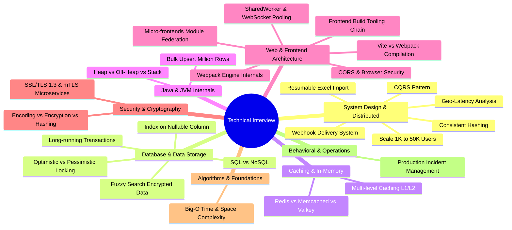
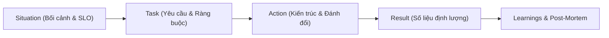

# Tổng quan Bộ câu hỏi Phỏng vấn Kỹ thuật

Chào mừng bạn đến với **Technical Interview Handbook** — bộ tài liệu phỏng vấn kỹ thuật chuyên sâu được thiết kế dành cho các kỹ sư phần mềm định hướng từ **Senior Developer, Technical Lead đến Solution Architect**.

Tài liệu này không đi theo lối mòn của các câu hỏi lý thuyết học vẹt (syntax questions hay flashcards) mà tập trung vào **4 giá trị cốt lõi**:

1. **Kiến trúc & Cơ chế tầng sâu (Internals)**: Hiểu rõ những gì xảy ra bên dưới tầng trừu tượng của framework, database engine, hệ điều hành và giao thức mạng.
2. **Cân nhắc đánh đổi (Engineering Trade-offs)**: Không có giải pháp hoàn hảo, chỉ có giải pháp phù hợp với hoàn cảnh (Consistency vs Availability, Latency vs Throughput, Simplicity vs Scalability).
3. **Kinh nghiệm thực chiến Production**: Những bài toán nghẽn cổ chai (bottleneck), race condition, data corruption, connection starvation và cách debug trên môi trường thực tế.
4. **Tư duy thiết kế có hệ thống (Structured Thinking)**: Phương pháp phân tích yêu cầu phi chức năng (NFR), ước lượng dung lượng (Capacity Estimation) và triển khai an toàn không downtime.

---

## Bản đồ Kiến thức Tổng thể

Hệ thống tài liệu bao gồm **23 chuyên đề kỹ thuật chuyên sâu** chia thành **8 nhóm năng lực chính**:

---

## Danh mục 8 Chuyên đề Kỹ thuật

### 1. System Design & Hệ thống Phân tán (Distributed Systems)

Nhóm chuyên đề tập trung vào các bài toán thiết kế kiến trúc phân tán thực chiến, đảm bảo tính sẵn sàng cao (High Availability), độ tin cậy (Fault Tolerance) và khả năng mở rộng (Scalability).

| Chủ đề & Bài viết                                                                                                                   | Trọng tâm Kỹ thuật & Tình huống Thực tế                                                                                                                                      |
| :---------------------------------------------------------------------------------------------------------------------------------- | :--------------------------------------------------------------------------------------------------------------------------------------------------------------------------- |
| 🌐 [Consistent Hashing: từ cách chia key đến di chuyển dữ liệu](/interview-question/system-design/02-consistent-hashing)            | Xây dựng Virtual Nodes trên Hash Ring để cân bằng tải; giải quyết bài toán re-sharding và di chuyển dữ liệu khi thêm/bớt node mà không gây downtime hoặc cache avalanche.    |
| ⚡ [Chẩn đoán độ trễ theo vùng: từ waterfall đến kiến trúc dữ liệu](/interview-question/system-design/02-geo-latency-60ms-vs-6s)    | Mổ xẻ nguyên nhân độ trễ 60ms vs 6s qua phân tích Network Waterfall (DNS lookup, TCP Handshake, TLS negotiation, TTFB); kiến trúc Multi-region và chiến lược định tuyến CDN. |
| 📈 [Scale từ 1.000 lên 50.000 users: tìm và gỡ bottleneck](/interview-question/system-design/03-scale-1k-to-50k-users)              | Chuyển đổi CCU sang Request Workload; quản lý Connection Budget (HikariCP); tách biệt Read/Write replicas; phân tầng Cache và thiết lập kiến trúc Stateless mở rộng ngang.   |
| 🔄 [CQRS: tách mô hình đọc và ghi, giữ đúng dữ liệu](/interview-question/system-design/04-cqrs)                                     | Tách biệt Command Model và Query Model; triển khai Transactional Outbox Pattern với Apache Kafka; quản lý Eventual Consistency, Idempotency và Projection Rebuild.           |
| 📬 [Thiết kế webhook delivery: tin cậy, cô lập lỗi và replay an toàn](/interview-question/system-design/05-webhook-delivery-system) | Đảm bảo ngữ nghĩa At-least-once Delivery; cơ chế Fair Scheduling tránh nghẽn hàng đợi do endpoint chậm; bảo mật chống tấn công SSRF; xác thực chữ ký HMAC và an toàn Replay. |
| 📁 [Upload và import file lớn: resume, staging và merge an toàn](/interview-question/system-design/06-resumable-excel-import)       | Kiến trúc Multipart Resumable Upload (Tus protocol); xử lý background job bất đồng bộ; kiến trúc Staging Tables và Batch Merge chống khóa bảng (Table Locking).              |

---

### 2. Database & Tối ưu hóa Truy vấn (Database Internals)

Khảo sát sâu cơ chế hoạt động bên trong của các hệ quản trị cơ sở dữ liệu (PostgreSQL, MySQL, NoSQL), các chiến lược lập chỉ mục (Indexing), quản lý giao dịch và concurrency.

| Chủ đề & Bài viết                                                                                                                       | Trọng tâm Kỹ thuật & Tình huống Thực tế                                                                                                                                                            |
| :-------------------------------------------------------------------------------------------------------------------------------------- | :------------------------------------------------------------------------------------------------------------------------------------------------------------------------------------------------- |
| 🗄️ [SQL và NoSQL: chọn database từ invariant và access pattern](/interview-question/database/01-sql-vs-nosql)                           | So sánh Relational, Document, Key-Value, Wide-Column và Graph databases; phân tích mô hình nhất quán ACID vs BASE, đánh đổi chi phí vận hành và tính linh hoạt mô hình dữ liệu.                    |
| 🔍 [Index trên cột nullable: từ NULL đến thiết kế và kiểm chứng](/interview-question/database/02-index-on-nullable-column)              | Bản chất lưu trữ NULL trong cấu trúc B-Tree; tác động của giá trị NULL tới Cardinality và Selectivity; thiết kế Partial Index và Composite Index; đọc hiểu kế hoạch truy vấn `EXPLAIN ANALYZE`.    |
| 🔒 [Optimistic và pessimistic locking: kiểm soát cập nhật đồng thời](/interview-question/database/03-optimistic-vs-pessimistic-locking) | Giải quyết triệt để vấn đề Lost Update; cơ chế Version Check (`@Version`) so với `SELECT ... FOR UPDATE`; chiến lược xử lý Deadlock, Exponential Backoff Retry và quy tắc phân xử nghiệp vụ.       |
| 🔐 [Fuzzy search trên dữ liệu mã hóa: thiết kế từ nhu cầu đến vận hành](/interview-question/database/04-fuzzy-search-encrypted-column)  | Thách thức tìm kiếm mờ trên Ciphertext; thiết kế Blind Index kết hợp N-gram HMAC để lọc ứng viên (Candidate generation); giải mã xác thực và kiểm soát rò rỉ phân bố tần suất (Frequency Leakage). |
| ⏳ [Long-running transaction: cơ chế, chẩn đoán và thiết kế lại](/interview-question/database/05-long-running-transaction)              | Tác hại của transaction kéo dài: giữ khóa dòng, cạn kiệt Connection Pool, tích tụ rác và table bloat do Postgres MVCC không thể VACUUM; chiến lược phân rã thành các giao dịch nhỏ.                |

---

### 3. Caching & Bộ nhớ Đệm Phân tán (Caching Systems)

Tối ưu hóa hiệu năng tầng dữ liệu, giảm tải cho Database và đảm bảo tính nhất quán của dữ liệu bộ nhớ đệm.

| Chủ đề & Bài viết                                                                                                    | Trọng tâm Kỹ thuật & Tình huống Thực tế                                                                                                                                                                      |
| :------------------------------------------------------------------------------------------------------------------- | :----------------------------------------------------------------------------------------------------------------------------------------------------------------------------------------------------------- |
| ⚡ [Redis và Memcached: chọn cache theo dữ liệu và cách phục hồi](/interview-question/caching/01-redis-vs-memcached) | So sánh Single-threaded Event Loop (Redis/Valkey) với Multi-threaded Memory Model (Memcached); các giải thuật thu hồi bộ nhớ (LRU/LFU); kỹ thuật Two-level Cache (L1 Local Caffeine + L2 Distributed Redis). |

---

### 4. Java & JVM Internals

Phân tích kiến trúc máy ảo Java, mô hình quản lý bộ nhớ, chu kỳ thu gom rác (GC) và kỹ thuật xử lý dữ liệu tải lớn.

| Chủ đề & Bài viết                                                                                                  | Trọng tâm Kỹ thuật & Tình huống Thực tế                                                                                                                                                                      |
| :----------------------------------------------------------------------------------------------------------------- | :----------------------------------------------------------------------------------------------------------------------------------------------------------------------------------------------------------- |
| ☕ [Heap, off-heap và stack: hiểu bộ nhớ trong Java](/interview-question/java/01-heap-vs-off-heap-vs-stack)        | Bản chất Stack Frames, Primitive types và Object References; phân bố Heap Generations (Eden, Survivor, Tenured); sử dụng Off-heap Direct ByteBuffer để tránh GC Pauses và kỹ thuật debug Native Memory Leak. |
| 🚀 [Bulk upsert: đưa một triệu bản ghi vào bảng lớn an toàn](/interview-question/java/02-bulk-upsert-billion-rows) | Thiết kế pipeline streaming dữ liệu qua PostgreSQL `COPY` Protocol; xử lý Batch Merge với `ON CONFLICT DO UPDATE`; tinh chỉnh checkpoint, WAL buffer và JDBC Batch Size an toàn.                             |

---

### 5. Web Architecture & Frontend Tooling

Toàn cảnh kiến trúc ứng dụng web hiện đại từ giao thức trình duyệt, mô hình gom kết nối nền đến chuỗi công cụ build và kiến trúc Micro-frontends.

| Chủ đề & Bài viết                                                                                                        | Trọng tâm Kỹ thuật & Tình huống Thực tế                                                                                                                                                        |
| :----------------------------------------------------------------------------------------------------------------------- | :--------------------------------------------------------------------------------------------------------------------------------------------------------------------------------------------- |
| 🛡️ [CORS: cơ chế browser, preflight và cấu hình an toàn](/interview-question/web/01-cors)                                | Cơ chế bảo vệ Same-Origin Policy (SOP); phân biệt Simple Request và Preflight Request (`OPTIONS`); cấu hình xử lý Cookie/Credentials (`withCredentials`); phòng chống CSRF song hành với CORS. |
| 🛠️ [Frontend build tooling: pipeline và từng công cụ](/interview-question/web/02-frontend-build-tooling)                 | Bản đồ phân định vai trò: Compiler (Babel, SWC), Type Checker (tsc), Bundler (Webpack, Rollup, Rspack), Minifier (esbuild, Terser) và Task Orchestrators (Turborepo, Nx).                      |
| 🔌 [SharedWorker và WebSocket: một connection owner cho nhiều tab](/interview-question/web/02-shared-worker-websocket)   | Kiến trúc chia sẻ 1 kết nối WebSocket duy nhất cho tất cả các tab trình duyệt qua `SharedWorker`; cơ chế điều phối Message Port, tái kết nối thông minh và fallback về dedicated connection.   |
| 📦 [Webpack: từ source code đến trình duyệt](/interview-question/web/03-webpack-tu-source-den-trinh-duyet)               | Cơ chế dựng Module Dependency Graph; vòng đời Compiler Hooks; cơ chế thực thi của Loaders và Plugins; chiến lược SplitChunks và bootstrap runtime code trên trình duyệt.                       |
| 🧩 [Module Federation: microfrontend React và Vue](/interview-question/web/04-module-federation-react-vue-microfrontend) | Tích hợp ứng dụng Vue (Remote) vào Shell React (Host) bằng Webpack 5 Module Federation; chia sẻ thư viện dùng chung (Shared Dependencies), đồng bộ Routing và xử lý CSS isolation.             |
| ⚡ [Vite và webpack: khác biệt từ dev server đến production build](/interview-question/web/05-vite-vs-webpack)           | Phân tích cơ chế Native ESM on-demand của Vite dev server so với Bundle-based của Webpack; sự khác biệt về tốc độ HMR (Hot Module Replacement) và Rollup production pipeline.                  |

---

### 6. Security & Mã hóa (Security & Cryptography)

Phân định rõ ràng các khái niệm an toàn thông tin, giao thức bắt tay mật mã và kiến trúc zero-trust trong microservices.

| Chủ đề & Bài viết                                                                                                         | Trọng tâm Kỹ thuật & Tình huống Thực tế                                                                                                                                                  |
| :------------------------------------------------------------------------------------------------------------------------ | :--------------------------------------------------------------------------------------------------------------------------------------------------------------------------------------- |
| 🔑 [Encoding, Encryption và Hashing: hiểu đúng để bảo vệ dữ liệu](/interview-question/security/01-encoding-vs-encryption) | Phân định ranh giới giữa Encoding (Base64/UTF-8), Hashing (Argon2/BCrypt/SHA-256) và Encryption (AES-256-GCM, RSA); chọn đúng thuật toán bảo vệ dữ liệu nhạy cảm theo chuẩn bảo mật.     |
| 🔒 [SSL/TLS: từ nền tảng đến triển khai HTTPS và mTLS](/interview-question/security/02-ssl-tls)                           | Quá trình bắt tay mật mã TLS 1.3 (1-RTT); chuỗi tin cậy PKI và Certificate Authority (CA); cấu hình thực hành HTTPS và Mutual TLS (mTLS) bảo vệ giao tiếp giữa các Microservices nội bộ. |

---

### 7. Thuật toán & Nền tảng (Algorithms & Data Structures)

Phân tích hiệu năng giải thuật bằng toán học và đánh giá tác động tới tài nguyên phần cứng trong môi trường thực thi.

| Chủ đề & Bài viết                                                                                            | Trọng tâm Kỹ thuật & Tình huống Thực tế                                                                                                                                                       |
| :----------------------------------------------------------------------------------------------------------- | :-------------------------------------------------------------------------------------------------------------------------------------------------------------------------------------------- |
| 📊 [Độ phức tạp thuật toán: Big O, thời gian và bộ nhớ](/interview-question/algorithms/01-do-phuc-tap-big-o) | Phương pháp toán học xác định kích thước đầu vào ($N$); phân tích vòng lặp lồng nhau, nhánh rẽ điều kiện và cây đệ quy; đánh đổi Time Complexity vs Space Complexity trong bài toán kỹ thuật. |

---

### 8. Xử lý Sự cố & Vận hành (Incident Management)

Kỹ năng điều phối, xử lý khủng hoảng và phục hồi hệ thống khi xảy ra sự cố nghiêm trọng trên môi trường Production.

| Chủ đề & Bài viết                                                                                                        | Trọng tâm Kỹ thuật & Tình huống Thực tế                                                                                                                                                                  |
| :----------------------------------------------------------------------------------------------------------------------- | :------------------------------------------------------------------------------------------------------------------------------------------------------------------------------------------------------- |
| 🚨 [Xử lý sự cố production: từ cảnh báo đến khôi phục an toàn](/interview-question/behavioral/01-production-server-down) | Khung 5 bước ứng phó sự cố (Triage → Trace Request Flow → Diagnose OS/K8s → Mitigate via Rollback/Traffic Shedding → RCA Post-mortem); phương pháp trả lời câu hỏi tình huống theo mô hình STAR mở rộng. |

---

## Khung Phương pháp Trả lời Phỏng vấn Senior / Lead

Để đạt điểm tối đa trong các vòng phỏng vấn kỹ thuật cấp cao, câu trả lời cần thể hiện tư duy kiến trúc hoàn chỉnh thông qua hai mô hình sau:

### 1. Mô hình STAR Mở rộng (Senior STAR Framework)

Không chỉ dừng lại ở kinh nghiệm cá nhân, bạn cần đặt câu trả lời vào bối cảnh hệ thống tổng thể:

- **Situation**: Nêu rõ quy mô hệ thống (RPS, DAU, kích thước database, hạ tầng cloud), SLO/SLA cam kết và điểm nghẽn đang gặp phải.
- **Task**: Mục tiêu kỹ thuật cụ thể cần đạt được, các ràng buộc khắt khe (ngân sách, timeline, không được làm gián đoạn dịch vụ).
- **Action**: Giải pháp kiến trúc chi tiết, các công nghệ đã cân nhắc và lý do lựa chọn; phân tích các **trade-offs** (đánh đổi độ phức tạp, chi phí hạ tầng hay tính nhất quán).
- **Result**: Kết quả đo đạc bằng số liệu cụ thể (P99 latency giảm từ 1.2s xuống 80ms, CPU utilization giảm 40%, tiết kiệm 30% chi phí server).
- **Learnings**: Bài học rút ra, những điều sẽ làm khác nếu được thiết kế lại từ đầu, quy trình phòng ngừa tái diễn sự cố.

### 2. Tư duy Phân tích Đánh đổi (Engineering Trade-off Matrix)

Mọi quyết định kiến trúc đều là một sự đánh đổi. Khi được hỏi _"Công nghệ nào tốt hơn?"_, câu trả lời chuẩn mực luôn là _"Tùy thuộc vào bối cảnh (It depends)"_, kèm theo các phân tích:

> [!IMPORTANT]
> **Các trục đánh đổi kinh điển cần chủ động nêu trong buổi phỏng vấn:**
>
> - **Consistency vs Availability (CAP Theorem)**: Chấp nhận đọc dữ liệu cũ tạm thời (Eventual Consistency) để đổi lấy thông lượng cao và độ trễ thấp, hay bắt buộc Strong Consistency bằng khóa phân tán (Distributed Locks)?
> - **Latency vs Financial Cost**: Dùng In-memory cluster đắt đỏ để tối ưu mili-giây hay tối ưu truy vấn trên ổ cứng SSD/NVMe với Indexing phù hợp?
> - **Simplicity vs Over-engineering**: Một monolith được tối ưu tốt với connection pool và chỉ mục chuẩn có thể phục vụ 50.000 users mà không cần chia nhỏ microservices hay dựng hạ tầng Kafka phức tạp.

---

## Gợi ý Lộ trình Ôn tập theo Vai trò

Mỗi vị trí phỏng vấn sẽ có trọng số đánh giá khác nhau. Bạn có thể ưu tiên các chuỗi bài đọc theo định hướng sau:

### Lộ trình 1: Backend Engineer / Distributed Systems Specialist

1. **System Design**: [Consistent Hashing](/interview-question/system-design/02-consistent-hashing) → [Scale 1K to 50K Users](/interview-question/system-design/03-scale-1k-to-50k-users) → [CQRS](/interview-question/system-design/04-cqrs) → [Webhook Delivery](/interview-question/system-design/05-webhook-delivery-system).
2. **Database & Cache**: [SQL vs NoSQL](/interview-question/database/01-sql-vs-nosql) → [Index on Nullable](/interview-question/database/02-index-on-nullable-column) → [Optimistic vs Pessimistic Locking](/interview-question/database/03-optimistic-vs-pessimistic-locking) → [Redis vs Memcached](/interview-question/caching/01-redis-vs-memcached).
3. **Core Platform**: [JVM Memory Anatomy](/interview-question/java/01-heap-vs-off-heap-vs-stack) → [Bulk Upsert](/interview-question/java/02-bulk-upsert-billion-rows).

### Lộ trình 2: Frontend Architect & Web Infrastructure

1. **Web Protocols**: [CORS & Security Boundaries](/interview-question/web/01-cors) → [SharedWorker & WebSocket](/interview-question/web/02-shared-worker-websocket).
2. **Build & Tooling**: [Frontend Build Tooling Chain](/interview-question/web/02-frontend-build-tooling) → [Webpack Internals](/interview-question/web/03-webpack-tu-source-den-trinh-duyet) → [Vite vs Webpack](/interview-question/web/05-vite-vs-webpack).
3. **Micro-frontends**: [Module Federation React & Vue](/interview-question/web/04-module-federation-react-vue-microfrontend) → [Resumable Multipart Upload](/interview-question/system-design/06-resumable-excel-import).

### Lộ trình 3: Tech Lead & DevOps / SRE

1. **Incident & Reliability**: [Xử lý sự cố Production Server Down](/interview-question/behavioral/01-production-server-down) → [Chẩn đoán độ trễ mạng Geo-latency](/interview-question/system-design/02-geo-latency-60ms-vs-6s).
2. **Security & Cryptography**: [SSL/TLS & mTLS](/interview-question/security/02-ssl-tls) → [Encoding, Encryption & Hashing](/interview-question/security/01-encoding-vs-encryption).
3. **System Capacity**: [Scale 1K to 50K Users](/interview-question/system-design/03-scale-1k-to-50k-users) → [Long-running Transactions](/interview-question/database/05-long-running-transaction).
