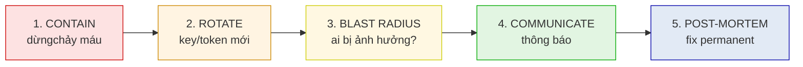

# Case Study: Incident Response — Lộ Token và Signing Key

## Mục lục

- [1. Bối cảnh: 2 giờ sáng, GitHub bot báo signing key trong commit](#1-bối-cảnh-2-giờ-sáng-github-bot-báo-signing-key-trong-commit)
- [2. Hai loại leak — hai cách xử khác nhau](#2-hai-loại-leak--hai-cách-xử-khác-nhau)
- [3. Timeline sự cố — từ T+0 đến T+24h](#3-timeline-sự-cố--từ-t0-đến-t24h)
- [4. Response playbook — 5 bước](#4-response-playbook--5-bước)
  - [4.1. Bước 1 — Contain: dừngchảy máu ngay](#41-bước-1--contain-dừngliệu-ngay)
  - [4.2. Bước 2 — Rotate: cấp key/token mới](#42-bước-2--rotate-cấp-keytoken-mới)
  - [4.3. Bước 3 — Blast radius: ai đã lợi dụng?](#43-bước-3--blast-radius-ai-đã-lợi-dụng)
  - [4.4. Bước 4 — Communicate: thông báo user và stakeholder](#44-bước-4--communicate-thông-báo-user-và-stakeholder)
  - [4.5. Bước 5 — Post-mortem: root cause và fix permanent](#45-bước-5--post-mortem-root-cause-và-fix-permanent)
- [5. Kịch bản A — Signing key bị commit lên GitHub](#5-kịch-bản-a--signing-key-bị-commit-lên-github)
- [6. Kịch bản B — Access token bị leak qua log](#6-kịch-bản-b--access-token-bị-leak-qua-log)
- [7. Revoke token bằng denylist `jti`](#7-revoke-token-bằng-denylist-jti)
- [8. Rotate JWKS — overlap window để không break user](#8-rotate-jwks--overlap-window-để-không-break-user)
- [9. Force re-login — khi access token không revoke được](#9-force-re-login--khi-access-token-không-revoke-được)
- [10. Pre-incident checklist — chuẩn bị trước khi máu chảy](#10-pre-incident-checklist--chuẩn-bị-trước-khi-máu-chảy)
- [11. Anti-patterns — đừng làm mấy cái này khi đang nổ](#11-anti-patterns--đừng-làm-mấy-cái-này-khi-đang-nổ)
- [12. ADRs — đầu tư trước khi cần](#12-adrs--đầu-tư-trước-khi-cần)
- [13. Cheat sheet — incident response runbook](#13-cheat-sheet--incident-response-runbook)

---

## 1. Bối cảnh: 2 giờ sáng, GitHub bot báo signing key trong commit

Thứ Bảy, 2:14 sáng. Điện thoại bạn rung. Đó không phải tin nhắn tình — là alert từ GitHub Secret Scanning:

```text
[GITHUB SECRET SCANNING — CRITICAL]
Repository: yourcorp/auth-service
Commit: a1b2c3d  "hotfix: tighten jwt validation"
Detected: EC PRIVATE KEY (có vẻ signing key JWT production)
Pushed by: dev-alex@yourcorp.com  (6 phút trước)
Branch: main
Trạng thái repo: PUBLIC ❗
```

Tim bạn chìm. Signing key JWT production — cái key dùng ký **mọi access token** cho 50.000 user — vừa bị đẩy lên **repo public**. Trong 6 phút qua, bot của GitHub, các crawler tự động, và bất kỳ ai quét yourcorp/auth-service đều đã có cơ hội tải nó về.

Và đây là phần tồi tệ nhất: bạn chưa biết leak này tồn tại từ bao giờ. Commit hiện tại bị bot bắt, nhưng `git log` cho thấy cùng file `keys/prod-signing.pem` đã được push **3 lần trước đó** trong 2 tháng — chỉ là lần này format trigger được pattern của bot. Có thể key đã nằm ngoài 60 ngày rồi.

```diagram
   Dòng thời gian thực:
   ──────────────────────────────────────────────▶ thời gian
      │                │              │         │
   key leak      key leak        key leak    BOT BẮT
   (60 ngày trc)  (40 ngày)      (14 ngày)   (T+0 — lúc này)
                                                        │
                                                        ▼
                                               Bạn đang đọc alert này
                                               KHÔNG BIẾT leak từ bao giờ
```

<Callout type="error" title="SEV-1 — signing key leak">

Signing key bị lộ là **sự cố an ninh mức cao nhất có thể xảy ra với hệ thống JWT**. Không phải vì attacker đọc được dữ liệu — mà vì attacker có thể **tự ký token hợp lệ**: giả vai bất kỳ user, bất kỳ quyền, trong thời gian key còn dùng. Token attacker tự ký sẽ pass mọi `verify()` của bạn vì chữ ký **đúng**. Không có cách "chặn" token giả mạo — cách duy nhất là **rotate key và revoke key cũ**. Đây là lúc mọi phút đều đếm.

</Callout>

Lưu ý: trong **60 ngày** từ lần leak đầu tiên, nếu attacker đã tải key và dùng nó, audit log của bạn sẽ chỉ thấy "token hợp lệ" — vì nó **đúng là hợp lệ**. Đây là lý do **blast-radius analysis** (Bước 3) là bước khó và quan trọng nhất.

> [!IMPORTANT]
> Doc này **không phải** case study thiết kế — nó là **runbook/kịch bản ứng phó sự cố**. Rất ít tài liệu JWT cover chủ đề "làm gì khi máu đã chảy". Thiết kế tốt (rotation tooling, audit log, denylist sẵn sàng) là phòng ngừa; doc này là **điều chạy khi phòng ngừa thất bại**. Đọc khi bình yên, thuộc lòng khi nổ.

---

## 2. Hai loại leak — hai cách xử khác nhau

Không phải leak nào cũng giống nhau. Cách xử **phụ thuộc vào cái gì bị lộ**:

```diagram
   ┌─────────────────────────────────────────────────────────────┐
   │                  CÁI GÌ BỊ LỘ?                              │
   └───────────────────────┬─────────────────────────────────────┘
                           │
            ┌──────────────┴──────────────┐
            ▼                              ▼
   ┌─────────────────────┐     ┌──────────────────────┐
   │ A. SIGNING KEY leak │     │ B. ACCESS TOKEN leak │
   │  (private key JWT)  │     │  (1 token cụ thể)    │
   └──────────┬──────────┘     └──────────┬───────────┘
              │                           │
   Mức:       │                   Mức:    │
   SEV-1 █████│                SEV-2/3 ██ │
   toàn hệ thống                       1 user / 1 session
              │                           │
              ▼                           ▼
   Rotate key (cấp key mới)      Revoke token (denylist jti)
   Revoke key cũ                 Có thể chờ token hết hạn (nếu exp gần)
   Force re-login toàn user      Force re-login 1 user (nếu cần)
```

Bảng so sánh nhanh — định nghĩa mức độ nghiêm trọng và cách xử ban đầu:

| Khía cạnh | A. Signing key leak | B. Access token leak |
|-----------|---------------------|----------------------|
| **Mức** | SEV-1 (toàn hệ thống) | SEV-2 hoặc SEV-3 (1 user) |
| **Ai bị ảnh hưởng?** | Mọi user (attacker giả vai bất kỳ ai) | 1 user / 1 session cụ thể |
| **Token có tự hết hạn?** | Không — attacker tự ký token mới liên tục | Có — khi token tới `exp` |
| **Cách dừngchảy máu** | Rotate key + revoke key cũ | Add `jti` vào denylist |
| **Phải force re-login?** | Có — toàn bộ user | Chỉ user đó (nếu cần) |
| **Điều tra** | Khó — key giả mạo pass verify | Dễ — `jti`/`sub` trace được trong log |
| **Thời gian phục hồi** | Giờ đến ngày (rotation + redeploy) | Phút (1 DB insert) |

<Callout type="warn" title="Phân loại sai = phản ứng sai">
Lỗi nguy hiểm nhất lúc nổ là **co signing key leak như access token leak** (xong rồi, chỉ revoke 1 token). Nếu key bị lộ mà bạn chỉ revoke token, attacker cứ dùng key ký token mới — bạn không bao giờ dứt được. **Luôn hỏi đầu tiên: cái gì bị lộ — key hay token?** Câu trả lời định nghĩa toàn bộ playbook.
</Callout>

---

## 3. Timeline sự cố — từ T+0 đến T+24h

Đây là timeline thực tế của một incident SEV-1 signing key leak. Dùng làm mốc — thời gian thực có thể chênh ±30 phút, nhưng **thứ tự các bước là bất di bất dịch**: Contain → Rotate → Blast radius → Communicate → Post-mortem.

```diagram
   T+0          T+15m        T+1h         T+4h         T+24h
    │            │            │            │            │
    ▼            ▼            ▼            ▼            ▼
  Phát hiện →  Triage →    Rotate →    Revoke →    Post-mortem
  alert        declare      key mới     key cũ      RCA + fix
               SEV-1                    hoàn toàn   permanent
    │            │            │            │            │
    │            │            │            │            └─ root cause
    │            │            │            │               tooling, viết
    │            │            │            │               report, announce
    │            │            │            │
    │            │            │            └─ old key off
    │            │            │               JWKS, denylist
    │            │            │               hết old token
    │            │            │
    │            │            └─ new key live, JWKS
    │            │               có 2 key (overlap),
    │            │               user cũ vẫn login OK
    │            │
    │            └─ xác nhận leak thật, paging,
    │               tạo war room, freeze deploy
    │
    └─ bot/sentry/user báo.
       Đừng vội tin — verify trước
```

Chi tiết từng mốc:

| Mốc | Thời gian | Hành động | Ai chịu trách nhiệm | Kết quả mong đợi |
|-----|-----------|-----------|---------------------|------------------|
| **Phát hiện** | T+0 | Alert tới (bot/user/sentry). **Verify leak thật** trước khi panic — đôi khi false positive. | On-call engineer | "Leak xác nhận: file X commit Y chứa key Z" |
| **Triage** | T+15m | Declare SEV-1, paging Incident Commander, lập war room (Slack channel / Zoom). Freeze deploy lên production. | Incident Commander (IC) | War room mở, role giao rõ: IC, Comms, Scribe |
| **Contain** | T+30m | **Dừngchảy máu**: key cũ **ngừng ký token mới** ngay (chỉ verify). Token mới ký bằng key mới. | Auth team | Key cũ chỉ verify, không sign |
| **Rotate** | T+1h | Key mới live, JWKS publish cả 2 key (overlap). User cũ token vẫn dùng được, user login mới nhận key mới. | Auth team | New key hoạt động, 0 user bị kick |
| **Revoke** | T+4h | Key cũ **gỡ khỏi JWKS** hoàn toàn. Mọi token do key cũ ký → fail verify → force re-login. | Auth team | Old tokens toàn bộ invalid |
| **Blast radius** | T+4h → T+12h | Audit access log 60 ngày: token nàođáng nghi? Session nào bất thường? Có data exfil không? | Security team | Danh sách user cần notify + data bị truy cập |
| **Communicate** | T+6h → T+48h | Thông báo user bị ảnh hưởng, security disclosure nếu có (GDPR 72h). Status page. | Comms lead + Legal | User biết, regulatory clock chạy |
| **Post-mortem** | T+24h → T+7 ngày | RCA (root cause analysis): **tại sao key vào repo?** Fix permanent (CI block, secret vault). | IC + toàn team | Report blameless, action items có owner |

> [!IMPORTANT]
> **Thứ tự bắt buộc: Contain TRƯỚC, hiểu nguyên nhân SAU.** Cảm xúc bình thường khi nổ là "ai làm? tại sao?" — nhưng đó là câu hỏi post-mortem. Trong 4 giờ đầu, câu hỏi duy nhất là "làm sao dừngchảy máu ngay". Đừng để chuyện tìm thủ phạm làm chậm việc rotate key. RCA blameless ở T+24h; giờ là lúc cứu.

---

## 4. Response playbook — 5 bước

Năm bước dưới đây áp dụng cho **cả hai** kịch bản (key leak và token leak) — chỉ khác chi tiết thực thi. Học thuộc trình tự: **Contain → Rotate → Blast radius → Communicate → Post-mortem**.



### 4.1. Bước 1 — Contain: dừngchảy máu ngay

Mục tiêu: **ngăn thiệt hại lan rộng trong khi còn đang điều tra**. Không phải fix permanent — chỉ là "cầm máu".

**Kịch bản A (signing key):** key cũ **ngừng ký token mới** ngay lập tức. Auth server chuyển sang ký bằng key dự phòng (nếu có) hoặc key mới cấp gấp. Key cũ vẫn **verify** tạm thời (để không kick toàn bộ user cùng lúc) — sẽ gỡ hoàn toàn ở Bước 2.

```bash
# 1. Tắt ability ký bằng key cũ (env flag, config flip)
export JWT_SIGNING_KID_OLD="disabled"   # auth service check: nếu disabled → không ký

# 2. Generate key mới gấp (tạm thời, sẽ rotate đúng ở Bước 2)
openssl ecparam -name prime256v1 -genkey -noout -out keys/new-signing.pem
openssl ec -in keys/new-signing.pem -pubout -out keys/new-signing.pub

# 3. Restart auth service với key mới ký, key cũ verify (overlap)
kubectl rollout restart deployment/auth-service
```

**Kịch bản B (access token):** add `jti` của token bị leak vào denylist **ngay**. Token đó fail ở request tiếp theo.

```sql
-- Insert vào denylist table (Redis cho tốc độ, DB cho persistence)
INSERT INTO token_denylist (jti, revoked_at, reason)
VALUES ('jwt-id-abc123-xyz', NOW(), 'leaked-via-log');
```

<Callout type="error" title="Contain ≠ Fix">

Contain là biện pháp khẩn cấp, **không phải giải pháp**. Key mới sinh bằng `openssl` ở bước trên chỉ là tạm — ở Bước 2 bạn phải rotate đúng quy trình (vào vault, tạo key với kid đúng, publish JWKS, overlap window). Nếu dừng ở Contain, bạn vừa fix leak mà vừa tạo leak mới (key tạm nằm lung tung). **Contain kéo dài tối đa 1-2 giờ, sau đó phải Rotate.**
</Callout>

### 4.2. Bước 2 — Rotate: cấp key/token mới

Contain cầm máu; Rotate là **thay máu**. Đây là lúc thực hiện rotation đúng quy trình, với overlap window để không break user.

```diagram
   ROTATION với OVERLAP WINDOW (xem /cryptography/key-rotation/):

   Trạng thái JWKS theo thời gian:
   ──────────────────────────────────────────────▶
        │            │              │         │
     t0 rotate   t0+1h         t0+24h     t0+24h+TTLmax
        │            │              │         │
   JWKS: {old}   {old,new}      {new}      {new}
   old: sign+verify  verify-only  ----     ----
   new: ----          sign+verify  sign+verify  sign+verify

   • t0:        publish key mới vào JWKS (client cache lại). old vẫn sign+verify.
   • t0+1h:     chuyển SIGN sang key mới. old chỉ verify (cho token đã cấp).
   • t0+24h:    gỡ old khỏi JWKS. Mọi token old → fail → user re-login.
   • t0+24h+TTL: an toàn — không token old nào còn sống.
```

Các bước rotate key (chi tiết ở [Kịch bản A](#5-kịch-bản-a--signing-key-bị-commit-lên-github)):

```bash
# 1. Tạo key mới trong VAULT (không sinh file ở disk như Contain!)
vault write -format=json transit/keys/jwt-signing-kid-2026-07 \
    type=ecdsa-p256 exportable=false

# 2. Lấy public key, build JWKS mới (kid mới)
#    Public JWKS giờ có CẢ kid-old và kid-2026-07 → client verify được cả 2

# 3. Đợi 1h (overlap) để mọi client fetch JWKS mới (cache TTL ~1h)
#    Trong lúc này: vẫn ký bằng kid-old, user không bị ảnh hưởng

# 4. Sau 1h: switch SIGN sang kid-2026-07
export JWT_SIGNING_KID="kid-2026-07"

# 5. Đợi đến TTLmax của token (vd 24h) → gỡ kid-old khỏi JWKS
#    Mọi token kid-old còn sống → fail → force re-login
```

> [!TIP]
> Overlap window = **1h + TTLmax của token**. Nếu access token TTL 15 phút → overlap ~1h15m. Nếu access token TTL 24h (sai lầm, nhưng có) → overlap 25h. Đây là lý do **access token phải ngắn (5-15 phút)** — rotation nhanh khi sự cố. Refresh token dài hơn OK vì revoke được qua DB.
</Callout>

### 4.3. Bước 3 — Blast radius: ai đã lợi dụng?

Đây là bước **khó nhất và dễ bị bỏ qua nhất**. Bạn đã rotate key, máu đã cầm — nhưng bạn **không biết** trong 60 ngày qua, attacker đã làm gì với key cũ. Token attacker tự ký sẽ **pass verify** (chữ ký đúng) → trông như user thật trong log.

<Callout type="error" title="Blast-radius analysis là bước khó nhất">

Signing key leak khác mọi leak khác ở chỗ: **token giả mạo không khác biệt với token thật trong audit log**. Bạn không thể query "token nào là giả mạo" — vì chữ ký đúng hết. Phải dùng **indirect signal**: session từ IP lạ, token có `iat` bất thường, volume request đột biến, data access pattern lạ. Đây là lúc [observability và audit log](/operations/observability-and-audit/) cứu bạn — hoặc chỉ ra bạn nên chuẩn bị tốt hơn cho lần sau.
</Callout>

Tín hiệuđáng nghi trong log 60 ngày — query từng cái:

```sql
-- 1. Token cấp nhưng user KHÔNG có login event (attacker tự ký, không qua login)
SELECT t.jti, t.sub, t.iat
FROM token_verify_log t
LEFT JOIN login_event l
  ON l.user_id = t.sub AND l.created_at BETWEEN t.iat - INTERVAL '5 minutes' AND t.iat
WHERE t.kid = 'kid-old' AND l.id IS NULL;

-- 2. Request từ IP chưa từng xuất hiện cho user này
SELECT user_id, ip, COUNT(*), MIN(created_at), MAX(created_at)
FROM api_request
WHERE created_at > NOW() - INTERVAL '60 days'
GROUP BY user_id, ip
HAVING COUNT(*) < 3 AND ip NOT IN (SELECT ip FROM known_user_ips WHERE user_id = api_request.user_id);

-- 3. Volume request đột biến cho 1 user (data exfil?)
SELECT user_id, DATE(created_at) AS d, COUNT(*) AS reqs
FROM api_request
WHERE created_at > NOW() - INTERVAL '60 days'
GROUP BY user_id, d
HAVING COUNT(*) > 10000   -- ngưỡng bất thường
ORDER BY reqs DESC;

-- 4. Access vào endpoint nhạy cảm (export, bulk download) bất thường
SELECT * FROM api_request
WHERE path IN ('/api/export', '/api/users/bulk', '/api/admin/*')
  AND created_at > NOW() - INTERVAL '60 days'
ORDER BY created_at;
```

Kết quả bước này cho biết: **ai cần được notify** (user bị mạo danh) và **data nào đã bị trộm** (báo cáo GDPR nếu PII).

```diagram
   KẾT QUẢ BLAST-RADIUS → HÀNH ĐỘNG:

   Tìm thấy tokenđáng nghi?  ──── CÓ ───▶ Notify user bị mạo danh
                                    Audit data họ truy cập
                                    Đo lường thiệt hại (PII? financial?)
                          │
                          └── KHÔNG ─▶ "Không có dấu hiệu lợi dụng"
                                       Vẫn rotate (phòng trường hợp attacker
                                       chưa kịp dùng), vẫn communicate minh bạch

   Báo cáo GDPR (nếu PII bị lộ): 72h từ khi BIẾT → clock chạy từ T+0!
```

### 4.4. Bước 4 — Communicate: thông báo user và stakeholder

Im lặng là lỗicommunications lớn nhất khi sự cố. **User được thông báo sớm sẽ tha thứ; user phát hiện ra bạn giấu sẽ nổi giận.**

| Đối tượng | Khi nào | Nội dung | Kênh |
|-----------|---------|----------|------|
| **Internal** (engineering, exec) | T+30m | Leak xác nhận, SEV-1 declare, war room link | Slack #incident, email exec |
| **User bị mạo danh** (nếu có) | T+6h | "Token của bạn bịlạm dụng, chúng tôi đã revoke, vui lòng re-login" | Email cá nhân, in-app banner |
| **Toàn bộ user** (nếu signing key leak) | T+12h | "Lộ key, đã rotate, bạn có thể cần re-login, đổi password nếu lo" | Email + status page |
| **Status page public** | T+2h | "Investigating security incident" → "Identified" → "Resolved" | status.yourcorp.com |
| **Regulator** (GDPR/HIPAA) | T+0 + 72h | Nếu PII bị truy cập, **clock 72h chạy từ T+0** (khi bạn BIẾT) | Legal file báo cáo |
| **Media / public** (nếu lớn) | T+24h-48h | Statement minh bạch, đã fix gì, user làm gì | Blog post, press |

<Callout type="warn" title="Mẫu thông báo user — đừng giấu">

```text
Tiêu đề: [Quan trọng] Sự cố bảo mật — hành động cần thiết cho tài khoản của bạn

Chúng tôi phát hiện sự cố bảo mật: một signing key dùng để xác thực
đăng nhập bị lộ do nhầm lẫn nội bộ. Chúng tôi đã rotate key và revoke
key cũ. Bạn có thể cần đăng nhập lại.

Hành động khuyến nghị:
- Đăng xuất và đăng nhập lại (token cũ đã bị invalidate)
- Đổi mật khẩu tại [link] (phòng trường hợp attacker có thông tin khác)
- Kiểm tra hoạt động tài khoản tại [link]

Chúng tôi xin lỗi vì sự bất tiện. Chi tiết: [status page].
```

**Đừng viết** "không có dấu hiệu dữ liệu bị lộ" nếu bạn chưa xong blast-radius. **Đừng viết** "đã xử lý xong" nếu chỉ Contain chưa Rotate. Minh bạch > cố tỏ ra yên tâm.
</Callout>

### 4.5. Bước 5 — Post-mortem: root cause và fix permanent

Sau khi máu cầm (T+4h-T+12h), bắt đầu **root cause analysis (RCA)**. Đây là bước quan trọng nhất để **sự cố không lặp lại**. Nguyên tắc: **blameless** — không đổ lỗi cá nhân, tìm lỗi hệ thống.

```markdown
## Post-mortem template (blameless)

**Sự cố:** Signing key JWT production bị commit lên repo public (60 ngày)
**Mức:** SEV-1
**Thời gian phục hồi:** T+4h (key rotated), T+48h (user notified)
**Tác động:** ~50.000 user force re-login; chưa tìm thấy dấu hiệu data exfil

### Root cause
Key được hardcode trong `config/jwt.go` để "test nhanh local", developer
commit nhầm lên branch main thay vì dùng env var / vault.

### Tại sao key có trong code?
- Không có CI check block secret (GitHub Secret Scanning chỉ bắt sau khi push)
- Không có pre-commit hook
- Vault có sẵn nhưng setup local khó → developer đi đường tắt

### Tại sao phát hiện trễ 60 ngày?
- Bot pattern không match format file cũ
- Không có alert khi key thay đổi trong repo

### Action items (có owner + deadline)
1. [ ] CI: block commit chứa secret (gitleaks pre-commit) — @alex — 1 tuần
2. [ ] Tạo `make dev-setup` dùng vault dev — @auth-team — 2 tuần
3. [ ] Alert khi file trong keys/ thay đổi — @platform — 1 tuần
4. [ ] Rotation drill hàng quý — @sre — tháng sau
5. [ ] Audit mọi repo: rà key hardcode — @security — 1 tháng
```

> [!IMPORTANT]
> **Post-mortem blameless KHÔNG nghĩa là "không ai sai".** Nó nghĩa là: thay vì hỏi "ai bị sa thải", hỏi "hệ thống nào cho phép lỗi này xảy ra, và fix hệ thống đó". Developer commit key nhầm là triệu chứng; **thiếu CI check + vault khó dùng** mới là root cause. Sa thải developer không fix gì — CI block secret mới fix.
</Callout>

---

## 5. Kịch bản A — Signing key bị commit lên GitHub

Đây là kịch bản SEV-1 đầy đủ, từ phát hiện đến phục hồi. Theo timeline ở mục 3, nhưng chi tiết hơn.

```text
T+0     GitHub Secret Scanning alert → on-call engineer
T+5m    Verify leak: git show a1b2c3d:keys/prod-signing.pem → ĐÚNG là key thật
T+10m   git log --all -- keys/prod-signing.pem → phát hiện 3 commit cũ hơn (60 ngày)
T+15m   DECLARE SEV-1. Page IC, auth team, security, comms, legal.
        Mở #incident-sev1-key-leak. Freeze deploy.
T+20m   Force-push repo xóa file? KHÔNG — đã public 60 ngày, xóa vô dụng.
        GitHub support request: purge cache/fork (nhưng không tin là sạch).
T+30m   CONTAIN: auth service ngừng ký key cũ. Key mới tạm (openssl).
T+45m  _ROTATE bắt đầu: tạo key mới trong vault (kid-2026-07-02).
        Publish JWKS mới: {kid-old, kid-2026-07-02}. Đợi overlap.
T+1h    Switch SIGN → kid-2026-07-02. Verify vẫn accept cả 2.
T+2h    BLAST RADIUS: query log 60 ngày (mục 4.3).
        Tìm thấy 2 sessionđáng nghi từ IP lạ cho user admin-3.
        Notify admin-3, audit data truy cập.
T+4h    REVOKE key cũ: gỡ kid-old khỏi JWKS.
        Mọi token kid-old → fail → force re-login toàn user.
T+6h    COMMUNICATE: email toàn user, status page "Resolved".
        Legal bắt đầu draft GDPR report (PII truy cập → 72h).
T+12h   User re-login ổn định. Metrics normal.
T+24h   POST-MORTEM: RCA blameless, action items.
T+7 ngày Tất cả action items hoàn thành. Rotation drill schedule.
```

<Callout type="error" title="Force-push không cứu được">

Nhiều team phản xạ đầu tiên khi thấy key trong git là `git push --force` xóa commit. **Vô dụng nếu repo đã public dù chỉ 1 phút.** GitHub cache, fork, crawler, archive (Wayback Machine, GH Archive) đã lưu. Xóa khỏi repo của bạn không xóa khỏi máy attacker. Co như key **vĩnh viễn bên ngoài** — chỉ còn cách rotate. Đừng phí 30 phút force-push; dành thời gian đó cho rotation.
</Callout>

> [!NOTE]
> Force-push **vẫn nên làm** (sau khi rotate) để lịch sử repo sạch cho tương lai, và để CI/secret-scanning không báo lại. Nhưng đây là dọn dẹp, không phải response — **không phải bước Contain**.
</Callout>

---

## 6. Kịch bản B — Access token bị leak qua log

Kịch bản nhẹ hơn nhưng phổ biến hơn nhiều. Một developer debug, paste toàn bộ `Authorization: Bearer eyJ...` vào Slack / log file / Sentry / GitHub issue. Token đó giờ public — và còn sống 15 phút (hoặc 24h nếu TTL dài).

```text
T+0     Sentry alert: "Authorization header logged in error" (PII detector)
        Hoặc: security review thấy token trong logs/debugger
T+5m    Verify: token đó còn valid không? (decode exp)
T+10m   Extract jti từ token (nếu có), hoặc sub + iat để trace
T+15m   CONTAIN: INSERT vào token_denylist (jti của token leak)
        → request tiếp theo với token đó → 401
T+20m   Clean log: xóa/redact token trong Sentry, log aggregator, Slack
        (token có thể đã bị crawl, nhưng denylist chặn được)
T+30m   BLAST RADIUS: query access log cho jti/sub đó trong cửa sổ leak→revoke.
        Có requestđáng nghi không? (thường KHÔNG — leak ngắn, attacker kịp ít)
T+45m   COMMUNICATE: notify user (sub) "token của bạn bị lộ trong log,
        đã revoke. Vui lòng re-login." (in-app, không cần email toàn user)
T+1h    Đóng incident. SEV-3 nếu chỉ 1 user, không data exfil.
T+24h   POST-MORTEM nhỏ: tại sao log full header?
        Fix: redact middleware, không log Authorization bao giờ.
```

```diagram
   Khác biệt chính vs Kịch bản A:

   Kịch bản A (key leak):               Kịch bản B (token leak):
   ┌────────────────────┐               ┌────────────────────┐
   │ Attacker ký token  │               │ Attacker có 1 token│
   │ mới liên tục       │               │ → dùng đến khi hết │
   │ → không bao giờ    │               │   hạn hoặc revoke  │
   │   tự dừng          │               └────────────────────┘
   └────────────────────┘               Chặn = denylist 1 jti
   Chặn = rotate key (cấp             Phục hồi = phút
   key mới, revoke key cũ)
   Phục hồi = giờ-ngày
```

> [!IMPORTANT]
> **Access token có `jti` thì revoke được; không có `jti` thì KHÔNG revoke được** (bạn không có gì để denylist). Đây là lý do **mọi access token phải có `jti`** — xem [revocation và logout](/lifecycle/revocation-and-logout/). Nếu token của bạn không có `jti` mà bị leak, cách duy nhất là **đợi hết hạn** (nếu exp gần) hoặc **rotate signing key** (rất tốn kém, ảnh hưởng toàn user — chỉ làm nếu token leak có quyền nhạy cảm).
</Callout>

---

## 7. Revoke token bằng denylist `jti`

Đây là code thực chiến cho Bước 1 (Contain) của Kịch bản B. Denylist `jti` — kiểm tra ở middleware verify.

```typescript
// middleware: checkDenylist.ts
// Mỗi request: verify JWT xong, check jti có trong denylist không

import { verifyJWT } from './jwt';
import { isDenylisted } from './denylist';
import { Request, Response, NextFunction } from 'express';

export async function authMiddleware(req: Request, res: Response, next: NextFunction) {
  const auth = req.headers.authorization;
  if (!auth?.startsWith('Bearer ')) {
    return res.status(401).json({ error: 'missing_token' });
  }
  const token = auth.slice(7);

  let payload;
  try {
    payload = await verifyJWT(token, { algorithms: ['ES256'] });
  } catch {
    return res.status(401).json({ error: 'invalid_token' });
  }

  // ★ CHECK DENYLIST — điểm quan trọng cho revoke
  if (!payload.jti) {
    // Token không có jti → KHÔNG thể revoke → reject (design rule)
    return res.status(401).json({ error: 'token_missing_jti' });
  }
  if (await isDenylisted(payload.jti)) {
    return res.status(401).json({ error: 'token_revoked' });
  }

  req.userId = payload.sub;
  next();
}
```

Implement denylist bằng Redis (nhanh, TTL tự dọn):

```typescript
// denylist.ts — Redis-backed, TTL = thời gian còn lại của token

import { redis } from './redis';

export async function revokeToken(jti: string, exp: number) {
  const ttl = exp - Math.floor(Date.now() / 1000);
  if (ttl <= 0) return; // token đã hết hạn, khỏi cần denylist
  // Key: denylist:{jti}, TTL = ttl → tự xóa khi token hết hạn (không phình DB)
  await redis.set(`denylist:${jti}`, '1', 'EX', ttl);
}

export async function isDenylisted(jti: string): Promise<boolean> {
  const val = await redis.get(`denylist:${jti}`);
  return val !== null;
}
```

<Callout type="warn" title="Denylist chỉ cho access token NGẮN">

Denylist `jti` phù hợp khi access token TTL ngắn (5-15 phút) — Redis TTL tự dọn sau khi token hết hạn, denylist không phình. **Đừng dùng denylist cho refresh token dài hạn** (vài tháng) — đó là việc của DB (revoke flag trên session row). Chi tiết so sánh denylist vs DB-backed revoke ở [blacklist-whitelist](/lifecycle/blacklist-whitelist/).
</Callout>

---

## 8. Rotate JWKS — overlap window để không break user

Rotate key mà **gây kick toàn user ngay lập tức** là lỗi kinh điển. Đúng cách: **overlap window** — publish cả key cũ và mới trong JWKS, đủ lâu cho client fetch key mới, rồi mới gỡ key cũ.

```diagram
   JWKS (public, fetch tại /.well-known/jwks.json) theo thời gian:

   T+0:       { "keys": [ {kid:"old", ...} ] }
                                          ← key leak phát hiện

   T+30m:     { "keys": [ {kid:"old"}, {kid:"new"} ] }
                                          ← publish key mới (verify cả 2)
                                              client bắt đầu fetch & cache new

   T+1h:      { "keys": [ {kid:"old"}, {kid:"new"} ] }
              SIGN = new                   ← ký token mới bằng new
                                          old chỉ verify (cho token đã cấp)

   T+1h+TTL:  { "keys": [ {kid:"new"} ] }
                                          ← gỡ old khỏi JWKS
                                              mọi token old → fail verify
                                              → force re-login

   TTL = max TTL của access token (vd 15 phút → overlap ~1h15m)
```

```python
# build_jwks.py — build JWKS với nhiều kid, publish lên CDN/static host
import json, time
from cryptography.hazmat.primitives import serialization

def build_jwks(keys: list[dict]) -> dict:
    """keys = [{"kid": "...", "priv": "...", "active_sign": bool}]"""
    jwks_keys = []
    for k in keys:
        pub = serialization.load_pem_private_key(k["priv"].encode(), None).public_key()
        nums = pub.public_numbers()
        jwks_keys.append({
            "kty": "EC", "crv": "P-256",
            "kid": k["kid"],
            "x": base64url(nums.x), "y": base64url(nums.y),
            # client dùng kid header của token để chọn key verify
        })
    return {"keys": jwks_keys}

# Publish: jwks = build_jwks([old_key, new_key])  → host immutable + cache 1h
```

> [!TIP]
> **JWKS cache TTL của client = giới hạn dưới overlap window.** Nếu client cache JWKS 1h, overlap phải ≥ 1h (publish new → chờ 1h → switch sign → chờ TTLmax → gỡ old). Đừng set client cache JWKS quá dài (1 ngày) nếu muốn rotate nhanh — đánh đổi với số request tới `/.well-known/jwks.json`. Chi tiết ở [key-rotation](/cryptography/key-rotation/).
</Callout>

---

## 9. Force re-login — khi access token không revoke được

Trường hợp xấu nhất của Kịch bản B: token leak **không có `jti`** (hoặc denylist chưa có), và token còn TTL dài. Bạn không denylist được. Cách duy nhất: **rotate signing key** để token đó (và mọi token khác) invalid → user phải re-login.

```diagram
   FORCE RE-LOGIN TOÀN USER (cách đắt nhất):

   Token leak không revoke được
            │
            ▼
   Rotate signing key (gỡ old khỏi JWKS)
            │
            ▼
   MỌI token (kể cả user thật) → fail verify
            │
            ▼
   Toàn user bị kick, phải login lại (token mới ký bằng key mới)
            │
            ▼
   User authentic → auth server ký token mới bằng key mới ✓
   Attacker (có token leak) → token đó cũng fail ✗ (nhưng có thể tự ký nếu có key!)

   ⚠ Nếu leak là KEY (không phải token): force re-login KHÔNG đủ
     vì attacker có key → tự ký token mới. Phải rotate key (Bước 2 đầy đủ).
```

<Callout type="error" title="Force re-login không thay thế rotate key">

Force re-login (gỡ old key khỏi JWKS) chỉ chặn **token đã cấp**. Nếu leak là **signing key**, attacker **tự ký token mới** sau re-login → vẫn vào được. Force re-login chỉ là **bước phụ** trong Kịch bản A (sau khi đã rotate key mới để ký), **không phải** giải pháp thay thế rotation. Đừng nhầm: "đã kick user re-login rồi, chắc xong" — chưa, nếu key còn ngoài.
</Callout>

Force re-login chỉ cho 1 user (khi token của 1 user leak nhưng có `jti`): denylist `jti` đó + bump `token_version` của user:

```sql
-- Bump token_version → mọi token cũ của user này fail (claim tv mismatch)
UPDATE users SET token_version = token_version + 1 WHERE id = $1;

-- Auth server: ký token có claim "tv": current_version
-- Verify: if (payload.tv != user.token_version) reject
-- → revoke hiệu quả mọi token của 1 user mà không cần denylist jti từng cái
```

---

## 10. Pre-incident checklist — chuẩn bị trước khi máu chảy

Sự cố **không phải lúc nào có tooling sẵn**. Nếu lần đầu bạn setup rotation khi đang nổ, bạn đã quá chậm. Checklist này phải **xong trước khi cần** — idéal là review hàng quý.

<Callout type="warn" title="Nếu tick hết ô dưới = bạn sống sót qua SEV-1">
Checklist này đo **độ sẵn sàng** ứng phó sự cố. Mỗi ô "chưa có" = 1 chỗ bạn sẽ stuck khi nổ. Tự đánh giá trung thực; lừa mình ở đây = chết thật khi sự cố tới.
</Callout>

| # | Mục | Có? | Vì sao quan trọng |
|---|-----|-----|-------------------|
| 1 | **Signing key trong vault/KMS**, không trong code/env file | ☐ | Key trong file = thời bom leak |
| 2 | **Có ≥ 2 key trong JWKS** lúc nào cũng (cho rotation nóng) | ☐ | 1 key duy nhất → phải tạo+rotate gấp khi nổ |
| 3 | **Rotation script/tool** chạy được trong < 5 phút | ☐ | Tạo key thủ công = 30 phút mỗi phút đều đếm |
| 4 | **Rotation drill** chạy hàng quý (chay thật, không giả) | ☐ | Drill 1 lần/năm = quên cách khi cần |
| 5 | **GitHub Secret Scanning / gitleaks** trên mọi repo | ☐ | Phát hiện leak tự động, không chờ ai nhìn thấy |
| 6 | **Pre-commit hook** block secret trước khi push | ☐ | Chặn trước khi leak, không sau |
| 7 | **Access token có `jti`** bắt buộc (reject nếu thiếu) | ☐ | Không `jti` = không revoke được |
| 8 | **Denylist `jti`** (Redis) ready, có TTL auto-cleanup | ☐ | Revoke = 1 DB/Redis insert |
| 9 | **Audit log** ghi mọi verify token (kid, jti, sub, ip) | ☐ | Blast-radius không có log = đoán mò |
| 10 | **`token_version`** trên user row (force re-login 1 user) | ☐ | Revoke 1 user không cần denylist |
| 11 | **JWKS endpoint** cacheable, immutable, CDN-backed | ☐ | Rotation không làm sập endpoint |
| 12 | **Incident runbook** (doc này) in wiki, có pager link | ☐ | On-call 2h sáng không nhớ hết |
| 13 | **Status page** ready, template thông báo soạn sẵn | ☐ | Communicate nhanh, không viết từ đầu |
| 14 | **Legal/regulatory playbook** (GDPR 72h clock) | ☐ | Trễ báo cáo = phạt, dù sự cố đã fix |
| 15 | **On-call rotation** có người biết JWT subsystem | ☐ | On-call generalist không rotate được key |

> [!IMPORTANT]
> **Ô số 3 và 4 (rotation tooling + drill) là ô quan trọng nhất.** Hầu hết team "biết cần rotate key" nhưng **chưa có tool và chưa từng drill** → khi nổ, rotation tốn 30-60 phút vật lược thay vì 5 phút. Đây là đầu tư rẻ nhất, ROI cao nhất — chi tiết ADR ở mục 12.
</Callout>

---

## 11. Anti-patterns — đừng làm mấy cái này khi đang nổ

Khi SEV-1, con người panic và làm sai. Đây là những gì **đừng làm**:

### 11.1. ❌ Panic và im lặng

```text
SAI:  Phát hiện leak → sợ → giấu → hy vọng không ai biết → 2 tuần sau
      attacker dùng key → user data leak → báo chí → công ty chết.

ĐÚNG: Declare SEV-1 trong 15 phút. Im lặng = tội. Communicate sớm,
      kể cả khi chưa fix xong: "đang điều tra" tốt hơn im lặng.
```

### 11.2. ❌ Force-push xóa commit thay vì rotate

```text
SAI:  git push --force xóa commit chứa key. Co như xong.
      (Key đã public, crawler đã lưu — force-push vô dụng)

ĐÚNG: Co key VĨNH VIỄN bên ngoài. Rotate key mới + revoke key cũ.
      Force-push chỉ để dọn repo (sau khi rotate), không phải response.
```

### 11.3. ❌ Tìm thủ phạm trước khi cầm máu

```text
SAI:  "Ai commit cái này?!" → điều tra 2 giờ → key vẫn leak →
      attacker ký token cả 2 giờ đó.

ĐÚNG: Contain + Rotate trước. RCA blameless ở T+24h. Câu hỏi "ai"
      là câu hỏi post-mortem, không phải incident response.
```

### 11.4. ❌ Co signing key leak như token leak

```text
SAI:  Key leak → chỉ denylist vài tokenđáng nghi. Key vẫn leak →
      attacker tự ký token mới → không bao giờ dứt.

ĐÚNG: Key leak = rotate key + revoke key cũ. Token leak = denylist jti.
      Khác hoàn toàn. Phân loại sai (mục 2) = phản ứng sai.
```

### 11.5. ❌ Không log, rồi không blast-radius được

```text
SAI:  Verify JWT không log gì. Khi leak: "không biết ai đã lợi dụng".
      Phải đoán mò, không notify đúng user, không đo được thiệt hại.

ĐÚNG: Log mọi verify (kid, jti, sub, ip, path). Khi leak: query
      signalđáng nghi (mục 4.3). Audit log là mắt của incident response.
```

### 11.6. ❌ Communicate quá muộn hoặc nói dối

```text
SAI:  "Không có dữ liệu nào bị lộ" (khi chưa xong blast-radius)
      → 2 ngày sau phát hiện PII bị truy cập → user nổi giận vì bị lừa.

ĐÚNG: "Đang điều tra, chưa có dấu hiệu lợi dụng, sẽ cập nhật" →
      cập nhật khi có thông tin. Minh bạch > yên tâm giả.
```

### 11.7. ❌ Post-mortem đổ lỗi cá nhân

```text
SAI:  "Alex commit key nhầm → sa thải Alex." Hệ thống không đổi →
      tuần sau Bob cũng commit key nhầm (cùng nguyên nhân).

ĐÚNG: "Hệ thống cho phép commit key (thiếu CI check, vault khó dùng)
       → fix hệ thống: pre-commit hook, vault UX, rotation drill."
       Blameless = tìm lỗi hệ thống, không bỏ qua trách nhiệm cá nhân
       nhưng không trừng phạt để che giấu lỗi quy trình.
```

### 11.8. ❌ Rotate mà không overlap → kick toàn user

```text
SAI:  Tạo key mới, gỡ key cũ khỏi JWKS ngay. Mọi token đang dùng
      → fail → toàn user bị kick → support nổ ticket.

ĐÚNG: Overlap window: publish cả 2 key → chờ client fetch (≥ cache TTL)
      → switch sign → chờ TTLmax → gỡ key cũ. 0 user bị kick không cần.
```

---

## 12. ADRs — đầu tư trước khi cần

Hai ADR quan trọng nhất cho incident response: **rotation tooling** và **denylist infrastructure**. Cả hai đều "đầu tư trước khi cần" — ROI không thấy lúc bình yên, thấy rõ lúc nổ.

### ADR-001: Đầu tư rotation tooling trước khi cần

**Status:** Accepted
**Context:** Signing key leak là SEV-1 hiếm nhưng chí mạng. Phản ứng nhanh (rotation < 5 phút) giảm thiệt hại cấp số mũ. Hầu hết team không có rotation tool, thủ công khi nổ = 30-60 phút mỗi phút đều đếm.

**Decision:** Xây rotation tool (script/CLI) cho phép rotate signing key trong < 5 phút: tạo key trong vault, build JWKS mới, publish, switch sign, schedule gỡ old key sau TTLmax. Chạy drill hàng quý.

**Alternatives:**

| Phương án | Ưu | Nhược |
|-----------|----|--------|
| **Rotation tool + drill** ✅ | Rotation 5 phút khi nổ; team quen quy trình | Tốn 1-2 sprint xây; cần duy trì |
| Thủ công khi nổ | 0 công sức trước | 30-60 phút khi nổ; dễ sai tay; panic |
| Managed (Auth0/Cognito) | Rotation tự động | Vendor lock-in; mất kiểm soát key |

**Consequences:**
- ✅ Rotation < 5 phút → thiệt hại giảm 10x
- ✅ Drill phát hiện bug tooling lúc bình yên, không lúc nổ
- ✅ Team tự tin xử SEV-1
- ❌ Tốn 1-2 sprint + duy trì tool
- ❌ Drill cần environment staging riêng

### ADR-002: Denylist `jti` cho mọi access token

**Status:** Accepted
**Context:** Access token leak phổ biến hơn key leak. Không có `jti` → không revoke được → phải chờ hết hạn hoặc rotate key (đắt). Mọi token phải có `jti` + denylist Redis ready.

**Decision:** Auth server **bắt buộc** ký `jti` (random UUID) vào mọi access token. Verify middleware **reject** token thiếu `jti`. Denylist Redis có TTL auto-cleanup, check ở middleware.

**Alternatives:**

| Phương án | Ưu | Nhược |
|-----------|----|--------|
| **Denylist `jti` (Redis)** ✅ | Revoke 1 token = 1 insert; O(1) lookup | Thêm Redis dependency; check mỗi request |
| Không revoke, chờ `exp` | Đơn giản | Token leak TTL dài = không xử được |
| `token_version` trên user | Revoke 1 user không cần denylist | Không revoke 1 token cụ thể (cả user) |
| Rotate key để revoke | Chặn được | Đắt, ảnh hưởng toàn user |

**Consequences:**
- ✅ Revoke 1 token leak = 1 Redis insert (phút)
- ✅ TTL Redis = TTL token → tự dọn, không phình
- ❌ +1 Redis call mỗi request (dùng cache local + Redis pub/sub giảm)
- ❌ Token thiếu `jti` (legacy) bị reject → cần migration

> [!TIP]
> Kết hợp **cả hai**: denylist `jti` (revoke 1 token) + `token_version` (revoke 1 user). Denylist cho access token ngắn, `token_version` cho refresh token dài. Chi tiết ở [revocation và logout](/lifecycle/revocation-and-logout/) và [blacklist-whitelist](/lifecycle/blacklist-whitelist/).
</Callout>

---

## 13. Cheat sheet — incident response runbook

**Leak JWT = Contain → Rotate → Blast radius → Communicate → Post-mortem. Thứ tự bất di bất dịch.**

```diagram
╭──────────────────────────────────────────────────────────────────────╮
│           INCIDENT RESPONSE — JWT LEAK — RUNBOOK                     │
│                                                                      │
│  CÂU HỎI ĐẦU TIÊN: cái gì bị lộ?                                     │
│     • Signing key  → SEV-1, rotate key, revoke key cũ                │
│     • Access token → SEV-2/3, denylist jti (hoặc chờ exp)            │
│                                                                      │
│  5 BƯỚC (theo thứ tự):                                               │
│     1. CONTAIN     — key cũ ngừng ký; denylist jti token leak        │
│     2. ROTATE      — key mới vault; JWKS overlap; switch sign        │
│     3. BLAST RADIUS— audit log 60 ngày: ai lợi dụng? data nào?       │
│     4. COMMUNICATE — notify user (T+6h), GDPR 72h clock từ T+0       │
│     5. POST-MORTEM — RCA blameless; fix permanent (CI, drill)        │
│                                                                      │
│  TIMLINE MỤC TIÊU:                                                   │
│     T+15m declare SEV1   T+1h rotate    T+4h revoke old key          │
│     T+6h notify user     T+24h post-mortem                           │
│                                                                      │
│  KHÔNG LÀM:                                                          │
│     ✗ force-push thay rotate  ✗ im lặng/giấu                         │
│     ✗ tìm thủ phạm trước contain ✗ rotate không overlap              │
│     ✗ "không data bị lộ" khi chưa blast-radius                       │
╰──────────────────────────────────────────────────────────────────────╯
```

**5 nguyên tắc bất di bất dịch:**

| # | Nguyên tắc | Vì sao |
|---|-----------|--------|
| 1 | **Contain trước, hiểu nguyên nhân sau** | Mỗi phút delay = thêm token attacker ký. RCA là việc T+24h |
| 2 | **Co key leak vĩnh viễn bên ngoài** | Force-push vô dụng nếu public. Chỉ rotate cứu được |
| 3 | **Access token phải có `jti`** | Không `jti` = không revoke = phải rotate key (đắt) |
| 4 | **Overlap window khi rotate** | Không overlap = kick toàn user = sự cố kép |
| 5 | **Drill rotation hàng quý** | Tool không drill = tool không chạy khi cần |

**Tài nguyên ready (phải có TRƯỚC khi cần):**

- Rotation script/CLI (< 5 phút) + drill environment
- Denylist Redis với TTL auto-cleanup
- Audit log ghi mọi verify (kid, jti, sub, ip, path)
- `token_version` trên user row (revoke 1 user)
- Pre-commit hook (gitleaks) + GitHub Secret Scanning
- Status page template + thông báo user soạn sẵn
- Doc này (runbook) in wiki, có pager link

**Bốn câu hỏi thường gặp:**

- **Token leak nhưng không có `jti`?** — Phải rotate signing key (đắt, kick toàn user) hoặc chờ `exp` (nếu ngắn). Lần sau: bắt buộc `jti`.
- **Force-push xóa commit có đủ?** — Không, nếu repo đã public. Key coi như vĩnh viễn leak. Rotate.
- **Phải báo GDPR không?** — Có, nếu PII bị truy cập. Clock 72h chạy từ lúc bạn **biết** (T+0), không phải lúc fix xong.
- **Sa thải developer commit key?** — Không (nếu blameless). Fix hệ thống: pre-commit hook, vault UX, CI block. Sa thải không ngăn Bob làm y hệt tuần sau.

---

## Tài liệu tham khảo

- Trong repo: [key-rotation](/cryptography/key-rotation/) (overlap window, JWKS rotation), [revocation và logout](/lifecycle/revocation-and-logout/) (denylist vs token_version), [blacklist-whitelist](/lifecycle/blacklist-whitelist/) (denylist Redis TTL), [secure-storage](/security/secure-storage/) (key trong vault, không trong code), [observability và audit](/operations/observability-and-audit/) (audit log cho blast-radius).
- [GitHub Secret Scanning](https://docs.github.com/code-security/secret-scanning) — phát hiện secret trong repo tự động.
- [gitleaks](https://github.com/gitleaks/gitleaks) — pre-commit hook + CI scan secret.
- [NIST SP 800-57 — Key Management](https://csrc.nist.gov/publications/detail/sp/800-57-part-1/rev-5/final) — chuẩn rotation/crypto periods cho signing key.
- [Google SRE Book — Incident Response](https://sre.google/sre-book/postmortem/) — blameless post-mortem, incident commander role.
- [OWASP — Incident Response](https://owasp.org/www-community/Incident_Response) — checklist response chung áp dụng cho JWT leak.
