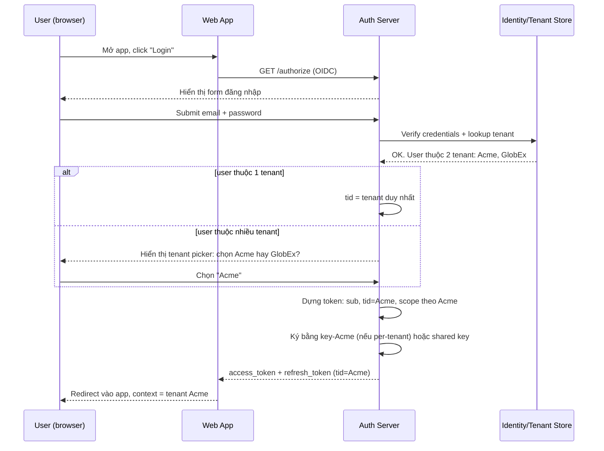
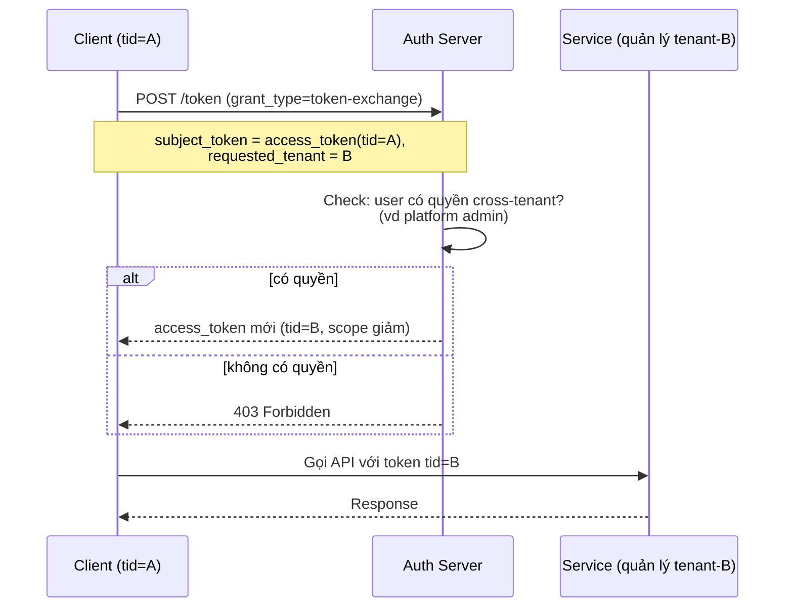

# Case Study: Multi-tenant SaaS với JWT

## Mục lục

- [Bài toán: 1000 tenant, một bộ code — cách ly thế nào?](#1-bài-toán-1000-tenant-một-bộ-code--cách-ly-thế-nào)
- [Multi-tenant là gì — và vì sao JWT khó hơn](#2-multi-tenant-là-gì--và-vì-sao-jwt-khó-hơn)
- [Bài toán 1: Định danh tenant — claim `tid` và `tenant_id`](#3-bài-toán-1-định-danh-tenant--claim-tid-và-tenant_id)
- [Bài toán 2: Phân quyền theo tenant — scope có namespace](#4-bài-toán-2-phân-quyền-theo-tenant--scope-có-namespace)
- [Bài toán 3: Key per-tenant — JWKS multi-issuer](#5-bài-toán-3-key-per-tenant--jwks-multi-issuer)
- [Bài toán 4: Isolation dữ liệu — phòng tuyến cuối ở DB](#6-bài-toán-4-isolation-dữ-liệu--phòng-tuyến-cuối-ở-db)
- [Hai mô hình triển khai: shared vs dedicated](#7-hai-mô-hình-triển-khai-shared-vs-dedicated)
- [Luồng đăng nhập tenant — sequence đầy đủ](#8-luồng-đăng-nhập-tenant--sequence-đầy-đủ)
- [Token exchange khi gọi service khác tenant-scope](#9-token-exchange-khi-gọi-service-khác-tenant-scope)
- [Threat model — năm chỗ tenant hay bị rò rỉ](#10-threat-model--năm-chỗ-tenant-hay-bị-rò-rỉ)
- [Code thực chiến — middleware multi-tenant](#11-code-thực-chiến--middleware-multi-tenant)
- [Anti-patterns cần tránh](#12-anti-patterns-cần-tránh)
- [Tóm tắt — Cheat sheet](#13-tóm-tắt--cheat-sheet)

---

## 1. Bài toán: 1000 tenant, một bộ code — cách ly thế nào?

Bạn vận hành một nền tảng SaaS B2B — kiểu Stripe / Notion / Slack — phục vụ **hàng nghìn tổ chức** (tenant) cùng lúc: chung một bộ code, chung một database, chung hạ tầng. Mỗi tenant là một "công ty khách hàng": có user riêng, dữ liệu riêng, bill riêng, quyền riêng. Giá trị cốt lõi bạn bán cho khách hàng là một lời hứa: **dữ liệu của họ không bao giờ lọt sang tổ chức khác**.

Đó là bài toán **tenant isolation**. Nó khó không phải vì thiếu công cụ, mà vì cách ly phải đúng ở **từng lớp** — từ token (JWT mang danh tính tenant), qua service (kiểm tra ranh giới tenant), đến DB (filter theo tenant_id). Sai một lớp, dữ liệu rò rỉ. Và khi đã rò rỉ, hậu quả là **cross-tenant data leak** — lỗi chết người của SaaS multi-tenant: user tenant A gõ một URL và đọc được bill của tenant B, vì không service nào check "token này thuộc tenant nào, resource đó thuộc tenant nào, có khớp không".

```diagram
   User tenant A đăng nhập → token ghi tid: "tenant-A"
                                     │
                                     ▼
   Gọi GET /api/invoices/inv_5f8a2c  (resource thuộc tenant B)
                                     │
                                     ▼
   Service: verify JWT ✓ (signature đúng, chưa hết hạn)
            NHƯNG:  không check tid(token) vs tid(resource)
                                     │
                                     ▼
   ❌ Trả bill tenant B cho user tenant A   ← LEAK
```

Lỗi này không nằm ở chữ ký hay expiration — nó nằm ở chỗ **không ai kiểm tra ranh giới tenant**. Đây là lỗi top-1 multi-tenant, và là lỗi có thể giết cả công ty. Doc này mổ xẻ cách thiết kế JWT sao cho tenant isolation là điều kiểm tra đầu tiên, không phải điều bỏ quên cuối.

---

## 2. Multi-tenant là gì — và vì sao JWT khó hơn

**Multi-tenant**: một bộ phần mềm phục vụ nhiều tổ chức (tenant) cùng lúc, dữ liệu của các tenant **cùng nằm trong hạ tầng chung** nhưng phải **cách ly hoàn toàn** về mặt logic. Khác với single-tenant (một công ty = một bộ cài riêng), multi-tenant dùng chung code, chung DB, chung hạ tầng — chỉ khác nhau ở **dữ liệu và quyền**.

```diagram
   Single-tenant (cũ):                 Multi-tenant (SaaS hiện đại):
   ┌──────────┐  ┌──────────┐          ┌─────────────────────────────┐
   │ App A    │  │ App B    │          │  Một bộ code                │
   │ + DB A   │  │ + DB B   │          │  phục vụ 1000 tenant        │
   │ (riêng)  │  │ (riêng)  │          │  + 1 DB shared              │
   └──────────┘  └──────────┘          │  (dữ liệu chia theo tid)    │
                                       └─────────────────────────────┘
   Cách ly vật lý                      Cách ly LOGIC — dễ rò rỉ nếu sai
```

Vì sao JWT khó hơn trong multi-tenant? Vì token phải mang theo **danh tính kép**: *ai* (user) thuộc *tổ chức nào* (tenant). Verifier phải kiểm tra **cả hai** — và phải kiểm tra xem user của tenant này **có được chạm vào resource của tenant khác không**.

| Single-tenant | Multi-tenant |
|---------------|--------------|
| Token chỉ cần `sub` (ai) | Token cần `sub` (ai) + `tid` (thuộc tenant nào) |
| Mọi resource thuộc "công ty mình" | Mỗi resource thuộc một tenant cụ thể |
| Check quyền: user có quyền này không | Check quyền: user của tenant X có quyền này **trên resource của tenant X** không |
| 1 cặp key cho toàn hệ thống | Key có thể per-tenant (rotation độc lập) |

> [!NOTE]
> Khác biệt cốt lõi: single-tenant chỉ cần trả lời *"ai?"*, multi-tenant phải trả lời *"ai, **của tổ chức nào**, và resource đó **có thuộc tổ chức đó không**?"*. Câu hỏi thứ ba là chỗ 90% bug cross-tenant xuất hiện.

---

## 3. Bài toán 1: Định danh tenant — claim `tid` và `tenant_id`

Mọi token multi-tenant **bắt buộc** có một claim định danh tenant. Không có claim này, không service nào biết token thuộc tenant nào → không cách nào isolate.

### 3.1. Hai cách đặt claim tenant

| Cách | Ví dụ | Ưu/nhược |
|------|-------|----------|
| **Claim riêng** `tid` | `{ "sub":"u1", "tid":"tenant-A" }` | Rõ ràng, dễ query, tách bạch với user |
| **Namespace trong sub** | `{ "sub":"tenant-A:u1" }` | Gọn nhưng phải parse, dễ trộn logic |

Đa số SaaS B2B dùng **claim riêng** — thường tên `tid` (Azure AD), `tenant_id` (tự build), hoặc `org_id`:

```json
{
  "sub": "user-123",
  "tid": "tenant-acme-001",
  "role": "admin",
  "scope": "invoices:read invoices:write",
  "iss": "https://auth.saas.com",
  "exp": 1735689600
}
```

### 3.2. Quy tắc: `tid` phải có và phải được verify

Claim `tid` không phải "thông tin tham khảo" — nó là **ranh giới bảo mật**. Hai quy tắc bắt buộc:

```diagram
   Quy tắc 1: tid BẮT BUỘC có trong mọi access token
              thiếu tid → REJECT ngay (không biết tenant nào)

   Quy tắc 2: tid trong token phải KHỚP với tid của resource truy cập
              tid(token) != tid(resource) → 403 Forbidden
```

<Callout type="error" title="tid không có = mời gọi leak">
Một SaaS từng leak vì service "quên" require `tid` ở một số endpoint "internal". Hệ quả: token cũ không có `tid` vẫn dùng được, và vì không check tenant → đọc được data mọi tenant. Quy tắc: middleware **reject mọi token thiếu `tid`**, không có ngoại lệ — kể cả endpoint "internal".
</Callout>

### 3.3. Vì sao `tid` phải là claim riêng, không phải phần của `sub`

Nhiều team mới nhét tenant vào `sub` (`sub: "tenant-A:user-1"`) để "gọn". Nhưng cách này có ba vấn đề:

- **Parse rủi ro** — mỗi service phải split `sub` bằng `:`, dễ sai (user_id có thể chứa `:`)
- **Khó index/query** — DB index trên `tid` nhanh hơn index trên substring `sub`
- **Trộn danh tính và phân vùng** — `sub` phải là định danh user *duy nhất toàn cục*, không nên ghép tenant

> [!TIP]
> Best practice: `sub` là user ID toàn cục (duy nhất trên mọi tenant), `tid` là tenant ID riêng. Tách bạch hai danh tính — verify cả hai, dùng cả hai để quyết định quyền.

---

## 4. Bài toán 2: Phân quyền theo tenant — scope có namespace

Multi-tenant mở ra vấn đề mà single-tenant không có: **cùng một user có thể có quyền khác nhau ở tenant khác nhau**. Một người dùng consultant có thể là `admin` ở tenant A nhưng chỉ `viewer` ở tenant B.

### 4.1. Vì sao scope đơn giản không đủ

Trong single-tenant, scope thường là: `invoices:read`. Trong multi-tenant, câu hỏi là: *invoices của **tenant nào**?*

```diagram
   Token tenant A:   scope = "invoices:read"
                    → đọc invoices của tenant nào?  ← KHÔNG RÕ

   Nếu user thuộc 2 tenant (A, B):
   Token tenant A:   scope = "invoices:read"  +  tid = "tenant-A"
                    → chỉ đọc được invoices của tenant A  ✓ RÕ
```

Khóa ở đây: **scope phải đi kèm `tid` rõ ràng**. Token có `scope: invoices:read` chỉ có nghĩa trong context của `tid` trong cùng token.

### 4.2. Hai mô hình scope multi-tenant

| Mô hình | Ví dụ | Khi nào dùng |
|---------|-------|--------------|
| **Scope + tid** (phổ biến) | `scope:"invoices:read"`, `tid:"tenant-A"` | Mỗi token gắn 1 tenant |
| **Namespaced scope** | `scope:"tenant-A.invoices:read"` | Một token nhiều tenant (hiếm) |

Hầu hết SaaS dùng mô hình đầu — **mỗi login session gắn đúng 1 tenant**. Khi user muốn "chuyển tenant", phải đăng nhập lại hoặc đổi token (xem [§9 token exchange](#9-token-exchange-khi-gọi-service-khác-tenant-scope)).

```diagram
   User anne@consult.com
      ├── Login chọn tenant A → token: tid=A, scope="invoices:write"
      ├── Login chọn tenant B → token: tid=B, scope="invoices:read"
      └── KHÔNG có 1 token dùng cho cả 2 tenant
```

> [!IMPORTANT]
> Quy tắc vàng multi-tenant: **một token, một tenant**. Tránh nhét nhiều tenant vào cùng token (`tid: ["A","B"]`) trừ khi thực sự cần — vì mỗi request vẫn chỉ truy cập 1 tenant, để nhiều tenant chỉ tăng phức tạp và tăng diện tấn công.

---

## 5. Bài toán 3: Key per-tenant — JWKS multi-issuer

Trong single-tenant, một cặp key cho toàn hệ thống là đủ. Trong multi-tenant, câu hỏi đặt ra: **mỗi tenant có nên có key riêng không?**

### 5.1. Ba mô hình key

| Mô hình | Cấu trúc | Ưu điểm | Nhược điểm |
|---------|----------|---------|------------|
| **Shared key** | 1 key cho mọi tenant | Đơn giản, ít vận hành | Tenant nào cũng verify bằng cùng key → lộn lẫn dễ |
| **Key per-tenant** | Mỗi tenant 1 cặp key | Isolate hoàn toàn, rotate độc lập | Phức tạp, JWKS lớn |
| **Shared + kid** | 1 key cho mọi tenant nhưng mỗi tenant có `iss` khác | Trung dung | Phải check `iss` nghiêm ngặt |

```diagram
   Shared key (đơn giản, cho SaaS nhỏ):
   ┌───────────────────────────────┐
   │ Auth Server (1 cặp key)       │
   │   mọi tenant → cùng key       │
   └───────────────┬───────────────┘
                   │
        ┌──────────┼──────────┐
        ▼          ▼          ▼
    Service    Service    Service
    (verify    (verify    (verify
     cùng key)  cùng key)  cùng key)
   ⚠ Chỉ an toàn nếu check tid kỹ

   Key per-tenant (isolate cao, cho enterprise):
   ┌───────────────────────────────┐
   │ Auth Server (nhiều cặp key)   │
   │   tenant A → key-A            │
   │   tenant B → key-B            │
   └───────────────┬───────────────┘
                   │
        ┌──────────┼──────────┐
        ▼          ▼          ▼
    Service    Service    Service
    (verify    (verify    (verify
     theo tid)  theo tid)  theo tid)
   ✅ Tenant A's key không thể verify token tenant B
```

### 5.2. Vì sao key per-tenant mạnh hơn

Với key per-tenant, **dù service quên check `tid` thì vẫn an toàn hơn**: token ký bằng key-A sẽ **không verify được** bằng key-B. Tức là một token tenant A dùng để truy cập "endpoint chỉ check key-B" sẽ bị reject ngay ở bước signature — một lớp phòng vệ nữa.

<Callout title="Khi nào dùng key per-tenant">
Không phải SaaS nào cũng cần. Quy tắc:
- **Shared key + tid check nghiêm ngặt**: đủ cho đa số SaaS SME, dưới 1000 tenant.
- **Key per-tenant**: cần khi (1) tenant yêu cầu isolation mạnh (y tế, tài chính, government), (2) tenant tự mang key (BYOK — bring your own key), (3) compliance SOC2/HIPAA đòi hỏi key isolation. Đổi lại chi phí: JWKS endpoint phải phục vụ nhiều key, service phải select key theo `tid`.
</Callout>

Chi tiết JWKS và key rotation: [jwk-and-jwks](/cryptography/jwk-and-jwks/) và [key-rotation](/cryptography/key-rotation/).

---

## 6. Bài toán 4: Isolation dữ liệu — phòng tuyến cuối ở DB

Đây là điểm quan trọng nhất mà nhiều team bỏ sót: **JWT chỉ là phòng tuyến đầu**. Dù token có check `tid` kỹ đến đâu, nếu **query DB không filter theo tenant** thì vẫn leak. Phòng tuyến cuối cùng, cứng nhất, phải nằm ở tầng dữ liệu.

### 6.1. Bốn lớp phòng tuyến tenant isolation

```diagram
   Request: GET /api/invoices/inv_5f8a2c
      │
      ▼
   Lớp 1: Gateway — verify chữ ký, check tid có trong token
      │
      ▼
   Lớp 2: Service middleware — extract tid, gắn vào request context
      │
      ▼
   Lớp 3: Authorization — check user có quyền invoices:read trong tid này
      │
      ▼
   Lớp 4: DATA LAYER ★ — query DB luôn WHERE tenant_id = tid
      │
      ▼
   ❌ Nếu lớp 4 bỏ sót WHERE → leak (dù 3 lớp trên pass)
```

Lớp 4 là nơi hay bị quên nhất. Developer viết `SELECT * FROM invoices WHERE id = ?` và quên `AND tenant_id = ?`. Hậu quả: đúng ID thì ra invoice — bất kể tenant nào.

### 6.2. Kỹ thuật enforce tenant filter ở DB

**Pattern 1 — WHERE clause bắt buộc:**

```sql
-- ❌ SAI (leak cross-tenant)
SELECT * FROM invoices WHERE id = ?;

-- ✅ ĐÚNG (filter tenant)
SELECT * FROM invoices WHERE id = ? AND tenant_id = ?;
```

**Pattern 2 — Row-Level Security (PostgreSQL RLS):**

```sql
-- PostgreSQL RLS enforce tenant filter ở tầng DB
ALTER TABLE invoices ENABLE ROW LEVEL SECURITY;

CREATE POLICY tenant_isolation ON invoices
  USING (tenant_id = current_setting('app.current_tenant')::uuid);
-- Service set: SET app.current_tenant = 'tenant-A';
-- → mọi query tự động filter tenant, kể cả khi developer quên WHERE
```

<Callout type="warn" title="Đừng tin middleware, hãy tin DB">
Middleware có thể quên, developer có thể quên, nhưng **DB policy thì không quên**. RLS (Row-Level Security) là lớp phòng thủ **default-deny**: nếu service quên set tenant context, query trả 0 dòng thay vì trả data sai tenant. Trong multi-tenant production, RLS không phải "tùy chọn nâng cao" — nó là **bắt buộc** nếu muốn ngủ yên. Đây là kỹ thuật dùng bởi Supabase, Notion, và mọi SaaS enterprise.
</Callout>

---

## 7. Hai mô hình triển khai: shared vs dedicated

Có hai cách triển khai hạ tầng multi-tenant, ảnh hưởng tới thiết kế JWT:

### 7.1. Shared tenancy (phổ biến)

```diagram
   ┌──────────────────────────────────────────────────┐
   │  Một cụm hạ tầng dùng chung cho mọi tenant       │
   │  ┌─────┬─────┬─────┬─────┬─────┐                 │
   │  │ t-A │ t-B │ t-C │ t-D │ ... │ (cùng DB)       │
   │  └─────┴─────┴─────┴─────┴─────┘                 │
   └──────────────────────────────────────────────────┘
   → Tiết kiệm, dễ vận hành, isolation logic (tid + RLS)
```

### 7.2. Dedicated tenancy (enterprise)

```diagram
   ┌──────────────────┐  ┌──────────────────┐
   │ Tenant Enterprise│  │  Tenant SMB      │
   │  (DB riêng,      │  │  (DB shared      │
   │   key riêng)     │  │  với 1000 t khác)│
   └──────────────────┘  └──────────────────┘
   → Enterprise trả thêm tiền cho isolation vật lý
```

| Tiêu chí | Shared | Dedicated (silos) |
|----------|--------|-------------------|
| Chi phí | Thấp (dùng chung) | Cao (mỗi tenant 1 bộ) |
| Isolation | Logic (tid + RLS) | Vật lý (DB/key riêng) |
| Số tenant | Hàng nghìn | Vài chục (enterprise) |
| JWT thiết kế | `tid` claim + key shared | `tid` claim + key per-tenant |
| Noisy neighbor | Có (1 tenant nặng kéo chậm mọi người) | Không |

> [!TIP]
> Hybrid phổ biến: đa số tenant dùng **shared** (rẻ), riêng vài tenant enterprise (y tế, tài chính) dùng **dedicated**. Auth server thống nhất vẫn cấp token có `tid`, nhưng định tuyến tenant enterprise về cụm riêng. Tức là thiết kế JWT không đổi, chỉ hạ tầng đằng sau thay đổi.

---

## 8. Luồng đăng nhập tenant — sequence đầy đủ

Trọn bộ luồng: user mở app → chọn tenant → đăng nhập → nhận token có `tid`.



### 8.1. Chi tiết: tenant picker

Khi user thuộc nhiều tenant, auth server **bắt buộc** hỏi user chọn tenant trước khi cấp token. Đừng cố "chọn default tenant" — vì:

```diagram
   SAI:  auto-chọn tenant đầu tiên → token tid=default
         → user muốn làm việc với tenant khác phải đăng xuất, đăng nhập lại
         → UX tệ, dễ tạo token sai context

   ĐÚNG: hiển thị tenant picker → user chọn rõ ràng
         → token tid = tenant user chọn → mọi request sau ở đúng context
```

> [!NOTE]
> Token luôn có **đúng 1 `tid`**. Khi user muốn "chuyển tenant" trong cùng phiên, không sửa token — mà dùng **token exchange** (xem [§9](#9-token-exchange-khi-gọi-service-khác-tenant-scope)) để lấy token mới có `tid` khác.

---

## 9. Token exchange khi gọi service khác tenant-scope

Trong SaaS phức tạp, có tình huống: user tenant A cần **gọi một service hành động trên dữ liệu tenant B**. Ví dụ: admin platform (tenant-A) cần truy vấn usage metrics của tenant-B. Token hiện tại có `tid=A` — không thể dùng trực tiếp cho tenant-B.

### 9.1. Luồng token exchange (RFC 8693)



Quy tắc: token exchange **luôn giảm scope**, không bao giờ tăng. Token mới (tid=B) chỉ có quyền tối thiểu cần thiết cho tác vụ, không thừa kế toàn bộ quyền token gốc.

<Callout type="warn" title="Token exchange là privilege cao">
Token exchange cho phép user tenant A "nhập vai" tenant B — đây là privilege cực mạnh, chỉ cấp cho platform admin / support staff có audit trail. Nếu lạm dụng (cấp cho mọi user), biến thành lỗ hổng: user tenant A tự exchange sang tenant B và đọc data. Nguyên tắc: **token exchange phải có audit log đầy đủ** — ai, khi nào, đổi sang tenant nào, scope nào.
</Callout>

---

## 10. Threat model — năm chỗ tenant hay bị rò rỉ

Multi-tenant có năm điểm nóng leak cross-tenant. Kiểm tra từng điểm trong code review:

| # | Điểm nóng | Triệu chứng | Khắc phục |
|---|-----------|-------------|-----------|
| 1 | **Quên WHERE tenant_id** | `SELECT * FROM x WHERE id=?` | RLS hoặc enforce tenant filter ở ORM |
| 2 | **Cache cross-tenant** | Cache theo key `resource:id`, không theo tenant | Cache key phải có `tid` |
| 3 | **URL không tenant-scoped** | `/api/invoices/:id` (id đủ duy nhất) | `/api/tenants/:tid/invoices/:id` hoặc check tid(token)==tid(resource) |
| 4 | **Token thiếu tid** | Endpoint "internal" quên require `tid` | Middleware reject mọi token thiếu `tid` |
| 5 | **Search index cross-tenant** | ElasticSearch/Lucene trả kết quả mọi tenant | Filter `tenant_id` ở query |

```diagram
   ⚠ Cache là điểm nguy hiểm ít được để ý:
   Key: "invoice:inv_5f8a2c"  →  value: {amount, tenant_id=B}
   User tenant-A gọi GET /invoices/inv_5f8a2c
   Service: check cache → hit → trả luôn (KHÔNG check tid)  →  LEAK

   ĐÚNG: cache key phải là "tenant-A:invoice:inv_5f8a2c"
         → user tenant-B gọi cùng ID → cache miss → query DB → 0 dòng
```

> [!IMPORTANT]
> Năm điểm trên đều có chung một triệu chứng: **service verify JWT kỹ, chữ ký đúng, nhưng vẫn leak**. Vì leak không nằm ở auth — nó nằm ở chỗ **service không gắn tid vào mọi tầng**: DB query, cache key, search index, URL routing. Multi-tenant security = JWT tốt + **tid lọt qua mọi tầng** cho đến DB.

---

## 11. Code thực chiến — middleware multi-tenant

Middleware Enforce `tid` ở mọi request. Đây là mẫu Express/Fastify, áp dụng nguyên tắc "default-deny tenant".

```typescript
// middleware: requireTenant.ts
// Bắt buộc mọi request có tid, gắn vào context, và chặn cross-tenant

import { verifyJWT } from './jwt';
import { Request, Response, NextFunction } from 'express';

declare global {
  namespace Express {
    interface Request {
      tenantId?: string;
      userId?: string;
      scopes?: string[];
    }
  }
}

export async function requireTenant(req: Request, res: Response, next: NextFunction) {
  // 1. Extract token
  const auth = req.headers.authorization;
  if (!auth?.startsWith('Bearer ')) {
    return res.status(401).json({ error: 'missing_token' });
  }
  const token = auth.slice(7);

  // 2. Verify JWT (chữ ký + exp + iss)
  let payload;
  try {
    payload = await verifyJWT(token, { algorithms: ['RS256'] });
  } catch {
    return res.status(401).json({ error: 'invalid_token' });
  }

  // 3. ★ MULTI-TENANT CHECK — điểm quan trọng
  if (!payload.tid) {
    // Token thiếu tid → REJECT ngay, không cho qua dù chữ ký đúng
    return res.status(403).json({ error: 'missing_tenant_claim' });
  }

  // 4. Gắn tenant vào request context
  req.tenantId = payload.tid;
  req.userId = payload.sub;
  req.scopes = payload.scope?.split(' ') ?? [];
  next();
}

// Sử dụng ở mọi route cần tenant isolation
app.get('/api/invoices/:id', requireTenant, async (req, res) => {
  // ★ Mọi query đều dùng req.tenantId — không bao giờ quên
  const invoice = await db.invoices.findOne({
    id: req.params.id,
    tenant_id: req.tenantId,   // ← filter tenant, bắt buộc
  });
  if (!invoice) return res.status(404).json({ error: 'not_found' });
  res.json(invoice);
});
```

### 11.1. Mẫu PostgreSQL RLS — default-deny ở DB

```typescript
// Mỗi request, set tenant context cho DB session
// → mọi query tự động filter tenant, kể cả khi code quên WHERE

app.use(requireTenant, async (req, res, next) => {
  await db.query(`SET LOCAL app.current_tenant = $1`, [req.tenantId]);
  // Từ thời điểm này trong transaction, RLS filter mọi table theo tenant
  // Developer viết SELECT * FROM invoices WHERE id=$1 → tự động +AND tenant_id=A
  next();
});
```

<Callout type="warn" title="Code minh hoạ — production cần thêm">
Code trên là khung minimum. Production cần thêm: rate limit per-tenant, audit log (ai truy cập tenant nào khi nào), metrics per-tenant, xử lý tenant suspended/inactive, tenant admin có thể rotate key riêng. Nguyên tắc: middleware tenant **phải có ở mọi route** — không route nào "internal" được bỏ qua.
</Callout>

---

## 12. Anti-patterns cần tránh

### 12.1. ❌ Token không có `tid`

```text
SAI:  jwt.sign({ sub: 'user-1', role: 'admin' }, key)
      → không có tid → service không biết tenant nào

ĐÚNG: jwt.sign({ sub: 'user-1', tid: 'tenant-A', role: 'admin' }, key)
```

### 12.2. ❌ Query DB không WHERE tenant_id

```text
SAI:  SELECT * FROM invoices WHERE id = $1
      → trả invoice dù tenant nào

ĐÚNG: SELECT * FROM invoices WHERE id = $1 AND tenant_id = $2
      hoặc dùng RLS tự filter
```

### 12.3. ❌ Cache key không có tid

```text
SAI:  cache.set("invoice:inv_5f8a2c", data)  → cross-tenant hit
ĐÚNG: cache.set("tenant-A:invoice:inv_5f8a2c", data)
```

### 12.4. ❌ Một token cho nhiều tenant

```text
SAI:  tid = ["tenant-A", "tenant-B"]  → không biết dùng tenant nào cho request này
ĐÚNG: mỗi token đúng 1 tid. Đổi tenant → token exchange.
```

### 12.5. ❌ URL không tenant-scoped

```text
SAI:  GET /api/invoices/:id          → dựa hoàn toàn vào tid(token), dễ leak nếu quên check
ĐÚNG: GET /api/tenants/:tid/invoices/:id + check tid(token) == tid(URL)
      hoặc dùng tid(token) và bỏ tid khỏi URL, nhưng RLS-enforce
```

### 12.6. ❌ Tin `tid` trong token mà không check với resource

```text
SAI:  đọc tid(token) rồi tin luôn → "user tenant-A, chắc truy cập data tenant-A"
ĐÚNG: đọc tid(token), rồi check tid(resource) == tid(token) ở DB. Token có thể đúng,
      nhưng resource user yêu cầu có thể thuộc tenant khác (thử ID).
```

---

## 13. Tóm tắt — Cheat sheet

**Multi-tenant JWT = JWT + tenant claim xuyên suốt.**

```diagram
╭────────────────────────────────────────────────────────────────────╮
│           MULTI-TENANT JWT — CHEAT SHEET                           │
│                                                                    │
│  Token bắt buộc:                                                   │
│     sub (user), tid (tenant), scope (quyền trong tid này)          │
│                                                                    │
│  4 lớp phòng tuyến tenant isolation:                               │
│     1. Gateway — verify + check tid có trong token                 │
│     2. Middleware — extract tid, reject nếu thiếu                  │
│     3. Authorization — check scope trong context tid               │
│     4. DB ★ — WHERE tenant_id = tid (hoặc RLS)                     │
│                                                                    │
│  Quy tắc:                                                          │
│     • 1 token = 1 tenant (đổi tenant → token exchange)             │
│     • Mọi cache key, DB query, URL phải có tid                     │
│     • Key per-tenant cho enterprise, shared+SaaS cho SMB           │
╰────────────────────────────────────────────────────────────────────╯
```

**5 nguyên tắc bất di bất dịch:**

| # | Nguyên tắc | Vì sao |
|---|-----------|--------|
| 1 | Token **luôn có `tid`** | Không tid = không biết tenant = mời leak |
| 2 | **1 token, 1 tenant** | Đổi tenant phải token exchange, không nhét nhiều tid |
| 3 | **DB query luôn WHERE tid** | JWT là phòng tuyến đầu, DB là phòng tuyến cuối |
| 4 | **Cache key phải có tid** | Cache cross-tenant là leak rất khó debug |
| 5 | **RLS > middleware** | Middleware quên được, RLS thì không |

**Bốn câu hỏi thường gặp:**

- **User thuộc nhiều tenant thì sao?** — Auth server hiển thị tenant picker, user chọn 1, token cấp đúng tid đó.
- **Shared key có an toàn không?** — Có, nếu check `tid` kỹ + RLS. Key per-tenant chỉ bắt buộc cho enterprise isolation.
- **Làm sao test leak cross-tenant?** — Tạo 2 user ở 2 tenant, user A thử truy cập resource ID của tenant B → phải 404/403.
- **Token exchange khi nào cần?** — Khi user tenant A phải hành động trên data tenant B (vd support, platform admin). Luôn giảm scope + audit log.

---

## Tài liệu tham khảo

- [RFC 9068 — JSON Web Token (JWT) Profile for OAuth 2.0 Access Tokens](https://datatracker.ietf.org/doc/html/rfc9068) — profile JWT cho access token; cho phép claim tuỳ chỉnh như `tid` (Azure AD, Auth0).
- [RFC 8693 — OAuth 2.0 Token Exchange](https://datatracker.ietf.org/doc/html/rfc8693) — token exchange sang tenant khác.
- [Supabase — Multi-tenant RLS Guide](https://supabase.com/docs/guides/auth/multi-tenancy) — pattern RLS thực chiến.
- Trong repo: [microservices-auth](/implementation/microservices-auth/) (lan truyền tenant context), [api-gateway-auth](/implementation/api-gateway-auth/) (gateway strip+inject), [secure-storage](/security/secure-storage/) (token storage multi-tenant), [claims](/fundamentals/claims/).
