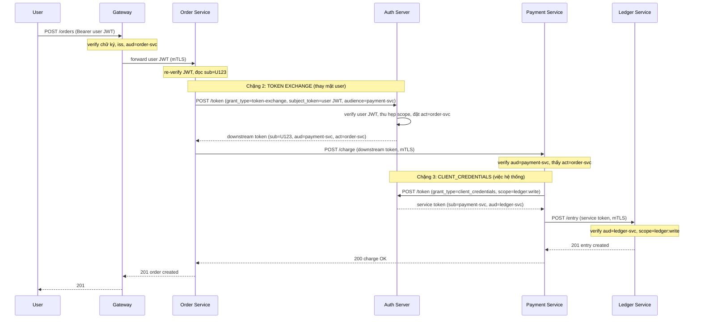

# Case Study: Service-to-Service — Order → Payment → Ledger

## Mục lục

- [1. Bối cảnh: ba service, câu hỏi "ai gọi ai, thay mặt ai?"](#1-bối-cảnh-ba-service-câu-hỏi-ai-gọi-ai-thay-mặt-ai)
- [2. Yêu cầu hệ thống](#2-yêu-cầu-hệ-thống)
- [3. Ba cách authenticate giữa service](#3-ba-cách-authenticate-giữa-service)
- [4. Quyết định: pattern nào cho chặng nào](#4-quyết-dịnh-pattern-nào-cho-chặng-nào)
- [5. Luồng end-to-end — sequence diagram](#5-luồng-end-to-end--sequence-diagram)
- [6. mTLS + JWT — hai lớp danh tính](#6-mtls--jwt--hai-lớp-danh-tính)
- [7. aud và iss nghiêm ngặt giữa services](#7-aud-và-iss-nghiêm-ngặt-giữa-services)
- [8. Code thực chiến — client_credentials + token exchange](#8-code-thực-chiến--client_credentials--token-exchange)
- [9. Architecture Decision Records (ADRs)](#9-architecture-decision-records-adrs)
- [10. Anti-patterns cần tránh](#10-anti-patterns-cần-tránh)
- [11. Tóm tắt — Cheat sheet](#11-tóm-tắt--cheat-sheet)

---

## 1. Bối cảnh: ba service, câu hỏi "ai gọi ai, thay mặt ai?"

Bạn làm kỹ sư cho **ShopLite** — nền tảng e-commerce đang lớn dần. Khi mớikhởi động, mọi thứ nằm trong một monolith: tạo đơn hàng, trừ tiền, ghi sổ kế toán — cùng một process, gọi hàm nhau trực tiếp, không cần nghĩ về "danh tính" giữa chúng.

Một năm sau, monolith vỡ ra thành ba service:

```text
┌──────────────┐      ┌───────────────┐      ┌──────────────┐
│ Order Service│─────▶│Payment Service│─────▶│Ledger Service│
│  tạo đơn     │charge│   trừ tiền    │ entry│ghi sổ kế toán│
└──────────────┘      └───────────────┘      └──────────────┘
```

Bây giờ, mỗi service chạy trong container riêng, gọi nhau qua HTTP. Và câu hỏi bảo mật xuất hiện:

```text
Order gọi Payment: "Payment ơi, trừ tiền user U123 giúp tôi"
  → Payment tự hỏi: "Làm sao TIN đây là Order thật?
                     Và làm sao biết là thay mặt user U123?"
                     "Không phải kẻ tấn công giả vờ gọi à?"

Payment gọi Ledger: "Ledger ơi, ghi khoản 50$ vào sổ"
  → Ledger tự hỏi: "Đây là Payment gọi, hay ai khác mạo danh?
                     Ghi sổ cho ai? Vì lý do gì?"
```

Đây không còn là bài toán "user đăng nhập thế nào" — user đã đăng nhập ở Gateway từ lâu. Đây là bài toán **service-to-service**: khi các service nội bộ gọi nhau, chúng authenticate với nhau *thế nào*? Và quan trọng hơn — nhiều khi một service gọi service khác **thay mặt một user** (Order trừ tiền *của user*), nhiều khi lại gọi **cho chính hệ thống** (Payment ghi sổ *của platform*). Hai trường hợp cần hai cách xử lý khác nhau.

> [!IMPORTANT]
> Trong một luồng đi qua nhiều service, mỗi service phải trả lời được hai câu hỏi độc lập: **"Service nào đang gọi tôi?"** (danh tính service) và **"Hành động này thay mặt ai?"** (danh tính user, nếu có). Trộn lẫn hoặc bỏ qua một câu hỏi chính là nguồn gốc của hầu hết lỗ hổng service-to-service.

Đọc thêm về hai trục danh tính này trong [Microservices Authentication](/implementation/microservices-auth/) — doc how-to tham chiếu. Case study này đi sâu vào **hành trình ra quyết định** cho ba chặng cụ thể.

---

## 2. Yêu cầu hệ thống

Trước khi chọn pattern, ta cần làm rõ hệ thống cần gì.

### 2.1. Functional requirements

| # | Yêu cầu | Chặng liên quan |
|---|---------|-----------------|
| F1 | User đặt hàng → Order trừ tiền đúng số lượng, đúng người | User → Order → Payment |
| F2 | Mọi khoản tiền phải được ghi vào sổ kế toán | Payment → Ledger |
| F3 | Audit log đầy đủ: "ai đã làm gì, thay mặt ai, lúc nào" | Toàn bộ |
| F4 | Một số thao tác nền (cron đối soát cuối ngày) gọi Ledger | Worker → Ledger |

### 2.2. Non-functional requirements

| Yêu cầu | Mục tiêu | Lý do |
|---------|----------|-------|
| Bảo mật | Chặn pivot attack — chiếm 1 service không lan ra cả cụm | Xem [Zero-Trust API](/case-studies/zero-trust-api/) |
| Latency | Thêm overhead < 5ms mỗi chặng s2s | Trải nghiệm user đặt hàng phải nhanh |
| Audit | Dựng lại được chuỗi "U123 → Order → Payment → Ledger" | Compliance tài chính |
| Khả phục vụ | Nếu auth server tạm chết, service vẫn chạy được một thời gian ngắn | Không để đặt hàng sập toàn bộ |

<Callout type="note" title="Phân biệt với zero-trust-api">

Doc [Zero-Trust API](/case-studies/zero-trust-api/) trả lời câu hỏi *mindset*: "tại sao không tin mạng nội bộ, verify ở mỗi hop". Case study này trả lời câu hỏi *kỹ thuật cụ thể*: "với ba service Order → Payment → Ledger, ta chọn cơ chế authenticate nào cho từng chặng, và vì sao". Hai doc bổ sung nhau — zero trust là *nguyên lý*, đây là *ca áp dụng*.
</Callout>

---

## 3. Ba cách authenticate giữa service

Khi Order cần gọi Payment, có ba pattern phổ biến. Mỗi pattern trả lời câu hỏi "dùng token nào?" theo cách khác nhau.

### 3.1. Pattern A — Forward user token (On-Behalf-Of)

Order đã nhận được user JWT từ Gateway. Khi gọi Payment, Order **chuyển tiếp nguyên token đó**.

```text
User ──(user JWT, sub=U123, aud=order)──▶ Gateway ──▶ Order
Order ──(cùng user JWT)──▶ Payment
```

- **Ý tưởng**: dùng lại đúng token mà user mang tới, chuyển cho service tiếp theo.
- **Danh tính mang theo**: user (`sub=U123`).
- **Điểm mạnh**: đơn giản nhất — không cần gọi auth server thêm lần nào; Payment biết ngay là thay mặt U123.
- **Điểm yếu**: token sống lâu lan rộng khắp mạng nội bộ; `aud` phải bao gồm *mọi* service downstream; khó thu hẹp quyền (scope đi theo user, rộng).

### 3.2. Pattern B — client_credentials (service identity)

Order không mang theo user. Order tự lấy một token riêng bằng `client_id` / `client_secret`, token này có `sub=order-svc` (chính service), không liên quan tới user nào.

```text
Order ──(client_id + secret)──▶ Auth Server ──▶ token (sub=order-svc, aud=payment-svc)
Order ──(service token)──▶ Payment
```

- **Ý tưởng**: service tự authenticate *với tư cách chính nó*, không thay mặt ai.
- **Danh tính mang theo**: service (`sub=order-svc`).
- **Điểm mạnh**: scope hẹp đúng việc (`payment:charge`), token ngắn hạn, service độc lập với user.
- **Điểm yếu**: mất thông tin "thay mặt user nào" — Payment không biết đây là đơn của U123.

### 3.3. Pattern C — Token exchange (RFC 8693)

Order đã có user JWT. Thay vì forward nguyên token, Order **đổi** nó lấy một token mới nhắm đúng Payment, với scope thu hẹp và claim `act` ghi lại "ai đang thay mặt".

```text
Order ──(user JWT + audience=payment-svc)──▶ Auth Server
Auth Server: verify user JWT → phát token mới (sub=U123, aud=payment-svc, act=order-svc)
Order ──(token mới)──▶ Payment
```

- **Ý tưởng**: On-Behalf-Of chính quy — đổi user token lấy downstream token hẹp.
- **Danh tính mang theo**: cả user (`sub=U123`) lẫn service gọi (`act=order-svc`).
- **Điểm mạnh**: least-privilege từng chặng (scope hẹp, `aud` hẹp), audit đầy đủ qua chuỗi `act`.
- **Điểm yếu**: phức tạp nhất — cần auth server hỗ trợ token exchange, thêm một round-trip mỗi lần.

### 3.4. So sánh ba pattern

| Tiêu chí | A: Forward JWT | B: client_credentials | C: Token exchange |
|----------|---------------|----------------------|-------------------|
| Danh tính mang theo | user | service | user + service (`act`) |
| Phức tạp triển khai | Thấp nhất | Trung bình | Cao nhất |
| Round-trip auth server | 0 | 1 (lấy service token) | 1 (đổi token) mỗi chặng |
| `aud` của token downstream | Phải bao gồm mọi service | Hẹp, đúng 1 service | Hẹp, đúng 1 service |
| Least-privilege | Yếu (scope theo user, rộng) | Tốt (scope hẹp cố định) | Tốt nhất (scope hẹp + aud hẹp) |
| Audit "thay mặt ai" | Có (`sub`) | Không (mất user) | Có (`sub` + `act`) |
| Khi nào dùng | Hệ vừa, ít chặng | Việc nền không liên quan user | Hệ lớn/nhạy cảm, cần audit |

> [!TIP]
> Không có pattern "tốt nhất" nói chung — mỗi pattern giải một bài toán khác nhau. Pattern A cho "thay mặt user, đơn giản"; Pattern B cho "việc của hệ thống, không dính user"; Pattern C cho "thay mặt user nhưng cần least-privilege + audit". Phần tiếp theo quyết định *chặng nào* dùng *cái nào*.

---

## 4. Quyết định: pattern nào cho chặng nào

Đây là phần cốt lõi của case study — không phải liệt kê pattern, mà là **hành trình ra quyết định** cho từng chặng.

### 4.1. Phân tích từng chặng theo bản chất nghiệp vụ

```text
Chặng 1: User → Order          (qua Gateway)
   Bản chất: user thật thao tác
   → Pattern A: user JWT, sub=U123, aud=order-svc

Chặng 2: Order → Payment
   Bản chất: Order gọi Payment THAY MẶT user (trừ tiền CỦA user)
   → cần mang theo user + service gọi → Pattern C (token exchange)

Chặng 3: Payment → Ledger
   Bản chất: Payment ghi sổ — việc CỦA HỆ THỐNG, không lệ thuộc user
   → Pattern B (client_credentials) là đủ

Chặng 4 (nền): Cron Worker → Ledger
   Bản chất: đối soát cuối ngày, không có user nào trong ngữ cảnh
   → Pattern B (client_credentials)
```

Phân biệt chặng 2 và chặng 3 là điểm nhiều team sai. Cả hai đều là "service gọi service", nhưng chặng 2 *dính tới user* (trừ tiền của ai?), còn chặng 3 *không* (ghi sổ là nghiệp vụ kế toán, khoản tiền đã được xác nhận). Lầm tưởng "toàn bộ service-to-service đều giống nhau" dẫn đến chọn sai pattern — ví dụ dùng client_credentials cho chặng 2 thì mất luôn thông tin user, không audit được "đơn này của ai".

### 4.2. Weighted decision matrix

Chấm điểm mỗi pattern theo trọng số yêu cầu (1–5, cao hơn = tốt hơn):

| Tiêu chí (trọng số) | A: Forward JWT | B: client_credentials | C: Token exchange |
|---------------------|:--------------:|:---------------------:|:-----------------:|
| Bảo mật chặn pivot (×3) | 3 | 5 | 5 |
| Least-privilege (×3) | 2 | 4 | 5 |
| Audit "thay mặt ai" (×2) | 4 | 1 | 5 |
| Đơn giản / ít round-trip (×1) | 5 | 3 | 2 |
| **Tổng có trọng số** | **30** | **38** | **40** |

```text
Quyết định cuối:
  Chặng 2 (Order → Payment, dính user):     Pattern C — audit + least-privilege là sống còn
  Chặng 3 (Payment → Ledger, không user):   Pattern B — đơn giản hơn, đủ dùng
  Chặng 4 (Worker → Ledger):                Pattern B — cùng bản chất hệ thống
```

<Callout type="note" title="Vì sao chặng 2 không dùng Pattern A?">

Pattern A (forward JWT) có thể chấm cao hơn về đơn giản, nhưng với yêu cầu F3 (audit đầy đủ "thay mặt ai") và bảo mật (token user không nên lan tới Payment), Pattern C thắng. Tuy nhiên, nếu ShopLite còn nhỏ và chưa cần token exchange, **bắt đầu với Pattern A rồi tiến hóa sang C** là lộ trình hợp lý — xem ADR-002 bên dưới.
</Callout>

---

## 5. Luồng end-to-end — sequence diagram

Sơ đồ một lượt đặt hàng đi qua ba service, kết hợp cả ba pattern ở đúng chặng:



**Bốn điểm verify độc lập** trong một lượt đặt hàng. Mỗi service tự verify token ở chặng nó nhận — không tin "service trước đã verify". Đây chính là phòng thủ chiều sâu: nếu Order bị xâm nhập và gửi token giả cho Payment, Payment phải phát hiện và reject.

```text
Nếu Payment bị xâm nhập, kẻ tấn công cầm được gì?
  • downstream token (từ Order): aud=payment-svc → chỉ dùng được VỚI Payment, scope payment:charge
  • service token (cho Ledger):  aud=ledger-svc → chỉ ghi sổ được, scope ledger:write
  → KHÔNG có token nào cho phép gọi admin-svc hay đọc dữ liệu user khác
  → thiệt hại giới hạn trong payment ↔ ledger (least-privilege phát huy)
```

---

## 6. mTLS + JWT — hai lớp danh tính

Token (dù user hay service) chứng minh danh tính ở **tầng ứng dụng**. Nhưng nó không chứng minh "kết nối này thật sự từ Order, hay kẻ tấn công giả vờ là Order". Đó là việc của **mTLS (mutual TLS)** — tầng vận chuyển.

```text
Request từ Order → Payment mang THEO HAI LỚP:

  ┌────────────────────────────────────────────────────┐
  │ Lớp 1: mTLS (transport)                            │
  │  Payment kiểm chứng cert của Order                 │
  │  → "kết nối này thật sự từ service Order"          │
  │                                                    │
  │ Lớp 2: JWT (application)                           │
  │  Payment verify token downstream                   │
  │  → "thay mặt user U123, service order-svc gọi"     │
  └────────────────────────────────────────────────────┘

  mTLS chặn: kẻ tấn công không có cert Order → không giả vờ gọi được
  JWT chặn: token rò cũng cần đúng aud + scope mới dùng được
```

| Lớp | Chứng minh | Chặn được | Nếu chỉ dùng một |
|-----|-----------|-----------|------------------|
| **mTLS** | Service gọi là service thật | Mạo danh kết nối, MITM | Không biết user nào, không phân quyền |
| **JWT** | User/service đã được xác thực | Request mù danh, sai scope | Token rò → kẻ tấn công dùng lại được ở đâu cũng được |

<Callout type="warn" title="Hai lớp bổ sung nhau, không thay thế">
Chỉ mTLS: Payment biết "Order gọi" nhưng không biết "thay mặt user nào" → không phân quyền theo user được. Chỉ JWT: token rò thì kẻ tấn công dùng ở bất kỳ đâu. Kết hợp cả hai thì kẻ tấn công phải có **cả** cert Order **lẫn** token hợp lệ — rào cản cao hơn nhiều. Trong service mesh (Istio/Linkerd), mTLS thường do sidecar tự lo, app code chỉ cần verify JWT. Xem chi tiết: <a href="/implementation/microservices-auth/">Microservices Authentication</a>.
</Callout>

---

## 7. aud và iss nghiêm ngặt giữa services

Điểm sống còn trong service-to-service: mỗi service verify token với `aud` **chính xác service mình**, và `iss` **chính xác auth server**. Bỏ qua một trong hai là mở toang cửa.

### 7.1. aud — token này dành cho AI?

`aud` (audience) trả lời: "token này được phát hành cho service nào?". Khi Payment verify token, nó phải yêu cầu `aud=payment-svc` — nếu token có `aud=order-svc` thì *dù chữ ký đúng* Payment cũng phải reject.

```text
⚠ Lỗ hổng nếu KHÔNG check aud:
  User đăng nhập Blog, nhận token aud=blog-svc
  Lấy cùng token gọi Payment → Payment verify chữ ký ✓ → XỬ LÝ (sai!)
  Vì Payment không check aud → token của service này dùng được ở service khác

✓ Đúng: Payment verify với audience=payment-svc
  token aud=blog-svc → Payment REJECT 401 "invalid audience"
```

### 7.2. iss — ai phát hành token này?

`iss` (issuer) trả lời: "token này do ai ký?". Khi mọi service cùng dùng một auth server thì `iss` tưởng như thừa — nhưng khi có *nhiều* issuer (IdP khác nhau, môi trường staging vs production), không check `iss` dẫn tới **issuer confusion**: token cấp bởi IdP test lại được accept ở production.

```text
Quy tắc cho ShopLite:
  Mọi service verify với:
    issuer:  "https://auth.shoplite.com"     ← cứng, đúng auth server duy nhất
    audience: "<tên service mình>"            ← vd payment-svc, ledger-svc
    algorithms: ["RS256"]                     ← whitelist, KHÔNG tin alg trong header
```

> [!IMPORTANT]
> `aud` và `iss` là hai claim bị bỏ qua nhiều nhất — và cũng là hai claim quan trọng nhất trong service-to-service. Verify chữ ký mà không check `aud`/`iss` giống khóa cửa rồi để chìa ở ổ: kẻ tấn công có token hợp lệ của service khác sẽ dùng được cho service bạn. Đọc sâu về cơ chế này ở [Audience, Issuer, Subject](/internals/audience-issuer-subject/).

---

## 8. Code thực chiến — client_credentials + token exchange

Mã minh hoạ cho hai chặng chính. Token được **cache** tới gần hết hạn để tránh gọi auth server mỗi request.

### 8.1. Chặng 3 — Payment lấy service token (client_credentials)

```typescript
// payment-svc: lấy service token gọi Ledger, cache tới gần hết hạn
let cached = { token: null as string | null, exp: 0 };

async function getLedgerToken(): Promise<string> {
  // còn hạn (dự trù 30s) → tái dùng
  if (cached.token && Date.now() < cached.exp - 30_000) {
    return cached.token;
  }
  const res = await fetch('https://auth.shoplite.com/oauth/token', {
    method: 'POST',
    headers: { 'Content-Type': 'application/x-www-form-urlencoded' },
    body: new URLSearchParams({
      grant_type: 'client_credentials',
      client_id: process.env.PAYMENT_CLIENT_ID!,
      client_secret: process.env.PAYMENT_CLIENT_SECRET!,
      scope: 'ledger:write', // scope tối thiểu — chỉ ghi sổ
      audience: 'ledger-svc', // nhắm đúng Ledger
    }),
  });
  if (!res.ok) throw new Error('token_request_failed');
  const { access_token, expires_in } = await res.json();
  cached = { token: access_token, exp: Date.now() + expires_in * 1000 };
  return access_token;
}

async function postLedgerEntry(entry: object) {
  const token = await getLedgerToken();
  return fetch('https://ledger.internal/entries', {
    method: 'POST',
    headers: { Authorization: `Bearer ${token}`, 'Content-Type': 'application/json' },
    body: JSON.stringify(entry),
  });
}
```

### 8.2. Chặng 2 — Order đổi user token (token exchange, RFC 8693)

```typescript
// order-svc: đổi user JWT lấy downstream token nhắm Payment, mang act=order-svc
async function exchangeForPayment(userJwt: string): Promise<string> {
  const res = await fetch('https://auth.shoplite.com/oauth/token', {
    method: 'POST',
    headers: { 'Content-Type': 'application/x-www-form-urlencoded' },
    body: new URLSearchParams({
      grant_type: 'urn:ietf:params:oauth:grant-type:token-exchange',
      subject_token: userJwt,
      subject_token_type: 'urn:ietf:params:oauth:token-type:jwt',
      audience: 'payment-svc', // token mới chỉ cho Payment
      scope: 'payment:charge', // thu hẹp về đúng việc cần
    }),
  });
  if (!res.ok) throw new Error('token_exchange_failed');
  const { access_token } = await res.json();
  // access_token: sub=U123 (user), aud=payment-svc, act={sub: order-svc}
  return access_token;
}

async function chargePayment(userJwt: string, amount: number, orderId: string) {
  const token = await exchangeForPayment(userJwt);
  return fetch('https://payment.internal/charge', {
    method: 'POST',
    headers: { Authorization: `Bearer ${token}`, 'Content-Type': 'application/json' },
    body: JSON.stringify({ amount, orderId }),
  });
}
```

### 8.3. Payment verify token downstream nghiêm ngặt

```typescript
// payment-svc: verify mọi token đến với aud/iss/alg cứng, KHÔNG tin mặc định
import { createRemoteJWKSet, jwtVerify } from 'jose';

const JWKS = createRemoteJWKSet(new URL('https://auth.shoplite.com/.well-known/jwks.json'));

export async function verifyIncoming(token: string) {
  const { payload } = await jwtVerify(token, JWKS, {
    algorithms: ['RS256'], // whitelist — không tin header.alg
    issuer: 'https://auth.shoplite.com',
    audience: 'payment-svc', // CHỈ nhận token nhắm mình
  });
  // payload.act.sub = service gọi (order-svc), payload.sub = user (U123)
  return {
    userId: payload.sub,
    actor: payload.act?.sub, // "order-svc" — cho audit
    scope: (payload.scope as string)?.split(' ') ?? [],
  };
}
```

<Callout type="warn" title="Lưu ý production">
Code trên là khung tối thiểu. Production cần thêm: (1) cache JWKS có cooldown khi gặp <code>kid</code> mới (tránh refetch bão — xem <a href="/cryptography/jwk-and-jwks/">JWK & JWKS</a>), (2) retry 1 lần lấy token mới khi gặp 401 giữa request dài, (3) lưu <code>client_secret</code> trong secret manager, xoay định kỳ. Chi tiết vòng đời token ở <a href="/lifecycle/access-token-vs-refresh-token/">Access Token vs Refresh Token</a>.
</Callout>

---

## 9. Architecture Decision Records (ADRs)

Ghi lại quyết định chính thức cho team và người mới onboard.

### ADR-001: Chọn token exchange cho chặng Order → Payment

**Status:** Accepted

**Context:** Order trừ tiền *thay mặt user* (chặng 2). Cần vừa mang danh tính user (để Payment biết đơn của ai, phân quyền), vừa thu hẹp scope và không để user token full lan xuống Payment. Xét ba pattern: forward JWT (đơn giản nhưng scope rộng, aud phải multi), client_credentials (mất user), token exchange.

**Decision:** Dùng **OAuth Token Exchange (RFC 8693)** cho chặng Order → Payment. Order đổi user JWT lấy downstream token `aud=payment-svc`, scope `payment:charge`, kèm claim `act=order-svc`.

**Consequences:**
- ✅ Least-privilege: downstream token scope hẹp, chỉ Payment dùng được
- ✅ Audit đầy đủ: chuỗi `act` cho phép dựng "U123 → order-svc → payment-svc"
- ✅ User token gốc không lọt xuống Payment — giảm rủi ro nếu Payment bị xâm nhập
- ❌ Phức tạp hơn: cần auth server hỗ trợ token exchange + thêm 1 round-trip mỗi lần đổi
- ❌ Caching khó hơn: downstream token gắn với từng user, không cache dùng chung như service token

### ADR-002: Lộ trình tiến hóa — bắt đầu với forward JWT

**Status:** Accepted (cho giai đoạn đầu)

**Context:** ShopLite còn nhỏ, team chưa sẵn sàng triển khai token exchange ngay. Tuy nhiên bỏ qua authentication s2s thì nguy hiểm.

**Decision:** **Giai đoạn 1** dùng Pattern A (forward user JWT), nhưng mỗi service vẫn re-verify với `aud` của chính nó (IdP cấp token `aud` mảng gồm `order-svc`, `payment-svc`). **Giai đoạn 2**, khi quy mô/độ nhạy cảm tăng, migrate sang Pattern C (token exchange) cho chặng Order → Payment. Việc verify `aud` ở mỗi service không đổi → migration chỉ ảnh hưởng cách *phát* token, không phá service consumer.

**Consequences:**
- ✅ Bắt đầu đơn giản, ship nhanh
- ✅ Migration từng bước: forward JWT → token exchange, không big-bang
- ⚠ Giai đoạn 1: token user lan rộng hơn → chấp nhận được khi chưa có dữ liệu cực nhạy cảm

### ADR-003: Chọn client_credentials cho chặng Payment → Ledger

**Status:** Accepted

**Context:** Payment ghi sổ kế toán — việc *của hệ thống*, không lệ thuộc user nào. Cron đối soát cuối ngày cũng gọi Ledger mà không có user trong ngữ cảnh.

**Decision:** Dùng **client_credentials** cho Payment → Ledger và Worker → Ledger. Token có `sub=payment-svc` (hoặc `worker-svc`), `aud=ledger-svc`, scope `ledger:write`.

**Consequences:**
- ✅ Service token ngắn hạn, scope hẹp cố định — không dính user
- ✅ Dùng chung cho cả chặn user-driven và cron background
- ✅ Cache token dùng chung cho mọi request (không gắn user) → ít round-trip
- ❌ Mất thông tin user trong chặng này — nhưng Ledger chỉ cần biết "khoản này từ Payment", không cần "đơn của ai" (đã audit ở chặng 2)

### ADR-004: mTLS bắt buộc cho mọi kết nối service-to-service

**Status:** Accepted

**Context:** JWT chứng minh danh tính tầng ứng dụng, nhưng không chống được mạo danh kết nối nếu token bị rò.

**Decision:** Ép **mTLS mọi nơi** giữa các service nội bộ (qua service mesh sidecar). Mỗi service có cert riêng, hai bên xác thực lẫn nhau khi bắt tay TLS.

**Consequences:**
- ✅ Lớp phòng thủ độc lập với JWT — kẻ tấn công cần cả cert lẫn token
- ✅ Mã hóa transit miễn phí
- ❌ Phụ thuộc PKI / service mesh — team ops cần quản cert (mesh tự lo nếu có)

---

## 10. Anti-patterns cần tránh

### 10.1. ❌ Một super service account full-scope cho mọi service

```text
SAI:  Tạo 1 client_credentials "shoplite-super-svc" với scope *:* 
      mọi service dùng chung cặp ID/secret này
      → lộ 1 cặp = chìa khóa vạn năng cho cả cụm

ĐÚNG: Mỗi service một client riêng (order-svc, payment-svc, ledger-svc),
      scope tối thiểu đúng việc (ledger:write, payment:charge)
```

### 10.2. ❌ Forward user token mà không exchange

```text
SAI:  Order forward nguyên user JWT (full-scope) xuống Payment → Ledger
      → token user sống lâu lan khắp cụm, aud phải bao gồm mọi service
      → 1 service bị xâm nhập = cầm được token user full-scope

ĐÚNG: Token exchange cho chặng nhạy cảm — downstream token aud hẹp, scope hẹp
```

### 10.3. ❌ Trust the network — service tin nhau vì cùng cluster

```text
SAI:  Payment tin "Order gọi thì OK, cùng cluster mà"
      → Order bị RCE → kẻ tấn công gọi Payment mù, Payment tin luôn

ĐÚNG: Mỗi service verify token + mTLS, bất kể nguồn gọi (xem Zero-Trust API)
```

### 10.4. ❌ Không check aud/iss khi verify

```text
SAI:  Service verify chỉ chữ ký, không check aud
      → token của service khác (cùng key) dùng được cho mình

ĐÚNG: Verify với audience=<tên mình>, issuer=<auth server>, algorithms whitelist
```

### 10.5. ❌ Dùng client_credentials cho chặng thay mặt user

```text
SAI:  Order → Payment dùng client_credentials (sub=order-svc)
      → Payment không biết đơn này của user nào → không audit, không phân quyền theo user

ĐÚNG: Chặng dính user → token exchange (mang sub=user + act=order-svc)
```

### 10.6. ❌ Token không cache, gọi auth server mỗi request

```text
SAI:  Mỗi request Payment → Ledger đều lấy token mới (gọi /token)
      → thêm 50-100ms latency, quá tải auth server

ĐÚNG: Cache token tới gần hết hạn (trừ 30s buffer), tái dùng
```

---

## 11. Tóm tắt — Cheat sheet

```text
╭────────────────────────────────────────────────────────────────────╮
│        SERVICE-TO-SERVICE — CHEAT SHEET                            │
│                                                                    │
│  Nguyên tắc gốc: mỗi service TỰ verify, không tin mạng nội bộ      │
│                                                                    │
│  Ba pattern — chọn theo BẢN CHẤT chặng:                            │
│     A. Forward user JWT     → dính user, hệ vừa, ưu tiên đơn giản  │
│     B. client_credentials   → việc hệ thống, không dính user       │
│     C. Token exchange       → dính user + cần least-privilege      │
│                                                                    │
│  Áp dụng cho Order → Payment → Ledger:                             │
│     • Chặng 2 (Order→Payment, thay mặt user):  Pattern C           │
│     • Chặng 3 (Payment→Ledger, việc hệ thống): Pattern B           │
│     • Worker → Ledger (công việc nền):         Pattern B           │
│                                                                    │
│  Hai lớp danh tính:                                                │
│     • mTLS = service nào (transport)   • JWT = user nào (app)      │
│                                                                    │
│  Verify nghiêm ngặt ở mọi service:                                 │
│     audience = <tên mình>   issuer = <auth server>   alg whitelist │
╰────────────────────────────────────────────────────────────────────╯
```

**Năm quy tắc bất di bất dịch:**

| # | Quy tắc | Vì sao |
|---|---------|--------|
| 1 | **Chọn pattern theo bản chất chặng** | Dính user → exchange/OBO; việc hệ thống → client_credentials |
| 2 | **Mỗi service tự verify** | Chặn pivot attack — chiếm 1 service không lan cả cụm |
| 3 | **mTLS + JWT song song** | Hai lớp độc lập: service thật + user hợp lệ |
| 4 | **aud/iss nghiêm ngặt** | Token service này không dùng được ở service khác |
| 5 | **Scope tối thiểu từng token** | Lộ token cũng chỉ phạm vi hẹp, không toàn hệ thống |

<Cards>
<Card title="Microservices Authentication" href="/implementation/microservices-auth/">
Doc how-to tham chiếu: edge-only vs zero-trust, hai trục danh tính, token exchange, mTLS, edge cases và checklist đầy đủ.
</Card>
<Card title="Zero-Trust API" href="/case-studies/zero-trust-api/">
Mindset đằng sau: vì sao không tin mạng nội bộ, threat model, pivot attack và phòng thủ chiều sâu.
</Card>
<Card title="Audience, Issuer, Subject" href="/internals/audience-issuer-subject/">
Ba claim định danh cốt lõi — vai trò aud/iss trong việc định tuyến tin tưởng giữa service.
</Card>
</Cards>

---

## Tài liệu tham khảo

- [Microservices Authentication](/implementation/microservices-auth/) — doc how-to tham chiếu đầy đủ.
- [Zero-Trust API](/case-studies/zero-trust-api/) — mindset "không tin mạng nội bộ", threat model.
- [Audience, Issuer, Subject](/internals/audience-issuer-subject/) — cơ chế aud/iss trong định tuyến tin tưởng.
- [Access Token vs Refresh Token](/lifecycle/access-token-vs-refresh-token/) — vòng đời token, khi nào cấp lại.
- [JWK & JWKS](/cryptography/jwk-and-jwks/) — phân phát public key, cache JWKS.
- [RFC 8693 — OAuth 2.0 Token Exchange](https://www.rfc-editor.org/rfc/rfc8693) — chuẩn token exchange chính thức.
- [RFC 6749 — OAuth 2.0 Client Credentials](https://www.rfc-editor.org/rfc/rfc6749#section-4.4) — chuẩn client_credentials grant.
