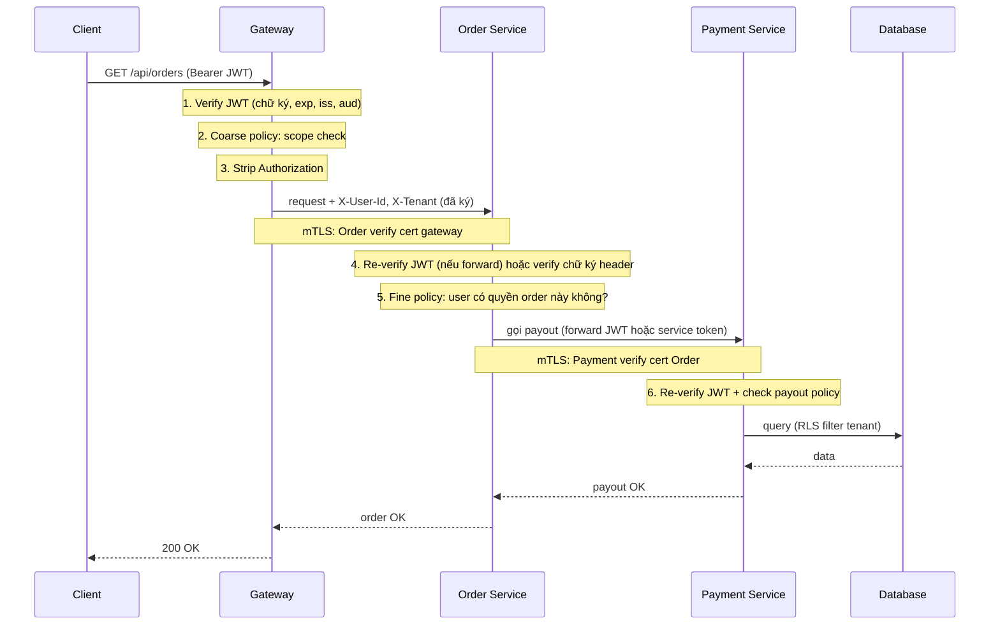

# Case Study: Zero Trust API với JWT

## Mục lục

- [Castle-and-moat: cửa chính thép, cửa sổ mở toang](#1-castle-and-moat-cửa-chính-thép-cửa-sổ-mở-toang)
- [Zero Trust là gì — lật ngược tư duy "mạng nội bộ an toàn"](#2-zero-trust-là-gì--lật-ngược-tư-duy-mạng-nội-bộ-an-toàn)
- [Vấn đề: trong cụm microservices, JWT thường bị lười verify](#3-vấn-đề-trong-cụm-microservices-jwt-thường-bị-lười-verify)
- [Nguyên tắc 1: Verify ở mỗi hop, không chỉ ở edge](#4-nguyên-tắc-1-verify-ở-mỗi-hop-không-chỉ-ở-edge)
- [Nguyên tắc 2: Gateway strip + inject an toàn](#5-nguyên-tắc-2-gateway-strip--inject-an-toàn)
- [Nguyên tắc 3: Service re-verify chữ ký](#6-nguyên-tắc-3-service-re-verify-chữ-ký)
- [Nguyên tắc 4: mTLS + JWT — hai lớp danh tính](#7-nguyên-tắc-4-mtls--jwt--hai-lớp-danh-tính)
- [Nguyên tắc 5: Policy Enforcement Point ở mỗi service](#8-nguyên-tắc-5-policy-enforcement-point-ở-mỗi-service)
- [Architecture: cụm zero-trust đầy đủ](#9-architecture-cụm-zero-trust-đầy-đủ)
- [Luồng request end-to-end](#10-luồng-request-end-to-end)
- [Threat model — bốn kịch bản zero trust chặn được](#11-threat-model--bốn-kịch-bản-zero-trust-chặn-được)
- [Code thực chiến — service self-verify](#12-code-thực-chiến--service-self-verify)
- [Anti-patterns cần tránh](#13-anti-patterns-cần-tránh)
- [Tóm tắt — Cheat sheet](#14-tóm-tắt--cheat-sheet)

---

## 1. Castle-and-moat: cửa chính thép, cửa sổ mở toang

Trong cụm microservices, service A có nên tin service B chỉ vì cả hai cùng nằm trong một VPC? Câu hỏi này là gốc rễ của mọi thiết kế bảo mật hiện đại — và phần lớn hệ thống vẫn trả lời **sai**.

Kiểu trả lời sai mang tên **castle-and-moat** (thành trì + hào nước): tiền tuyến cố thủ như thành trì, nhưng bên trong là "vùng tin tưởng" — service A gọi service B thì B tin ngay, không hỏi. Mô hình này hợp thời ở kỷ nguyên mạng nội bộ khép kín, nhưng trong cụm microservices nó trở thành cửa chính bằng thép, cửa sổ mở toang.

```diagram
   Mô hình castle-and-moat (cũ — nguy hiểm):
   ┌──────────────────────────────────────────────┐
   │  Internet (đầy kẻ xấu)                       │
   └──────────────┬───────────────────────────────┘
                  ▼
          ┌──────────────┐          ← THÀNH LỚP duy nhất (gateway)
          │  API Gateway │             verify JWT kỹ
          └──────┬───────┘
                 │ (qua cửa ải → vào vùng TIN CẬY)
   ╔═════════════╪══════════════════════════════╗
   ║   VÙNG TIN CẬY (mạng nội bộ)               ║
   ║   ┌─────────┴───────┐                      ║
   ║   │ Order → Payment │  ← Payment tin Order ║
   ║   │       ↘ Notify  │    (cùng mạng)       ║
   ║   └─────────────────┘                      ║
   ║   ⚠ Chiếm được 1 service = chiếm cả cụm    ║
   ╚════════════════════════════════════════════╝
```

Hậu quả thực tế rất cụ thể: khi kẻ tấn công chiếm được **một service yếu nhất** (thường là service ít để ý — notification, logging), họ có quyền của cả cụm. Từ "notification" làm bước đệm (pivot), gọi thẳng payment. Phòng tuyến "chỉ gateway verify" thì đã bị vòng qua rồi. (Chi tiết kịch bản pivot này nằm ở section Threat model — phần sau.)

> [!IMPORTANT]
> Castle-and-moat đã lỗi thời. Kẻ tấn công chỉ cần một điểm yếu nhỏ để làm bàn đạp, rồi tấn công service giá trị cao. **Zero Trust** sinh ra để giải quyết: không "vùng tin cậy", verify ở **mọi hop** — kể cả khi request đến từ mạng nội bộ, kể cả khi gọi đến service "cùng nhà".

---

## 2. Zero Trust là gì — lật ngược tư duy "mạng nội bộ an toàn"

**Zero Trust** (Không Tin Tưởng) là triết lý bảo mật đảo ngược giả định truyền thống:

| Mô hình cũ (castle-and-moat) | Zero Trust |
|------------------------------|------------|
| Mạng nội bộ = an toàn | **Không mạng nào an toàn**, kể cả nội bộ |
| Verify ở biên (gateway) thôi | Verify ở **mọi hop** |
| Tin service nội bộ gọi nhau | **Không service nào tin service khác** |
| Một khi vào trong, đi tự do | Mỗi request đều qua kiểm tra |

Nguyên tắc gốc (NIST SP 800-207): *"Never trust, always verify"* — Đừng bao giờ tin, luôn kiểm tra.

```diagram
   Castle-and-moat:                   Zero Trust:
   ┌──────────────────┐               ┌──────────────────┐
   │ Vùng an toàn     │               │ Không vùng an    │
   │ ┌──┐ ┌──┐ ┌──┐   │               │ ┌──┐ ┌──┐ ┌──┐   │
   │ │A │→│B │→│C │   │               │ │A │→│B │→│C │   │
   │ │  │ │  │ │  │   │               │ │  │ │  │ │  │   │
   │ │  │ │  │ │  │   │               │ │  │ │  │ │  │   │
   │ └──┘ └──┘ └──┘   │               │ └──┘ └──┘ └──┘   │
   │ A tin B tin C    │               │ A→B: B verify A  │
   │ (vì cùng mạng)   │               │ B→C: C verify B  │
   └──────────────────┘               └──────────────────┘
   ⚠ 1 đứa vào = hết  ✓ 1 đứa bị     ✓ Không ai tin ai
                          chiếm → vẫn   → chiếm 1 đứa không
                          bị chặn       lan ra cả cụm
```

> [!NOTE]
> Zero Trust không có nghĩa là "mọi service đều verify chữ ký JWT nặng nề". Nó là **mindset**: không tin dựa trên vị trí mạng. Có nhiều cách thực thi — JWT verify, mTLS, service mesh, policy engine — quan trọng là **không service nào chấp nhận request mà không kiểm tra danh tính**, dù request đến từ "nội bộ".

---

## 3. Vấn đề: trong cụm microservices, JWT thường bị lười verify

Trước khi đi sâu zero trust, hãy nhìn các pattern "lười" phổ biến — đây chính là lỗ hổng mà zero trust bị triệt tiêu.

### 3.1. Pattern lười 1: Gateway verify rồi service tin luôn

```diagram
   Client → Gateway: verify JWT ✓
   Gateway → Service A: forward token (hoặc header user-id)
   Service A: đọc header "X-User-Id" → tin luôn, không verify lại
   ⚠ Nếu service A bị gọi trực tiếp (bỏ gateway) → tin mù
```

Service A tin header `X-User-Id` do gateway tiêm. Nhưng header đó **có thể bị làm giả** — bất kỳ ai gọi trực tiếp service A (tr mạng nội bộ) đều tiêm header gì cũng được.

### 3.2. Pattern lười 2: Service A gọi Service B, B tin "vì A đã verify"

```diagram
   Service A (đã verify JWT client): gọi Service B
   Service B: "A đã verify rồi, mình tin"
   ⚠ Nếu A bị chiếm (RCE) → kẻ tấn công gọi B với request giả → B tin
```

Đây là lỗi trong bối cảnh §1: Notification bị RCE, gọi Payment, Payment tin "vì nội bộ".

### 3.3. Pattern lười 3: Network policy thay cho auth

```diagram
   Service B: chỉ accept request từ IP của Service A
   ⚠ Kẻ tấn công chiếm Service A → dùng IP của A → qua mặt network policy
```

Network policy (firewall, security group) **không thay thế được auth**. Nó chỉ kiểm tra *request đến từ đâu*, không kiểm tra *request có hợp pháp không*. Khi service bị chiếm, IP bị chiếm theo.

<Callout type="error" title="Network ≠ Identity">
Đây là câu thần chú của Zero Trust: **vị trí mạng không bằng danh tính**. "Request đến từ mạng nội bộ" không chứng minh request hợp pháp — nó chỉ chứng minh request đến từ mạng nội bộ. Kẻ tấn công trong mạng nội bộ (sau khi pivot) vẫn là kẻ tấn công. Auth phải độc lập với network.
</Callout>

---

## 4. Nguyên tắc 1: Verify ở mỗi hop, không chỉ ở edge

Nguyên tắc đầu tiên và quan trọng nhất: **mỗi service nhận request đều phải verify danh tính**, không tin bất kỳ hop nào trước đó.

### 4.1. Mỗi hop là một cửa ải độc lập

```diagram
   Client → Gateway → Order → Payment → Ledger
            verify    verify   verify    verify
            JWT       JWT      JWT       JWT

   Mỗi service verify độc lập:
   ┌────────────────────────────────────────┐
   │ Service X                              │
   │ nhận req                               │
   │  ──verify JWT? ✓                       │
   │  ──chữ ký đúng? ✓                      │
   │  ──chưa hết hạn? ✓                     │
   │  ──claims đúng (iss/aud/scope)? ✓      │
   │  ──token chưa bị revoke? ✓             │
   │ → mới xử lý request                    │
   └────────────────────────────────────────┘
```

Tức là Payment Service **phải tự verify token** mà Order gửi tới — không tin "Order đã verify". Nếu Order bị chiếm và gửi token giả, Payment phải phát hiện và reject ngay.

### 4.2. Nhưng "verify mỗi hop" có nặng không?

Đây là lo ngại phổ biến: *"Verify JWT ở mỗi service thì CPU không nổi?"*. Thực tế:

- **HMAC (HS256)**: ~0.05ms mỗi verify — không đáng kể
- **RSA (RS256)**: ~0.5ms mỗi verify — vẫn rất nhanh với public key
- **JWKS cache**: public key cache 1-24h, không fetch lại mỗi request

```diagram
   Lo ngại:                       Thực tế:
   "Verify mỗi hop = chậm"        HMAC: ~0.05ms/request
                                   RSA:  ~0.5ms/request
                                   → << latency mạng (1-5ms)
                                   → không đáng kể
```

> [!IMPORTANT]
> Verify JWT ở mỗi hop là **rẻ** (dưới 1ms) và là **cách duy nhất** chặn được pivot attack (kẻ tấn công chiếm 1 service rồi tấn công service khác). Chi phí CPU bỏ qua được hoàn toàn so với rủi ro. Đây là lý do Zero Trust khả thi ở quy mô lớn.

---

## 5. Nguyên tắc 2: Gateway strip + inject an toàn

Trong cụm zero trust, gateway vẫn verify JWT client — nhưng **không bao giờ forward token gốc vào mạng nội bộ**. Thay vào đó, gateway **strip** token gốc và **inject** danh tính đã xác thực vào header nội bộ, sau đó service verify lại header đó.

### 5.1. Vì sao không forward token gốc

```diagram
   SAI (forward token gốc):
   Client → Gateway (verify ✓) → Order: "Authorization: Bearer eyJ...token gốc"
   ⚠ Token gốc lọt vào mạng nội bộ → bị sniff/replay nếu 1 service bị chiếm

   ĐÚNG (strip + inject):
   Client → Gateway (verify ✓)
   Gateway: BỎ token gốc
   Gateway → Order: tiêm header nội bộ "X-User-Id: 123" + "X-Tenant: A"
   Order: verify lại gateway? → đọc header nội bộ
```

### 5.2. Nhưng làm sao service biết header từ gateway, không phải từ kẻ tấn công?

Đây là điểm sống còn: header nội bộ `X-User-Id` **có thể bị làm giả** nếu service nghe mọi nguồn. Giải pháp: gateway ký header nội bộ, hoặc dùng mTLS với gateway (chỉ gateway mới gọi được service).

```diagram
   ⚠ Kẻ tấn công gọi trực tiếp Service Order:
      POST http://order.internal/api/orders
      X-User-Id: admin   ← header giả
      → Order phải PHÁT HIỆN đây không phải gateway

   Giải pháp 1: mTLS — chỉ gateway có cert gọi được Order
   Giải pháp 2: Gateway ký header, Order verify chữ ký gateway
   Giải pháp 3: Service mesh (Istio/Linkerd) enforce identity
```

<Callout type="warn" title="Header nội bộ không tự an toàn">
Tiêm `X-User-Id` vào header nội bộ là pattern phổ biến — nhưng **chỉ an toàn nếu service chắc chắn request đến từ gateway**. Nếu service nghe mọi nguồn (kể cả network nội bộ), kẻ tấn công tiêm header giả. Bắt buộc kết hợp với mTLS hoặc service mesh để **chỉ gateway mới gọi được service**. Chi tiết: [api-gateway-auth](/implementation/api-gateway-auth/).
</Callout>

---

## 6. Nguyên tắc 3: Service re-verify chữ ký

Trong zero trust, **mỗi service verify chữ ký JWT độc lập** — không tin "gateway đã verify". Điều này nghe thừa nhưng là lớp phòng thủ then chốt.

### 6.1. Hai mô hình trust

| Mô hình | Verify ở đâu | Rủi ro |
|---------|--------------|--------|
| **Edge-only** (cũ) | Chỉ gateway | Service bị gọi trực tiếp → tin mù |
| **Defense-in-depth** (zero trust) | Gateway + mọi service | Service tự verify → chặn gọi trực tiếp |

```diagram
   Edge-only:                       Zero Trust (defense-in-depth):
   Gateway verify ✓                 Gateway verify ✓
   Service: tin header              Service: verify lại JWT ✓ + đọc header
                                            ↑
                                   Hai lớp độc lập — 1 lớp fail vẫn còn lớp kia
```

### 6.2. Service cần gì để verify

Mỗi service cần:

```diagram
   1. Public key (RSA/ECDSA) hoặc secret (HMAC)
      → lấy từ JWKS cache hoặc env config
   2. Whitelist thuật toán (vd chỉ RS256)
   3. Expected issuer (iss) và audience (aud)
   4. (Tuỳ chọn) Revocation list (nếu cần check logout)
```

Đây là **không nhiều** — mỗi service giữ một bộ config auth nhỏ, gọi thư viện JWT verify, và **chỉ trust kết quả verify của chính nó**.

> [!TIP]
> Pattern tốt nhất: **gateway verify + forward token gốc (đã verify) xuống service**, service **verify lại**. Hai lớp verify độc lập. Gateway là "fast filter" (reject token hỏng sớm), service là "hard gate" (chắc chắn token hợp lệ trước khi xử lý). Nếu gateway bị config sai, service vẫn chặn.

---

## 7. Nguyên tắc 4: mTLS + JWT — hai lớp danh tính

Zero Trust thường kết hợp **hai lớp danh tính** độc lập: JWT (định danh user) + mTLS (định danh service). Đây là combo mạnh nhất cho microservices nội bộ.

### 7.1. JWT định danh ai, mTLS định danh service nào

```diagram
   Request từ Order → Payment:
   ┌────────────────────────────────────────────────────┐
   │ Lớp 1: mTLS                                        │
   │  Payment kiểm chứng: Order đúng cert không?        │
   │  → chứng minh "request đến từ service Order thật"  │
   │                                                    │
   │ Lớp 2: JWT                                         │
   │  Payment verify: token user hợp lệ không?          │
   │  → chứng minh "user X đã đăng nhập"                │
   └────────────────────────────────────────────────────┘
   Hai lớp độc lập:
   ✓ mTLS chặn kẻ tấn công giả vờ là service Order
   ✓ JWT chặn kẻ tấn công dùng token user lạ
```

### 7.2. Vì sao kết hợp cả hai

| Lớp | Chứng minh | Chặn được |
|-----|-----------|-----------|
| **mTLS** | Service gọi là service thật (có cert) | Kẻ tấn công pivot rồi giả vờ là service nội bộ |
| **JWT** | User đã đăng nhập (có token) | Request mù danh, không có user |

```diagram
   Chỉ JWT (không mTLS):
   Order → Payment: token user OK
   ⚠ Nhưng làm sao Payment biết "Order" thật là Order, không phải kẻ tấn công
     giả service Order? → có thể tin nhầm

   Chỉ mTLS (không JWT):
   Order → Payment: cert Order OK
   ⚠ Nhưng không biết user nào → không phân quyền

   Cả hai: ✅
   Order → Payment: cert Order OK + token user OK
   → Payment biết: service thật gọi + user đã đăng nhập → xử lý
```

<Callout title="mTLS cho service-to-service">
mTLS (mutual TLS) yêu cầu **cả hai bên** trình cert và verify nhau. Trong cụm microservices, mỗi service có cert riêng (SPIFFE/SPIRE hoặc service mesh cấp phát). Khi Order gọi Payment, Payment kiểm chứng cert của Order — nếu kẻ tấn công không có cert Order (dù đã pivot vào mạng), không thể giả vờ gọi. mTLS là lớp phòng thủ độc lập với JWT. Chi tiết: [microservices-auth](/implementation/microservices-auth/).
</Callout>

---

## 8. Nguyên tắc 5: Policy Enforcement Point ở mỗi service

Zero Trust không chỉ verify danh tính — còn **enforce policy** (chính sách) ở mỗi service. Tức là: service phải biết *"user X có được làm hành động Y trên resource Z không?"* — và câu trả lời phải được kiểm tra tại điểm thi hành, không phải chỉ ở gateway.

### 8.1. Policy Enforcement Point (PEP)

PEP là điểm trong code **quyết định allow/deny** một hành động cụ thể. Zero Trust đặt PEP ở **mọi service**, không chỉ gateway.

```diagram
   Edge-only (PEP chỉ ở gateway):
   Gateway: check policy (user có quyền?) → allow
   Service: tin gateway, không check lại
   ⚠ Gateway sai config → service làm bừa

   Zero Trust (PEP ở mỗi service):
   Gateway: check policy (lọc thô) → allow
   Service: check policy CHÍNH XÁC (cho resource cụ thể) → allow/deny
   ✅ Policy decision độc lập, sát tài nguyên
```

### 8.2. Hai loại policy

| Loại | Ví dụ | Ở đâu check |
|------|-------|-------------|
| **Coarse-grained** (thô) | "User có quyền đọc invoice không?" | Gateway |
| **Fine-grained** (chi tiết) | "User có quyền đọc **invoice này** không? (cùng tenant?)" | Service (gần DB) |

```diagram
   Request: GET /api/invoices/inv_5f8a2c

   Gateway (coarse-grained PEP):
     user có scope "invoices:read"? → ✓ allow qua gateway

   Service (fine-grained PEP):
     user (tid=A) truy cập invoice inv_5f8a2c (tid=B)? → ✗ deny
     ★ Đây là chỗ chặn cross-tenant leak — gateway không biết resource thuộc tid nào
```

> [!IMPORTANT]
> Gateway chỉ check policy **thô** (scope có quyền không), vì gateway không biết resource thuộc tenant nào, thuộc ai sở hữu. **Policy chi tiết** (user có được chạm resource cụ thể này không) phải check ở service — nơi gần dữ liệu. Bỏ qua fine-grained PEP = leak cross-tenant (xem [multi-tenant-saas](/case-studies/multi-tenant-saas/)).

---

## 9. Architecture: cụm zero-trust đầy đủ

Sơ đồ kiến trúc một cụm API zero trust hoàn chỉnh:

```diagram
╭──────────────────────────────────────────────────────────────────────────╮
│                       ZERO TRUST API CLUSTER                             │
│                                                                          │
│   Internet                                                               │
│      │                                                                   │
│      ▼                                                                   │
│   ┌────────────────────────────────────────────┐                         │
│   │  API Gateway (Edge PEP)                    │                         │
│   │  • Verify JWT client ✓                     │                         │
│   │  • Strip Authorization header              │                         │
│   │  • Inject X-User-Id, X-Tenant (đã ký)      │                         │
│   │  • Coarse policy: scope check              │                         │
│   │  • Rate limit per subject                  │                         │
│   └─────────────┬──────────────────────────────┘                         │
│                 │ (mTLS tới mọi service nội bộ)                          │
│   ╔═════════════╪═══════════════════════════════════════════╗            │
│   ║   MẠNG NỘI BỘ (KHÔNG vùng tin cậy)                      ║            │
│   ║              │                                          ║            │
│   ║   ┌──────────▼─────────┐  ┌──────────────────┐          ║            │
│   ║   │ Order Service      │  │ Payment Service  │          ║            │
│   ║   │ • mTLS verify gw   │  │ • mTLS verify    │          ║            │
│   ║   │ • Re-verify JWT    │  │   (gw hoặc Order)│          ║            │
│   ║   │ • Fine-grained PEP │  │ • Re-verify JWT  │          ║            │
│   ║   │ • Policy per tid   │  │ • Payout policy  │          ║            │
│   ║   └──────────┬─────────┘  └─────────┬────────┘          ║            │
│   ║              │ verify JWT           │ verify JWT        ║            │
│   ║              ▼                      ▼                   ║            │
│   ║   ┌──────────────────────────────────────────┐          ║            │
│   ║   │ DB Layer (RLS)                           │          ║            │
│   ║   │ • Mọi query filter tenant_id             │          ║            │
│   ║   └──────────────────────────────────────────┘          ║            │
│   ╚═════════════════════════════════════════════════════════╝            │
│                                                                          │
│   HỖ TRỢ:                                                                │
│   ┌─────────────────────┐  ┌──────────────────────┐  ┌──────────────┐    │
│   │ JWKS endpoint       │  │ Service Mesh (Istio) │  │ Policy Engine│    │
│   │ (cache public key)  │  │ (mTLS tự động)       │  │ (OPA/Authz)  │    │
│   └─────────────────────┘  └──────────────────────┘  └──────────────┘    │
╰──────────────────────────────────────────────────────────────────────────╯
```

### 9.1. Năm thành phần cốt lõi

| Thành phần | Vai trò |
|-----------|---------|
| **API Gateway** | Edge PEP — verify JWT, strip header, coarse policy |
| **mTLS** | Danh tính service — chống giả service nội bộ |
| **JWKS cache** | Phân phát public key cho mọi service |
| **Service Mesh** (tuỳ chọn) | Tự động mTLS + enforce policy giữa service |
| **Policy Engine** (OPA) | Fine-grained policy tập trung |

---

## 10. Luồng request end-to-end

Trọn bộ luồng một request đi qua cụm zero trust:



**Sáu điểm verify** độc lập trong một request — đây là "defense-in-depth" thực sự. Kẻ tấn công phải vượt **tất cả** sáu điểm, và chiếm 1 service không giúp vượt điểm khác.

---

## 11. Threat model — bốn kịch bản zero trust chặn được

| # | Kịch bản tấn công | Edge-only (cũ) | Zero Trust |
|---|-------------------|----------------|------------|
| 1 | **Token giả từ Internet** | Gateway chặn ✓ | Gateway chặn ✓ + service chặn nếu leak |
| 2 | **Service bị RCE, pivot sang service khác** | ❌ Service tin nội bộ → leak | ✅ Service đích re-verify + mTLS chặn |
| 3 | **Sniff token trên mạng nội bộ** | ❌ Token forward nội bộ → replay | ✅ Token không forward, header nội bộ ký |
| 4 | **Cross-tenant leak** | ❌ Gateway không biết tid resource | ✅ Fine-grained PEP ở service + RLS |

### 11.1. Kịch bản 2 chi tiết — pivot attack bị chặn

```diagram
   Kẻ tấn công RCE Notification Service:
   ┌─────────────────────────────────────────┐
   │ Bước 1: chiếm Notification              │
   │  → có code execution trong Notification │
   └─────────────────┬───────────────────────┘
                     ▼
   Bước 2: gọi Payment Service (pivot)
   ┌─────────────────────────────────────────┐
   │ POST http://payment.internal/api/payout │
   │ Body: {amount: 999999}                  │
   └─────────────────┬───────────────────────┘
                     ▼
   Bước 3: Payment kiểm tra
   ┌─────────────────────────────────────────┐
   │ • mTLS: cert của caller?                │
   │   → Notification không có cert gọi      │
   │     Payment (policy mesh chặn)    ✗     │
   │ • JWT: có token user không?             │
   │   → Notification gọi mù danh      ✗     │
   │ → REJECT 403                            │
   └─────────────────────────────────────────┘
   ✅ Zero Trust đã chặn — dù Notification bị chiếm
```

<Callout type="warn" title="Zero Trust giới hạn thiệt hại (blast radius)">
Điểm mạnh nhất của Zero Trust không phải là "không bao giờ bị tấn công" — mà là **giới hạn thiệt hại**. Khi 1 service bị chiếm, zero trust ngăn kẻ tấn công lan sang service khác. Đây là "blast radius" nhỏ — thiệt hại giới hạn ở service bị chiếm, không lan cả cụm. Trong bối cảnh §1, nếu có zero trust, chiếm Notification không giúp rút tiền Payment.
</Callout>

---

## 12. Code thực chiến — service self-verify

Mẫu middleware cho service nội bộ: verify JWT độc lập, không tin hop trước.

```typescript
// middleware: zeroTrustAuth.ts
// Mỗi service tự verify — không tin gateway hay service gọi

import { verifyJWT } from './jwt';
import { getJWKS } from './jwks-cache';
import { Request, Response, NextFunction } from 'express';

const EXPECTED_ISSUER = 'https://auth.myapp.com';
const EXPECTED_AUDIENCE = 'https://payment.myapp.com';
const ALLOWED_ALGS = ['RS256']; // whitelist cứng

export async function zeroTrustAuth(req: Request, res: Response, next: NextFunction) {
  // 1. Yêu cầu token — không tin header nội bộ mù quáng
  const auth = req.headers.authorization;
  if (!auth?.startsWith('Bearer ')) {
    return res.status(401).json({ error: 'missing_token' });
  }
  const token = auth.slice(7);

  // 2. Verify độc lập — chữ ký, thuật toán, claims
  let payload;
  try {
    const key = await getJWKS(token); // cache JWKS
    payload = await verifyJWT(token, key, {
      algorithms: ALLOWED_ALGS,      // whitelist, không tin header.alg
      issuer: EXPECTED_ISSUER,       // check iss
      audience: EXPECTED_AUDIENCE,   // check aud — service này
    });
  } catch (err) {
    return res.status(401).json({ error: 'invalid_token' });
  }

  // 3. Kiểm tra revocation (nếu có)
  if (await isRevoked(payload.jti)) {
    return res.status(401).json({ error: 'revoked' });
  }

  // 4. Gắn context
  req.userId = payload.sub;
  req.tenantId = payload.tid;
  req.scopes = payload.scope?.split(' ') ?? [];
  next();
}

// Mọi route đều qua zeroTrustAuth — không route nào "trusted internal"
app.post('/api/payout', zeroTrustAuth, async (req, res) => {
  // Fine-grained PEP: check quyền payout trong context tenant
  if (!req.scopes.includes('payout:write')) {
    return res.status(403).json({ error: 'insufficient_scope' });
  }
  // ... xử lý payout
});
```

### 12.1. mTLS enforcement (bổ sung)

```typescript
// Trong service mesh (Istio), mTLS được enforce tự động ở tầng sidecar
// Code service chỉ cần verify JWT — mTLS do mesh lo

// Nếu không có mesh, enforce mTLS ở reverse proxy (nginx):
// server {
//   listen 443 ssl;
//   ssl_client_certificate /etc/ssl/ca.crt;
//   ssl_verify_client on;   // ← yêu cầu cert từ client (gateway/service khác)
//   → request không có cert mTLS = reject ở tầng proxy, chưa tới service
// }
```

<Callout type="warn" title="Code minh hoạ — production cần thêm">
Code trên là khung zero trust tối thiểu. Production cần thêm: (1) JWKS cache TTL + refresh khi kid mới, (2) rate limit per-subject, (3) audit log mọi decision, (4) circuit breaker khi auth server down, (5) policy engine (OPA) cho fine-grained policy phức tạp. Nguyên tắc: **mọi route đều qua middleware auth — không route nào "internal trusted"**.
</Callout>

---

## 13. Anti-patterns cần tránh

### 13.1. ❌ Service tin header nội bộ không verify

```text
SAI:  Service đọc "X-User-Id" do gateway tiêm, không verify
      → kẻ tấn công gọi trực tiếp, tiêm header giả

ĐÚNG: Service re-verify JWT, hoặc verify chữ ký header nội bộ
      + mTLS đảm bảo chỉ gateway gọi được service
```

### 13.2. ❌ Forward token gốc vào mạng nội bộ

```text
SAI:  Gateway forward "Authorization: Bearer eyJ..." cho mọi service
      → token bị sniff nếu 1 service bị chiếm

ĐÚNG: Gateway strip token, inject header nội bộ đã ký, service re-verify
```

### 13.3. ❌ Service nội bộ tin nhau (vì cùng mạng)

```text
SAI:  Order → Payment, Payment tin "vì Order đã verify"
      → Order bị RCE → kẻ tấn công gọi Payment mù

ĐÚNG: Payment re-verify JWT + mTLS cert của Order
```

### 13.4. ❌ Chỉ verify ở gateway, service "trusted"

```text
SAI:  Gateway verify, service "internal trusted" không check
      → lộ service ra Internet (config sai) → tin mù

ĐÚNG: Service luôn verify, kể cả khi "chỉ gateway gọi"
```

### 13.5. ❌ Dùng network policy thay auth

```text
SAI:  Service B chỉ accept IP của Service A → tin luôn
      → Service A bị chiếm → IP A bị chiếm → bypass

ĐÚNG: Network policy (bổ sung) + JWT verify (chính)
      → auth độc lập với network
```

### 13.6. ❌ Policy chỉ coarse, không fine-grained

```text
SAI:  Gateway check scope "invoices:read" → allow
      Service tin luôn, không check resource thuộc tenant nào
      → cross-tenant leak

ĐÚNG: Gateway coarse policy + Service fine-grained PEP (check tid resource)
```

---

## 14. Tóm tắt — Cheat sheet

**Zero Trust = không tin mạng, verify mọi hop.**

```diagram
╭────────────────────────────────────────────────────────────────────╮
│              ZERO TRUST JWT — CHEAT SHEET                          │
│                                                                    │
│  Nguyên tắc gốc: "Never trust, always verify"                      │
│                                                                    │
│  5 nguyên tắc thực thi:                                            │
│     1. Verify JWT ở MỖI hop (không chỉ gateway)                    │
│     2. Gateway strip token + inject header nội bộ đã ký            │
│     3. Service re-verify chữ ký độc lập                            │
│     4. mTLS cho service-to-service (chống giả service)             │
│     5. Fine-grained PEP ở mỗi service (sát tài nguyên)             │
│                                                                    │
│  Combo hai lớp danh tính:                                          │
│     • JWT = ai (user)        • mTLS = service nào                  │
│                                                                    │
│  Mỗi request đi qua 6 điểm verify độc lập:                         │
│     Gateway → mTLS → Re-verify JWT → Fine PEP → DB (RLS)           │
╰────────────────────────────────────────────────────────────────────╯
```

**5 nguyên tắc bất di bất dịch:**

| # | Nguyên tắc | Vì sao |
|---|-----------|--------|
| 1 | **Không vùng tin cậy** | Mạng nội bộ cũng phải verify — kẻ tấn công pivot nằm đó |
| 2 | **Verify mỗi hop** | Chặn pivot attack, chi phí <1ms, rẻ hơn rủi ro |
| 3 | **mTLS + JWT** | Hai lớp độc lập: service thật + user hợp lệ |
| 4 | **Gateway strip + inject** | Token không lọt mạng nội bộ, header nội bộ phải ký |
| 5 | **Fine-grained PEP** | Policy chi tiết ở service, không chỉ coarse ở gateway |

**Bốn câu hỏi thường gặp:**

- **Verify mỗi hop có chậm không?** — Không. HMAC ~0.05ms, RSA ~0.5ms. << latency mạng.
- **Service mesh có thay JWT không?** — Không. Mesh lo mTLS (service identity), JWT lo user identity. Hai lớp bổ sung nhau.
- **Zero Trust có loại bỏ gateway không?** — Không. Gateway vẫn là edge PEP (fast filter), zero trust thêm verify ở service.
- **Làm sao test zero trust?** — Giả lập pivot: chiếm 1 service, thử gọi service khác → phải bị reject.

---

## Tài liệu tham khảo

- [NIST SP 800-207 — Zero Trust Architecture](https://nvlpubs.nist.gov/nistpubs/SpecialPublications/NIST.SP.800-207.pdf) — chuẩn Zero Trust chính thức.
- [RFC 8725 — JSON Web Token Best Current Practices](https://datatracker.ietf.org/doc/html/rfc8725) — best practice JWT.
- [Google BeyondCorp](https://cloud.google.com/beyondcorp) — case study Zero Trust thực chiến của Google.
- Trong repo: [api-gateway-auth](/implementation/api-gateway-auth/) (strip+inject), [microservices-auth](/implementation/microservices-auth/) (mTLS + token exchange), [security-best-practices](/security/security-best-practices/), [jwt-threat-model](/security/jwt-threat-model/).
