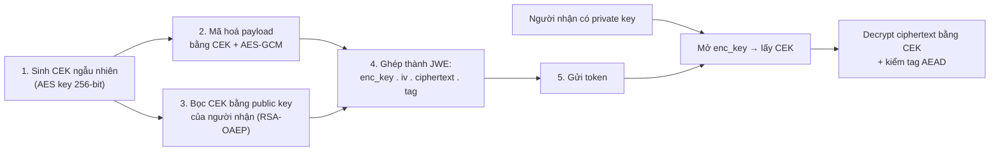
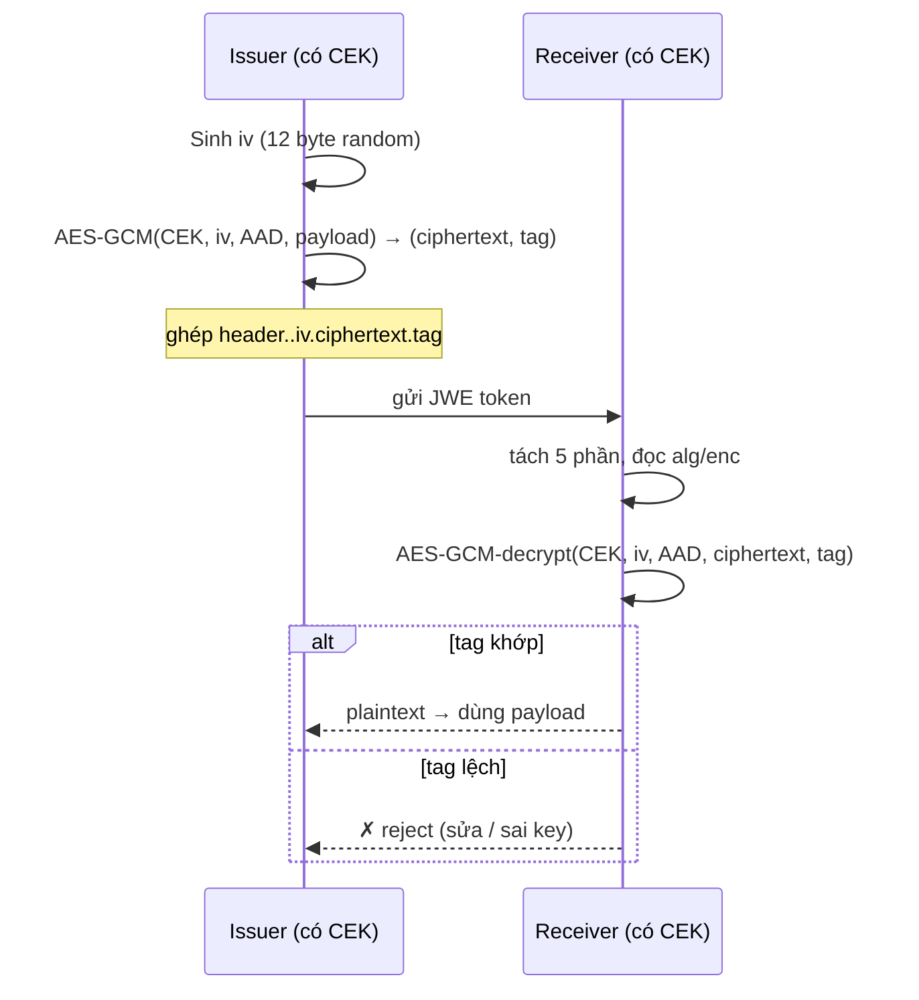

# JWE — Encrypted Token (Deep Dive)

## Mục lục

- [Câu chuyện: token chứa thông tin nhạy cảm bị đọc trên đường truyền](#1-câu-chuyện-token-chứa-thông-tin-nhạy-cảm-bị-đọc-trên-đường-truyền)
- [Chữ ký (JWS) giấu được gì — và không giấu được gì](#2-chữ-ký-jws-giấu-được-gì--và-không-giấu-được-gì)
- [JWE là gì — bọc token trong phong bì kín](#3-jwe-là-gì--bọc-token-trong-phong-bì-kín)
- [Cấu trúc 5 phần của JWE compact](#4-cấu-trúc-5-phần-của-jwe-compact)
- [Hai lớp mã hoá — CEK và content encryption](#5-hai-lớp-mã-hoá--cek-và-content-encryption)
- [Thuật toán key management (alg) — cách giao CEK](#6-thuật-toán-key-management-alg--cách-giao-cek)
- [Thuật toán content encryption (enc) — AEAD với GCM](#7-thuật-toán-content-encryption-enc--aead-với-gcm)
- [Tạo và giải mã JWE bằng tay — luồng byte](#8-tạo-và-giải-mã-jwe-bằng-tay--luồng-byte)
- [Khi nào THẬT SỰ cần JWE (gần như là không bao giờ)](#9-khi-nào-thật-sự-cần-jwe-gần-như-là-không-bao-giờ)
- [Code thực chiến — EncryptJWT / jwtDecrypt với jose](#10-code-thực-chiến--encryptjwt--jwtdecrypt-với-jose)
- [Anti-patterns cần tránh](#11-anti-patterns-cần-tránh)
- [Tóm tắt — Cheat sheet](#12-tóm-tắt--cheat-sheet)

---

## 1. Câu chuyện: token chứa thông tin nhạy cảm bị đọc trên đường truyền

Một team xây dựng cổng thanh toán, phát JWT cho session người dùng. Vì tiện, họ ném thẳng mấy thứ sau vào payload:

```json
{
  "sub": "user-42",
  "email": "h.nguyen@bank.vn",
  "account": "970436-0001234567",
  "balance": 152000000,
  "ssn": "079200012345",
  "role": "user"
}
```

Họ dùng RS256, verify đúng chữ ký, allowlist thuật toán, kiểm `exp` — tưởng như đủ. Rồi một ngày QA mở DevTools, copy token đang lưu trong `localStorage`, dán vào jwt.io, và thấy **toàn bộ payload hiện ra rõ mồn một**: số tài khoản, số dư, cả số CCCD. Không cần phá gì cả — chỉ cần dán.

```diagram
TOKEN (RS256, ký đúng):
   eyJhbGciOiJSUzI1NiJ9.eyJzdWIi...PAYLOAD....<signature>

Bước 1: tách lấy phần PAYLOAD
Bước 2: base64url decode   ← BIẾN ĐỔI ĐẢO NGƯỢC, AI CŨNG LÀM ĐƯỢC
Bước 3: đọc JSON: { account: "...", balance: 152000000, ssn: "..." }
   ↑ KHÔNG CẦN KHÓA, KHÔNG CẦN PHÁ CHỮ KÝ
```

Vấn đề không phải chữ ký yếu — chữ ký [chống giả, không che giấu](/cryptography/digital-signature/). Base64url là **mã hoá đảo ngược** (encoding), không phải bảo mật; chi tiết ở [Encoding vs Encryption](/fundamentals/encoding-vs-encryption/). Mọi proxy, gateway, browser extension, log middleware, hay kẻ tấn công man-in-the-middle (dù TLS có che mạng) đều có thể đọc payload nếu lỡ chạm được token.

> [!IMPORTANT]
> Chữ ký số (JWS) trả lời câu hỏi *"token này có bị sửa không, và ai phát?"*. Nó **không** trả lời *"ai được biết nội dung"*. Khi nội dung payload thực sự nhạy cảm (PII, y tế, tài chính) và bạn không muốn bất kỳ ai ngoài resource server đích đọc được — đó là lúc cần **mã hoá**, và đó là việc của **JWE**.

---

## 2. Chữ ký (JWS) giấu được gì — và không giấu được gì

Đặt cạnh nhau cho rõ ranh giới:

```diagram
                       JWS (ký)                  JWE (mã hoá)
                     ─────────────              ──────────────
  Payload đọc được?      CÓ (base64url)            KHÔNG (đã mã hoá)
  Payload sửa được       KHÔNG (chữ ký bét)        KHÔNG (tag AEAD bét)
  mà không bị phát hiện?
  Che giấu nội dung?     KHÔNG                     CÓ
  Chống giả mạo?         CÓ (verify chữ ký)        CÓ (cần đúng key để decrypt;
                                                   ngoài ra thường ký *trên* header)
```

Cách dễ nhớ: tưởng tượng **lá thư gửi qua bưu điện**.

```diagram
JWS = tờ giấy có DẤU SEAL của người gửi, nằm trong TÚI TRONG SUỐT.
      → Ai cũng ĐỌC được nội dung (túi trong suốt),
        nhưng KHÔNG AI SỬA được mà không bể seal.

JWE = tờ giấy nằm trong PHONG BÌ DÁN KÍN, chỉ người nhận CÓ CHÌA mới mở.
      → Ai cũng THẤY có phong bì, nhưng KHÔNG ĐỌC được nội dung.
```

Một điểm then chốt: JWE dùng **mã hoá đối xứng** cho nội dung (nhanh, có chế độ AEAD). Vậy server decrypt lấy "chìa mở phong bì" ở đâu? Đó là bài toán **key management** — và JWE giải nó bằng một lớp mã hoá thứ hai, mổ ở §5–§6.

---

## 3. JWE là gì — bọc token trong phong bì kín

**JWE (JSON Web Encryption, RFC 7516)** là chuẩn mã hoá một nội dung (thường là JSON, nhưng có thể là bất kỳ byte nào) thành một token base64url **không đọc được** trừ khi có đúng khóa. Khác với [JWS ký trên header.payload](/internals/header-payload-signature/), JWE **mã hoá** payload, đồng thời sinh một *authentication tag* để chống sửa.

```diagram
         ┌─────────── JWE bảo vệ hai thứ cùng lúc ───────────┐
         │                                                   │
         │   ① Confidentiality  — nội dung bị CHE (giấu)     │
         │   ② Integrity        — không sửa được (giống JWS) │
         │      (đạt qua AEAD tag, không cần chữ ký riêng)   │
         │                                                   │
         └───────────────────────────────────────────────────┘
```

> [!NOTE]
> JWE **không thay thế** JWS — chúng giải bài toán khác nhau. Bạn có thể **ký rồi mã hoá** (JWS nằm trong JWE) khi cần cả chống giả *và* che giấu. Nhưng đa số trường hợp thực tế chỉ cần một trong hai, và thường đó là JWS (xem [§9](#9-khi-nào-thật-sự-cần-jwe-gần-như-là-không-bao-giờ)).

---

## 4. Cấu trúc 5 phần của JWE compact serialization

JWS gọn 3 phần (`header.payload.signature`). JWE cần **5 phần** vì nó phải mang theo cả khóa phiên, vector khởi tạo, ciphertext, lẫn tag xác thực:

```diagram
JWS:  header  .  payload  .  signature
      (3 phần, ký)

JWE:  header  .  encrypted_key  .  iv  .  ciphertext  .  tag
      (5 phần, mã hoá)
```

Một token JWE thật (compact serialization) trông thế này:

```text
eyJhbGciOiJSU0EtT0FFUCIsImVuYyI6IkEyNTZHQ00ifQ.
OKOawDo13gRp2ojaHV7LFpZcgV7T6DVZKTyKOMTYUmKoTCVJRgckCL9kiMT03JGeipsEdY3x_etLbWSBiJawX8RkPvskM_2iX_rJZ.
48V1_ALb6US04U3b.
5eym8TW_c8SuK0ltJ3rpYIzOeDQz7TALvtu6UG9oMo4vpzs9tX_EFShS8iB7j6jiSdiwkIr3ajwQzaBtQD_A.
XFBoMYUZodetZdvTiFvSkQ
```

Mổ từng phần:

```diagram
① header          → JSON: { "alg": "RSA-OAEP", "enc": "A256GCM" }
                     base64url. Nói TRƯỚC sẽ dùng_alg_ và _enc_ nào.

② encrypted_key   → CEK (Content Encryption Key) đã bị mã hoá bằng
                     public key của người nhận (xem §5). Mỗi người nhận
                     một encrypted_key riêng.

③ iv              → Initialization Vector (nonce) ngẫu nhiên cho AEAD.
                     Mỗi token một iv khác → cùng plaintext ra ciphertext khác.

④ ciphertext      → payload THẬT đã mã hoá bằng CEK + iv. Đây là phần
                     KHÔNG ĐỌC ĐƯỢC nếu thiếu key.

⑤ tag             → Authentication Tag do GCM sinh ra. Đổi 1 bit ở
                     ciphertext/iv/header → tag không khớp → reject.
```

<Callout type="warn" title="Đừng nhầm iv với secret">
Phần <code>iv</code> (và cả <code>header</code>, <code>tag</code>) <b>không phải bí mật</b> — chúng công khai đi cùng token mà vẫn an toàn, như vốn dĩ của AEAD. Bí mật duy nhất là <code>CEK</code> (giấu trong <code>encrypted_key</code>) và khóa người nhận dùng mở <code>encrypted_key</code>. Đừng bao giờ "che giấu" iv hay cố code tay mã hoá thay vì dùng thư viện.
</Callout>

---

## 5. Hai lớp mã hoá — CEK và content encryption

Câu hỏi phải đặt: tại sao JWE tách ra **hai lớp** thay vì mã hoá thẳng payload bằng public key RSA? Vì lý do rất thực tế:

```diagram
RSA mã hoá thẳng payload:
   • Chậm     — RSA encrypt từng byte rất tốn (và giới hạn ~245 byte!)
   • Cồng kềnh — RSA 2048-bit cho ciphertext ~256 byte mỗi block
   • Không có AEAD — RSA thuần không cho authentication tag

AES-GCM mã hoá payload:
   • Nhanh    — phần cứng CPU có instruction riêng (AES-NI)
   • Không giới hạn độ dài
   • Có AEAD  — tặng kèm tag chống sửa
   • NHƯNG: dùng 1 CEK đối xứng → làm sao GIAO CEK cho người nhận?
```

JWE giải bằng **hybrid encryption** — mẫu thiết kế kinh điển trong mật mã:



Tóm tắt bằng một dòng:

```diagram
JWE = (CEK ngẫu nhiên) MÃ HOÁ (payload)     ← lớp 1: content encryption, ĐỐI XỨNG, nhanh
      + (CEK đó)     MÃ HOÁ (public key)     ← lớp 2: key wrapping/agreement, ĐỐI XỨNG/bất đối xứng
```

> [!TIP]
> Đây cũng là lý do JWE dùng tới 2 thuật toán (`alg` và `enc`) trong khi JWS chỉ cần 1. `alg` là **cách giao CEK**, `enc` là **cách mã hoá nội dung**. Hai cái độc lập — bạn có thể bọc CEK bằng RSA-OAEP rồi mã hoá nội dung bằng A256GCM, hoặc đổi sang ECDH-ES + A128GCM.

---

## 6. Thuật toán key management (alg) — cách giao CEK

Đây là phần `alg` trong header, quyết định **CEK được giao cho người nhận bằng cơ chế nào**. Có 4 nhóm chính:

<TypeTable
  type={{
    'RSA-OAEP': {
      loại: 'Key wrapping, bất đối xứng',
      cách_thức: 'Dùng public key RSA (OAEP padding) mã hoá CEK. Người nhận mở bằng private key.',
      khi_nào: 'Một người nhận đã biết trước, có cặp RSA.',
    },
    'ECDH-ES': {
      loại: 'Key agreement, bất đối xứng',
      cách_thức: 'Hai bên dùng ECDH sinh ra CEK chung từ cặp EC key, KHÔNG truyền CEK trong token.',
      khi_nào: 'Muốn CEK không bao giờ "đi" trên đường truyền, dùng EC.',
    },
    'A128KW / A256KW': {
      loại: 'Key wrapping, đối xứng',
      cách_thức: 'Dùng một khóa AES chung (shared) để bọc CEK. encrypted_key = CEK đã wrap.',
      khi_nào: 'Issuer và receiver đã chia sẻ sẵn một khóa AES (như HMAC nhưng để enc).',
    },
    dir: {
      loại: 'Trực tiếp, đối xứng',
      cách_thức: 'Không bọc gì cả — CEK CHÍNH LÀ khóa chung đã chia sẻ. encrypted_key rỗng.',
      khi_nào: 'Một khóa AES cố định dùng cho cả encrypt lẫn decrypt (giống HMAC nhưng để enc).',
    },
  }}
/>

Bảng so sánh nhanh khi chọn `alg`:

```diagram
BÀI TOÁN                                alg KHUYẾN NGHỊ
─────────────────────────────────       ─────────────────────────
1 người nhận, có cặp RSA                RSA-OAEP (256)
1 người nhận, có cặp EC                 ECDH-ES (+ A256KW nếu wrap)
Nhiều receiver (compact không hỗ trợ)   PHẢI dùng JSON serialization
Hai bên đã chia sẻ AES key              dir  (đơn giản nhất, token ngắn)
Issuer/Receiver là CHÍNH MÌNH           dir  (CEK = secret cố định)
```

<Callout type="info" title="dir vs A128KW — dễ nhầm nhất">
Cả hai đều đối xứng, nhưng khác nhau ở một chỗ: với <code>dir</code>, khóa chung <b>chính là CEK</b>, nên <code>encrypted_key</code> rỗng (token ngắn hơn). Với <code>A128KW</code>, mỗi lần encrypt sinh CEK ngẫu nhiên rồi <b>wrap</b> nó bằng khóa chung — an toàn hơn vì CEK xoay từng token (forward secrecy tốt hơn nếu log lộ). <code>dir</code> hợp cho service-to-service nội bộ; <code>A*KW</code> hợp khi muốn mỗi token một CEK riêng.
</Callout>

---

## 7. Thuật toán content encryption (enc) — AEAD với GCM

Đây là phần `enc` trong header — thuật toán **dùng CEK để mã hoá payload**. Gần như luôn là AEAD (Authenticated Encryption with Associated Data):

```diagram
AEAD = mã hoá (confidentiality)
     + tag xác thực (integrity)         ← tặng kèm, không cần chữ ký riêng

 Associated Data = phần KHÔNG mã hoá nhưng VẪN được tag bảo vệ
                   (trong JWE là 5-part header base64url — gọi là AAD)
                   → đổi header cũng làm tag bét, giống đổi payload
```

Các giá trị `enc` phổ biến (RFC 7518):

| `enc` | Thuật toán | Key length | Đặc điểm |
|---|---|---|---|
| **A128GCM** | AES-128-GCM | 128-bit | Mặc định cho phần lớn use case |
| **A256GCM** | AES-256-GCM | 256-bit | Yêu cầu cao, khuyên dùng |
| A128CBC-HS256 | AES-128-CBC + HMAC-SHA256 | 256-bit (total) | Cũ hơn, tính tag bằng HMAC thay vì GCM |
| A256CBC-HS512 | AES-256-CBC + HMAC-SHA512 | 512-bit | Tương tự, key dài hơn |

> [!IMPORTANT]
> Khuyến nghị: dùng **`A256GCM`** cho nội dung mới. GCM nhanh (có AES-NI), là AEAD trọn vẹn, và không vướng bẫy của CBC mode (padding oracle). CBC+HMAC vẫn hợp lệ chuẩn nhưng rườm rà và dễ sai khi tự implement. Tuyệt đối **không** bao giờ mã hoá tay — luôn dùng thư viện (`jose`, `jsonwebtoken` không hỗ trợ JWE nên phải dùng `jose`).

---

## 8. Tạo và giải mã JWE bằng tay — luồng byte

Để hiểu máy móc, đây là luồng byte khi tạo 1 JWE (`alg: dir`, `enc: A256GCM`, CEK là khóa AES chia sẻ sẵn):

```diagram
INPUT:
   header   = { "alg":"dir", "enc":"A256GCM" }
   payload  = { "sub":"user-42", "balance":152000000 }
   CEK      = <32 byte AES key đã chia sẻ>
   iv       = <12 byte ngẫu nhiên>        ← GCM cần đúng 12 byte
   aad      = base64url(header)            ← Associated Data

BƯỚC 1: protected header → base64url
   encoded_header = base64url(header)        → phần ①

BƯỚC 2: mã hoá nội dung bằng CEK + iv (AEAD)
   (ciphertext, tag) = AES-GCM(CEK, iv, aad, plaintext=payload)
                                                        ↑ parts ③④⑤

BƯỚC 3: (vì dir) encrypted_key = RỖNG          → phần ② trống

BƯỚC 4: ghép
   JWE = ① "." ②(rỗng) "." ③ "." ④ "." ⑤
       = encoded_header..iv.ciphertext.tag
                   ↑↑ hai chấm liền vì encrypted_key rỗng (đặc trưng dir)
```

Lúc decrypt, ngược lại:

```diagram
1. Tách 5 phần. Đọc header → biết alg=dir, enc=A256GCM.
2. Vì dir → CEK chính là khóa AES chung đã biết. Không cần mở encrypted_key.
3. Tính aad = base64url(header) lại.
4. AES-GCM-decrypt(CEK, iv, aad, ciphertext, tag)
       → nếu tag KHÔNG khớp → throw (token bị sửa / sai key)
       → nếu khớp → trả plaintext JSON
```



---

## 9. Khi nào THẬT SỰ cần JWE (gần như là không bao giờ)

Đây là phần quan trọng nhất của doc này — và câu trả lời nhiều người không muốn nghe: **đa số hệ thống không cần JWE**. Lý do:

```diagram
SUY NGHĨ PHỔ BIẾN (sai):
   "Mã hoá thì an toàn hơn → cứ JWE cho chắc"

THỰC TẾ:
   ① Payload JWT vốn KHÔNG NÊN chứa dữ liệu nhạy cảm.
      → sub/role/scope là đủ để định danh + phân quyền.
      → Số tài khoản, CCCD, balance... lấy qua API CÓ VERIFY token,
        KHÔNG nhét vào token.

   ② TLS (HTTPS) đã mã hoá đường truyền.
      → Trên mạng, payload JWS đã bị TLS che rồi.
      → JWE chỉ thêm giá trị khi token CÓ THỂ rời khỏi đường truyền
        an toàn: log, localStorage, backup, browser extension, proxy cache.

   ③ JWE phức tạp hơn nhiều:
      → 2 thuật toán (alg + enc), 5 phần, key management khó hơn.
      → Debug khó (không dán vào jwt.io xem được).
      → Rotate key phức tạp hơn JWS.
```

**Dùng JWE khi** (điều kiện thực sự):

```diagram
☑ Payload token THẬT chứa thông tin nhạy cảm mà bạn không tránh được
   (yêu cầu nghiệp vụ bắt buộc, ví dụ: claim chứa mã giao dịch,
    B2B truyền dữ liệu dạng signed-and-encrypted envelope).

☑ Token có thể bị đọc ở nơi KHÔNG DO BẠN KIỂM SOÁT
   (lưu ở client-side store, đi qua nhiều hop, partner log token).

☑ Bạn chấp nhận đánh đổi: debug khó hơn, thư viện ít hơn, sai sót dễ hơn.
```

**KHÔNG dùng JWE khi**:

```diagram
✘ Chỉ để "cho an toàn hơn"              → JWS đủ, JWE là overkill
✘ Muốn giấu role/sub/aud/scopes        → những cái đó VỐN DỰNG để verify, đọc được là ĐÚNG
✘ Thay TLS                              → TLS làm tốt hơn, JWE không thay được
✘ Payload chứa PII mà BỎ ĐƯỢC           → bỏ ra, lấy qua API, đỡ toàn bộ phức tạp
```

> [!IMPORTANT]
> Quy tắc ngón cái: **nếu bạn còn đang phân vân có nên dùng JWE không, thì không nên.** JWE là công cụ chuyên dụng cho bài toán hẹp — che giấu payload token khi không thể tránh khỏi việc token bị lộ ra ngoài đường truyền an toàn. Mặc định hãy chọn JWS, và chỉ chuyển sang JWE khi có lý do cụ thể (xem [Anti-patterns](#11-anti-patterns-cần-tránh)).

---

## 10. Code thực chiến — EncryptJWT / jwtDecrypt với jose

Thư viện `jose` (chuẩn de-facto cho JWT ở Node/browser) hỗ trợ đầy đủ JWE qua `EncryptJWT` và `jwtDecrypt`. Dưới đây là 2 kịch bản phổ biến: `dir` (AES chia sẻ) và `RSA-OAEP` (public key).

**Kịch bản A — `dir` với AES key (service-to-service nội bộ):**

```typescript
import { EncryptJWT, jwtDecrypt } from 'jose';

// Khóa AES-256 chia sẻ sẵn (32 byte). Trong thực tế: lấy từ KMS / secret manager.
const cek = await generateKey('A256GCM', { extractable: false });
// hoặc từ raw bytes: createSecretKey(Buffer.from('...32 bytes...', 'base64'))

// ---- ENCRYPT ----
const jwe = await new EncryptJWT({ sub: 'user-42', balance: 152000000 })
  .setProtectedHeader({ alg: 'dir', enc: 'A256GCM' })
  .setIssuedAt()
  .setExpirationTime('15m')
  .encrypt(cek);
// jwe = "eyJhbGci...A256GCM.. iv.ciphertext.tag"  ← 5 phần, phần ② rỗng (dir)

// ---- DECRYPT ----
const { payload, protectedHeader } = await jwtDecrypt(jwe, cek, {
  // BẮT BUỘC pin alg + enc, không tin header
  keyManagementAlgorithms: ['dir'],
  contentEncryptionAlgorithms: ['A256GCM'],
});
console.log(payload); // { sub: 'user-42', balance: 152000000, iat, exp }
```

**Kịch bản B — `RSA-OAEP` + `A256GCM` (issuer có public key, receiver có private key):**

```typescript
import { EncryptJWT, jwtDecrypt, generateKeyPair, importSPKI, exportSPKI } from 'jose';

// Receiver sinh cặp RSA, giữ private, công khai public (qua JWKS — xem /cryptography/jwk-and-jwks/)
const { publicKey, privateKey } = await generateKeyPair('RSA-OAEP-256', { extractable: false });

// ---- ISSUER: mã hoá bằng PUBLIC key của receiver ----
const jwe = await new EncryptJWT({ sub: 'user-42', txn: 'TXN-9912' })
  .setProtectedHeader({ alg: 'RSA-OAEP', enc: 'A256GCM' })
  .setIssuer('https://auth.example.com')
  .setAudience('https://pay.example.com')
  .setExpirationTime('10m')
  .encrypt(publicKey);

// ---- RECEIVER: giải mã bằng PRIVATE key ----
const { payload } = await jwtDecrypt(jwe, privateKey, {
  keyManagementAlgorithms: ['RSA-OAEP'],
  contentEncryptionAlgorithms: ['A256GCM'],
  issuer: 'https://auth.example.com',   // kiểm iss
  audience: 'https://pay.example.com',  // kiểm aud
});
```

<Callout type="error" title="Luôn pin alg + enc khi decrypt">
Giống như verify JWS phải <b>allowlist <code>alg</code></b> để tránh [Algorithm Confusion](/security/algorithm-confusion/), decrypt JWE <b>phải pin cả <code>alg</code> lẫn <code>enc</code></b> ở options của <code>jwtDecrypt</code>. Nếu tin header do client gửi, kẻ tấn công có thể đổi <code>alg</code> sang cái yếu hơn (vd <code>dir</code>) rồi dùng khóa họ tự sinh. Thư viện <code>jose</code> <i>thường</i> chặn, nhưng đừng dựa vào mặc định — khai báo tường minh luôn.
</Callout>

> [!TIP]
> `jsonwebtoken` (rất phổ biến cho JWS) **không hỗ trợ JWE**. Khi cần mã hoá, chuyển sang `jose`. API khác nhau: JWS dùng `SignJWT`, JWE dùng `EncryptJWT`; verify → `jwtVerify`, decrypt → `jwtDecrypt`. Đừng cố ép `jsonwebtoken` "mã hoá" bằng cách nhầm base64 với encryption — đó là lỗ hổng, xem [Encoding vs Encryption](/fundamentals/encoding-vs-encryption/).

---

## 11. Anti-patterns cần tránh

| Anti-pattern | Hậu quả | Thay bằng |
|---|---|---|
| Dùng JWE "cho an toàn hơn" mặc dù payload không nhạy cảm | Phức tạp hoá hệ thống, debug khó, dễ sai, rotate key rắc rối — mà lợi ích ~0 | Giữ JWS; nếu lo lộ, bỏ PII khỏi payload, lấy qua API |
| Nhét PII/secret vào payload rồi "mã hoá bằng JWE" cho xong | Nếu lộ CEK hoặc private key → toàn bộ token lịch sử bị giải mã | Thiết kế: token chỉ chứa `sub`/`scope`, dữ liệu nhạy cảm query sau verify |
| Decrypt mà KHÔNG pin `alg`/`enc` | Kẻ tấn công đổi header sang thuật toán yếu → downgrade attack | `keyManagementAlgorithms` + `contentEncryptionAlgorithms` tường minh |
| Coi `iv`, `tag`, `header` là bí mật và "giấu" đi | Lầm khái niệm — chúng công khai theo thiết kế AEAD; giấu cũng vô dụng | Chỉ CEK và khóa người nhận là bí mật; mọi thứ khác đi kèm token |
| Dùng `dir` với CEK = mật khẩu dễ đoán / short string | Brute-force → giải toàn bộ ciphertext | CEK phải là 32 byte ngẫu nhiên (cho A256GCM), lấy từ KMS/secret manager |
| Tự implement AES-GCM + ghép JWE bằng tay | Sai ivchiều dài, sai AAD, sai thứ tự phần → token "vừa encrypt xong đã không decrypt được" hoặc có lỗ hổng | Luôn dùng thư viện (`jose`); chỉ hiểu byte khi debug |
| Dùng JWE thay cho HTTPS | Payload "giấu" trong token nhưng request body/param khác vẫn rõ | JWE không thay TLS; JWE che payload token, TLS che toàn gói |
| Trộn JWS và JWE header (`alg` vừa ký vừa enc) | Header JWE không có `signature` — verify sai ngữ nghĩa | Cần cả ký lẫn mã hoá → ký rồi encrypt (nesting), không trộn header |

---

## 12. Tóm tắt — Cheat sheet

```diagram
┌──────────────── JWE — MỘT KHUNG ────────────────────────────────────────┐
│                                                                         │
│  MỤC ĐÍCH: CHE GIẤU nội dung payload (confidentiality) + chống sửa      │
│            (integrity, qua AEAD tag). KHÔNG thay chữ ký — giải bài toán │
│            KHÁC.                                                        │
│                                                                         │
│  CẤU TRÚC 5 PHẦN:  header . encrypted_key . iv . ciphertext . tag       │
│     • header        → JSON { alg, enc } base64url                        │
│     • encrypted_key → CEK đã bọc (RỖNG nếu alg=dir)                      │
│     • iv            → 12 byte ngẫu nhiên cho GCM (công khai)             │
│     • ciphertext    → payload ĐÃ MÃ HOÁ (không đọc được)                 │
│     • tag           → authentication tag AEAD (công khai)                │
│                                                                         │
│  HAI LỚP (hybrid encryption):                                           │
│     lớp 1 (enc):  AES-GCM(CEK) mã hoá nội dung — ĐỐI XỨNG, nhanh, AEAD  │
│     lớp 2 (alg):  bọc/giao CEK cho người nhận                           │
│                                                                         │
│  CHỌN alg:                                                              │
│     • RSA-OAEP   → 1 receiver có cặp RSA                                 │
│     • ECDH-ES    → EC, CEK không đi trên đường truyền                    │
│     • A128/256KW → hai bên chia sẻ AES key, mỗi token 1 CEK              │
│     • dir         → CEK chính là khóa chung, encrypted_key rỗng (ngắn)   │
│                                                                         │
│  CHỌN enc:  A256GCM (mặc định cho mọi code mới)                         │
│                                                                         │
│  KHI NÀO DÙNG: rất hiếm — chỉ khi payload THẬT nhạy cảm VÀ có thể bị     │
│                đọc ngoài đường truyền an toàn. Mặc định → JWS.           │
└─────────────────────────────────────────────────────────────────────────┘
```

```
5 ĐIỂM GHIM:
   ① JWS ký (chống giả); JWE mã hoá (chống đọc). Khác bài toán.
   ② Payload JWS đọc được (base64url). Muốn giấu → JWE, KHÔNG phải "mã hoá base64".
   ③ JWE 5 phần, 2 thuật toán (alg=giao CEK, enc=mã hoá nội dung).
   ④ Mặc định: alg=dir hoặc RSA-OAEP, enc=A256GCM. Dùng thư viện (jose).
   ⑤ Decrypt LUÔN pin alg + enc. JWE không thay HTTPS, không thay chữ ký.
```

> [!NOTE]
> Doc này là phần **mã hoá** của family cryptography. Đối ứng **chữ ký** nằm ở [Digital Signature](/cryptography/digital-signature/); phân phối public key cho verify ở [JWK & JWKS](/cryptography/jwk-and-jwks/); ranh giới encoding/encryption ở [Encoding vs Encryption](/fundamentals/encoding-vs-encryption/). Cấu trúc 3 phần của JWS để đối chiếu nằm ở [Header · Payload · Signature](/internals/header-payload-signature/). Bẫy "tin alg từ header" (áp dụng cho cả decrypt JWE) mổ ở [Algorithm Confusion](/security/algorithm-confusion/).
