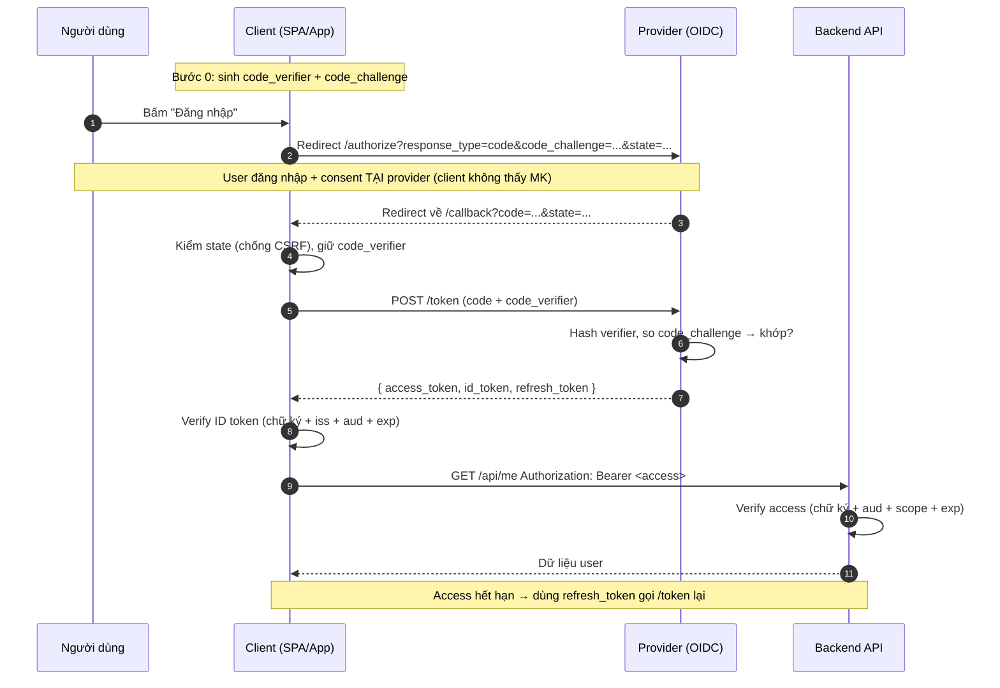

# OAuth2 và OIDC Integration

## Mục lục

- [1. Bối cảnh: đỡ viết 2.000 dòng auth — rồi bị tấn công](#1-bối-cảnh-đỡ-viết-2000-dòng-auth--rồi-bị-tấn-công)
- [2. Tổng quan: OAuth2 + OIDC là gì](#2-tổng-quan-oauth2--oidc-là-gì)
- [3. Hai lớp: ủy quyền (OAuth2) và xác thực (OIDC)](#3-hai-lớp-ủy-quyền-oauth2-và-xác-thực-oidc)
- [4. Ba loại token: access, refresh, ID](#4-ba-loại-token-access-refresh-id)
- [5. OAuth2 grant types — tổng quan](#5-oauth2-grant-types--tổng-quan)
- [6. Discovery document: `.well-known/openid-configuration`](#6-discovery-document-well-knownopenid-configuration)
- [7. Scopes vs claims](#7-scopes-vs-claims)
- [8. Chọn grant type theo use case](#8-chọn-grant-type-theo-use-case)
- [9. Authorization Code + PKCE: luồng đầy đủ](#9-authorization-code--pkce-luồng-đầy-đủ)
- [10. Anti-patterns](#10-anti-patterns)
- [11. Câu hỏi thường gặp](#11-câu-hỏi-thường-gặp)
- [12. Cheat sheet](#12-cheat-sheet)
- [Tài liệu tham khảo](#tài-liệu-tham-khảo)

---

## 1. Bối cảnh: đỡ viết 2.000 dòng auth — rồi bị tấn công

Một team startup quyết định "auth thì tự viết cũng được, có khó gì". Họ dựng bảng `users`, endpoint `/login` trả JWT, rồi tự lo:

- Đăng ký, đăng nhập, quên mật khẩu, đặt lại mật khẩu, verify email
- Session, refresh, rotation, revoke, multi-device
- Bcrypt + salt, chính sách mật khẩu, khóa tài khoản khi sai nhiều lần
- 2FA qua SMS, email, TOTP — rồi khôi phục khi mất thiết bị
- MFA theo bước, "nhớ thiết bị này", login anomaly detection
- SSO với Google, Microsoft, SAML cho khách hàng doanh nghiệp
- Audit log, consent screen, quản lý session của bên thứ ba
- … và rồi một CVE mới trên thư viện JWT, một cuộc review bảo mật phát hiện ký tự `none` vẫn được chấp nhận

Ba tháng sau, "module auth" vẫn chiếm phần lớn thời gian của 2 backend dev, còn tính năng chính thì đình trệ. Và cái module đó **vẫn kém an toàn hơn** Keycloak hay Auth0 — vốn được hàng nghìn người đánh giá, fix CVE trong vài giờ.

> [!IMPORTANT]
> Auth là **nguy hiểm, tốn thời gian, và không tạo ra lợi thế cạnh tranh**. OAuth2 + OIDC là giao thức chuẩn để **giao việc đó cho một provider** (Auth0, Keycloak, AWS Cognito, Okta, Google Identity…). Bạn đăng ký user, cấp token, verify token ở API — phần khó nhất (lưu mật khẩu, MFA, SSO, revoke) do provider lo. Doc này giải thích giao thức ở **tầng protocol**, để bạn hiểu mình đang dùng gì.

---

## 2. Tổng quan: OAuth2 + OIDC là gì

```diagram
╭──────────────────────────────────────────────────────────────────────────╮
│                HỆ SINH THÁI XÁC THỰC HIỆN ĐẠI (TÓM TẮT)                  │
│                                                                          │
│   OAuth 2.0            "Tôi cho phép app X truy cập tài nguyên Y         │
│   (ủy quyền)            thay tôi"  →  cấp ACCESS TOKEN                   │
│                                                                          │
│   OpenID Connect       "Tôi là ai?"  →  cấp ID TOKEN (chứng minh danh    │
│   (OIDC, lớp trên)      tính), mở rộng OAuth2 bằng login + userinfo      │
│                                                                          │
│   Provider (IdP)       Auth0, Keycloak, Cognito, Okta, Google, Azure AD  │
│   = máy chủ trung tâm   — chạy giao thức trên, bạn chỉ tích hợp          │
│                                                                          │
│   Bạn (Relying Party)  Frontend (SPA/mobile) + Backend API               │
│                          — chỉ gọi endpoint của provider, verify token   │
╰──────────────────────────────────────────────────────────────────────────╯
```

OAuth2 ra đời trước để giải bài toán **ủy quyền** (delegated authorization): "tôi muốn app Photo Printer đọc ảnh của tôi trên Google Photos, nhưng không muốn đưa mật khẩu Google cho nó". OIDC được xây **lên trên** OAuth2 để thêm **xác thực** (authentication): "người vừa đăng nhập vào app của tôi thực sự là alice@example.com". Hầu hết app hiện đại dùng **cả hai cùng lúc** — và gọi chung là "đăng nhập bằng OAuth2/OIDC".

---

## 3. Hai lớp: ủy quyền (OAuth2) và xác thực (OIDC)

Một nhầm lẫn kinh điển: **dùng OAuth2 (không có OIDC) để đăng nhập thì KHÔNG AN TOÀN**.

```diagram
NHẦM LẪN NGUY HIỂM:
  "Access token cho API = người dùng đã đăng nhập"
  → SAI. Access token chỉ nói "token này được phép gọi API",
    KHÔNG nói "ai là người đã đăng nhập" một cách xác thực được.

OIDC sửa điều đó bằng ID TOKEN:
  một JWT do provider ký, chứa sub (ai), iss (provider nào),
  aud (app nào), exp (khi nào hết hạn) → CHỨNG MINH danh tính.
```

| Khía cạnh | OAuth2 (riêng) | OpenID Connect |
|-----------|----------------|----------------|
| Mục đích | Ủy quyền truy cập tài nguyên | Xác thực danh tính + ủy quyền |
| Token chính | Access token | **ID token** (+ access token) |
| Trả về "tôi là ai"? | Không đáng tin cậy | Có, qua ID token đã ký |
| Endpoint thêm | — | `/userinfo`, `id_token` trong response |
| Dùng cho "login"? | ❌ Không (bất chấp tên) | ✅ Có |

> [!TIP]
> Quy tắc nhanh: **muốn đăng nhập → OIDC; muốn gọi API thay user → OAuth2**. Thực tế 99% app cần cả hai, nên luôn bật OIDC khi config provider.

---

## 4. Ba loại token: access, refresh, ID

Đây là phần hay gây lẫn. Khi đăng nhập qua OIDC, provider thường trả về **cả ba** loại token — mỗi loại một mục đích, một người nhận, một cách xử lý.

<TypeTable
  type={{
    "Access token": {
      description: "Gọi API thay user. Ngắn hạn (5–60 phút). API verify chữ ký + claims.",
      type: "string (JWT hoặc opaque)",
    },
    "Refresh token": {
      description: "Xin access token mới khi hết hạn. Dài hạn (giờ–tuần). Chỉ gửi cho provider, KHÔNG cho API.",
      type: "string (thường opaque)",
    },
    "ID token": {
      description: "Chứng minh danh tính cho CLIENT (frontend), KHÔNG gửi cho API. JWT do provider ký.",
      type: "string (JWT)",
    },
  }}
/>

```diagram
┌─────────────────────────────────────────────────────────────────────────┐
│  AI NHẬN TOKEN NÀO?  (quan trọng — nhầm là lỗ hổng)                     │
│                                                                         │
│  ACCESS TOKEN   →  gửi tới API:   Authorization: Bearer <access>        │
│                   AI verify?       backend API                          │
│                   để làm gì?       "token này được phép gọi API X"      │
│                                                                         │
│  REFRESH TOKEN  →  gửi tới PROVIDER: POST /oauth/token                  │
│                   AI verify?       provider (Auth0/Keycloak/...)        │
│                   để làm gì?       "cấp cho tôi access mới"             │
│                   ⚠ KHÔNG gửi cho API của bạn                           │
│                                                                         │
│  ID TOKEN       →  dùng tại CLIENT: đọc sub, email, tên → hiển thị UI   │
│                   AI verify?       chính client (verify chữ ký provider)│
│                   để làm gì?       "người đăng nhập là alice"           │
│                   ⚠ KHÔNG gửi cho API — API dùng access token           │
└─────────────────────────────────────────────────────────────────────────┘
```

> [!IMPORTANT]
> Lỗi phổ biến: **gửi ID token cho API** (API dùng ID token để phân quyền), hoặc **dùng access token để biết user là ai mà không verify `sub`/`aud`**. ID token dành cho client, access token dành cho API — đừng trộn. Xem chi tiết từng claim ở [Audience, Issuer & Subject](/internals/audience-issuer-subject/) và vòng đời ở [Access vs Refresh Token](/lifecycle/access-token-vs-refresh-token/).

### 4.1 Vì sao tách access và refresh?

Access token **ngắn hạn** để nếu bị lộ thì cửa sổ lạm dụng nhỏ. Nhưng ngắn thì user phải đăng nhập lại liên tục — phiền. Nên tách ra refresh token **dài hạn**, lưu nơi an toàn, dùng để "gia hạn" access mà không cần mật khẩu. Chi tiết cách lưu trữ an toàn ở [Secure Storage](/security/secure-storage/) và triển khai silent refresh ở [SPA & Mobile Auth](/implementation/spa-and-mobile-auth/).

---

## 5. OAuth2 grant types — tổng quan

"Grant type" (hay "flow") là **cách app xin token**. Mỗi flow cho một ngữ cảnh khác nhau. Đây là phần hay nhầm nhất — chọn sai flow = lỗ hổng.

| Grant type | Khi nào dùng | Trạng thái |
|------------|--------------|-----------|
| **Authorization Code** + PKCE | SPA, mobile, web app có backend | ✅ Chuẩn hiện nay |
| **Client Credentials** | Machine-to-machine (service gọi service, cron job) | ✅ Dùng cho server |
| **Refresh Token** | Gia hạn access khi hết hạn | ✅ Luôn dùng kèm |
| **Password** (ROPC) | App tin cậy của chính bạn (ngày xưa) | ⚠ Deprecated — tránh |
| **Implicit** | SPA thời sơ khai (không có PKCE) | ⚠ Deprecated — tránh |
| **Device Code** | TV, console, thiết bị không có bàn phím | ✅ Cho IoT/TV |

### 5.1 Authorization Code + PKCE (chính)

Đây là flow **mặc định cho mọi app có người dùng** (SPA, mobile, web SSR). Có 2 bước tách biệt:

1. **Lấy authorization code** — qua trình duyệt (redirect), user đăng nhập tại provider.
2. **Đổi code lấy token** — qua backend (POST trực tiếp), kèm secret hoặc PKCE verifier.

PKCE (Proof Key for Code Exchange) thay thế `client_secret` (không thể giấu trên SPA/mobile) bằng một `code_verifier` ngẫu nhiên sinh client-side: gửi `code_challenge` (hash) khi xin code, gửi `code_verifier` (gốc) khi đổi code. Provider hash rồi so sánh — kẻ tấn công bắt được code cũng không đổi được vì thiếu verifier. Chi tiết code PKCE ở [SPA & Mobile Auth](/implementation/spa-and-mobile-auth/).

### 5.2 Client Credentials (machine-to-machine)

Không có người dùng — chỉ có **service gọi service**. Service A đăng ký với provider, nhận `client_id` + `client_secret`, gọi `/oauth/token` để lấy access token, rồi gọi service B. Phù hợp cron job, background worker, internal API. Code triển khai đầy đủ ở [Microservices Auth](/implementation/microservices-auth/).

```http
POST /oauth/token HTTP/1.1
Content-Type: application/x-www-form-urlencoded

grant_type=client_credentials
&client_id=order-service
&client_secret=********
&audience=inventory-api
&scope=inventory:read
```

### 5.3 Refresh Token

Không phải flow đăng nhập độc lập — nó là cơ chế **gia hạn**. Khi access hết hạn, client gửi refresh token cho `/oauth/token` để lấy access mới (và đôi khi refresh mới). Hầu hết flow trên đều trả refresh token kèm.

### 5.4 Password grant & Implicit — vì sao deprecated

<Callout type="warning" title="Hai flow không nên dùng nữa">

**Password grant (Resource Owner Password Credentials):** app tự thu thập mật khẩu rồi gửi cho provider. Việc này (1) phá hoàn toàn mục đích ủy quyền — app thấy mật khẩu user, (2) không hỗ trợ MFA/SSO vì user không bao giờ đến trang provider, (3) OAuth 2.1 đã bỏ. Chỉ còn hợp lý nếu bạn **cả provider lẫn app đều của mình** và chấp nhận rủi ro — nhưng lúc đó dùng Authorization Code + PKCE vẫn tốt hơn.

**Implicit grant:** trả access token ngay trong URL fragment sau redirect (`#access_token=...`), không có bước đổi code. Ra đời vì SPA ngày xưa không giữ bí mật được — nhưng token lộ trên URL, vào browser history, lọt vào referrer header. PKCE đã giải quyết vấn đề đó an toàn hơn, nên Implicit bị bỏ.

</Callout>

---

## 6. Discovery document: `.well-known/openid-configuration`

Mỗi OIDC provider công bố một file JSON mô tả **tất cả endpoint, khóa, tính năng** nó hỗ trợ. Client chỉ cần biết URL provider là tự cấu hình được mọi thứ còn lại — không phải hardcode từng endpoint.

```http
GET https://accounts.google.com/.well-known/openid-configuration
```

```json
{
  "issuer": "https://accounts.google.com",
  "authorization_endpoint": "https://accounts.google.com/o/oauth2/v2/auth",
  "token_endpoint": "https://oauth2.googleapis.com/token",
  "userinfo_endpoint": "https://openidconnect.googleapis.com/v1/userinfo",
  "revocation_endpoint": "https://oauth2.googleapis.com/revoke",
  "jwks_uri": "https://www.googleapis.com/oauth2/v3/certs",
  "scopes_supported": ["openid", "email", "profile"],
  "response_types_supported": ["code", "token"],
  "grant_types_supported": ["authorization_code", "refresh_token", "client_credentials"],
  "id_token_signing_alg_values_supported": ["RS256"]
}
```

```diagram
VÌ SAO QUAN TRỌNG?
  - Không hardcode endpoint → đổi provider chỉ cần đổi 1 URL issuer
  - jwks_uri → API tải khóa công khai để verify ID/access token
  - *_supported → biết provider có hỗ trợ refresh, PKCE, SAML... trước khi code
  - Thư viện (next-auth, oauth4webapi) tự đọc file này → config tối thiểu
```

> [!TIP]
> Hãy mở thử `.well-known/openid-configuration` của provider bạn định dùng (Google, Auth0, Keycloak) — đó là "bảng kê năng lực" của nó. Nếu thiếu `revocation_endpoint` thì không logout chủ động được; thiếu PKCE trong `code_challenge_methods_supported` thì provider cũ, cân nhắc đổi.

---

## 7. Scopes vs claims

Hai khái niệm hay lẫn — một cái là **yêu cầu**, một cái là **được cấp**.

```diagram
SCOPE          =  những gì APP YÊU CẦU truy cập (lúc xin token)
                 vd: "openid email profile orders:read"
                 →  chuỗi permission, viết tay trong request

CLAIM          =  những gì PROVIDER CẤP thực tế (nằm trong token)
                 vd: { "sub": "alice", "email": "a@x.com", "scope": "..." }
                 →  dữ liệu thực tế token mang, provider quyết định
```

| | Scope | Claim |
|---|-------|-------|
| Ai đặt | App (trong request) | Provider (trong token) |
| Lúc nào | Lúc xin token | Lúc token được cấp |
| Dạng | Chuỗi permission (`openid email`) | Cặp key-value (`sub`, `email`, `name`) |
| Có thể bị từ chối? | Có (provider/consent giảm) | Token chỉ chứa claim của scope đã duyệt |

Ví dụ: app xin scope `email`, nhưng user **từ chối consent** → token được cấp nhưng **không** có claim `email`. Hoặc app xin `profile`, provider cấp `name` + `picture` nhưng không cấp `phone_number`. **Scope là mong muốn, claim là thực tế** — luôn đọc claim trong token để quyết định, đừng tin scope đã xin.

### 7.1 Scope chuẩn (OIDC) vs scope tự định nghĩa

<TypeTable
  type={{
    "openid": {
      description: "Bắt buộc để đây là OIDC (không phải OAuth2 thường). Bật trả ID token.",
    },
    "email": {
      description: "Yêu cầu claim email và email_verified.",
    },
    "profile": {
      description: "Yêu cầu claim name, family_name, given_name, picture, ...",
    },
    "offline_access": {
      description: "Yêu cầu refresh token (để gọi API khi user offline).",
    },
    "<custom>:<action>": {
      description: "Scope tự định nghĩa cho API của bạn, ví dụ orders:read, orders:write. API verify trong access token.",
    },
  }}
/>

> [!IMPORTANT]
> Scope `openid` chỉ ảnh hưởng **ID token** (đăng nhập). Scope `orders:read` ảnh hưởng **access token** (gọi API). Đừng nhầm: thêm `openid` vào access token rồi kỳ vọng API "đăng nhập được" — `openid` là tín hiệu OIDC, không phải quyền API.

---

## 8. Chọn grant type theo use case

Đây là bảng quyết định nhanh. Trước khi chọn flow, trả lời: **client có giữ được bí mật không? Có người dùng không?**

| Use case | Client giữ bí mật? | Có user? | Grant type |
|----------|-------------------|----------|------------|
| SPA (React, Vue) | ❌ | ✅ | Authorization Code + **PKCE** |
| Mobile (iOS, Android) | ❌ | ✅ | Authorization Code + **PKCE** |
| Web app có backend (Next SSR) | ✅ | ✅ | Authorization Code (secret hoặc PKCE) |
| Desktop app (Electron) | ❌ | ✅ | Authorization Code + **PKCE** |
| Service → Service (backend) | ✅ | ❌ | **Client Credentials** |
| Cron job, worker | ✅ | ❌ | **Client Credentials** |
| TV, console, IoT | ❌ | ✅ (nhập code trên điện thoại) | **Device Code** |
| Gia hạn access hết hạn | — | — | **Refresh Token** (kèm flow trên) |

```diagram
QUYẾT ĐỊNH NHANH:
  có người dùng?
    │
    ├─ CÓ → client giữ được bí mật?
    │        ├─ CÓ (backend SSR)  → Authorization Code
    │        └─ KHÔNG (SPA/mobile)→ Authorization Code + PKCE
    │
    └─ KHÔNG (machine) → Client Credentials

  thiết bị không nhập được? (TV/IoT) → Device Code

  access hết hạn? → luôn dùng Refresh Token kèm flow trên
```

---

## 9. Authorization Code + PKCE: luồng đầy đủ

Đây là flow phổ biến nhất — đáng hiểu kỹ. Có hai giai đoạn tách rời: **(A) xin code qua trình duyệt**, **(B) đổi code lấy token qua backend**.



```diagram
CHI TIẾT CÁC BƯỚC:

[0] CLIENT sinh:
    code_verifier = random 43-128 ký tự
    code_challenge = BASE64URL(SHA256(code_verifier))   ← gửi đi
    (giữ verifier bí mật, chỉ dùng ở bước đổi token)

[1-3] XIN CODE (qua trình duyệt, redirect):
    GET /authorize?
        response_type=code
        &client_id=my-app
        &redirect_uri=https://app.com/callback
        &scope=openid profile email
        &state=<random>            ← chống CSRF, kiểm lại sau
        &code_challenge=<hash>
        &code_challenge_method=S256

[4-6] USER ĐĂNG NHẬP tại provider:
    - client KHÔNG bao giờ thấy mật khẩu
    - provider hiện consent: "App X muốn đọc email của bạn — OK?"
    - redirect về callback kèm ?code=... (ngắn hạn ~10p)

[7-9] ĐỔI CODE LẤY TOKEN (POST trực tiếp, không qua trình duyệt):
    POST /token
        grant_type=authorization_code
        &code=<code từ bước 6>
        &redirect_uri=<giống bước xin>
        &client_id=my-app
        &code_verifier=<gốc, giữ từ bước 0>
    → provider hash verifier, so với challenge lúc xin → khớp mới cấp token

[10] CLIENT verify ID token:
    - tải JWKS từ jwks_uri ( discovery)
    - verify chữ ký RS256, kiểm iss, aud (=client_id), exp, nonce
```

> [!TIP]
> Đây chỉ là **sơ đồ giao thức**. Code PKCE, lưu verifier, silent refresh, xử lý multi-tab — triển khai chi tiết ở [SPA & Mobile Auth](/implementation/spa-and-mobile-auth/). Phiên bản machine-to-machine (Client Credentials) + token exchange cho microservices ở [Microservices Auth](/implementation/microservices-auth/).

---

## 10. Anti-patterns

Những sai lầm gặp đi gặp lại khi tích hợp OAuth2/OIDC.

| Anti-pattern | Hậu quả | Nên làm |
|--------------|---------|---------|
| Dùng Password grant cho "tiện" | App thấy mật khẩu, không hỗ trợ MFA/SSO, không thu hồi | Authorization Code + PKCE |
| Dùng Implicit flow cho SPA | Token lộ trên URL, vào history/referrer | Authorization Code + PKCE |
| Lưu access token trong `localStorage` | XSS đọc trộm → lộ token | Access ở memory, refresh ở cookie HttpOnly / Keychain. Xem [Secure Storage](/security/secure-storage/) |
| Không verify ID token ở client | Kẻ tấn công fake ID token → đăng nhập giả | Verify chữ ký (JWKS) + `iss` + `aud` + `exp` + `nonce` |
| Gửi ID token cho API thay access | API dùng sai token, claim không bảo mật cho API | API chỉ nhận access token; đọc `sub` để biết user |
| Không kiểm `state` trong OAuth | CSRF luồng đăng nhập (login CSRF) | Sinh `state` random, kiểm khớp ở callback |
| Hardcode endpoint thay vì discovery | Đổi provider = sửa code khắp nơi | Đọc `.well-known/openid-configuration` |
| Không kiểm `aud`/`iss` khi verify | Token của provider khác vẫn được chấp nhận | Whitelist `iss`, kiểm `aud` = client_id/api-id |
| Bỏ `nonce` khi xin ID token | Token replay / ID token dùng lại được | Sinh `nonce`, kiểm trong ID token |
| Trust `scope` đã xin thay vì claim trong token | User từ chối consent nhưng app vẫn tin | Đọc claim thực tế trong token để quyết định |

<Callout type="warning" title="Verify ID token là BẮT BUỘC, không phải optional">

Nhiều team nghĩ "ID token do provider cấp thì tin được". Sai — ID token đến client qua query string/fragment, **kẻ tấn công có thể fake**. Luôn: (1) tải JWKS từ `jwks_uri`, (2) verify chữ ký RS256, (3) kiểm `iss` đúng provider, (4) `aud` đúng `client_id` của bạn, (5) `exp` chưa hết, (6) `nonce` khớp giá trị bạn sinh lúc xin. Bỏ bước nào cũng là lỗ hổng. Xem chi tiết ở [Token Validation Flow](/internals/token-validation-flow/).

</Callout>

---

## 11. Câu hỏi thường gặp

<Accordions>

<Accordion title="Khác nhau giữa OAuth2 và OIDC, nói một câu?">
OAuth2 là giao thức **ủy quyền** (cấp access token để gọi API thay user). OIDC là **lớp xác thực xây trên OAuth2** (thêm ID token chứng minh "ai đăng nhập"). Muốn đăng nhập → OIDC; muốn gọi API thay user → OAuth2. Thực tế luôn bật OIDC để có cả hai.
</Accordion>

<Accordion title="Access token nên là JWT hay opaque token?">
Tùy kiến trúc. **JWT** tự chứa → API verify bằng chữ ký, không cần gọi provider mỗi request (tốt cho microservices). **Opaque** (chuỗi ngẫu nhiên) → API phải gọi provider `/introspect` mỗi lần (chậm hơn nhưng thu hồi tức thì). Nhiều provider cho chọn `audience`: audience là API của bạn → JWT; audience là provider → opaque. Xem [Microservices Auth](/implementation/microservices-auth/).
</Accordion>

<Accordion title="Tôi tự chạy Keycloak hay dùng Auth0 (SaaS)?">
Tự chạy (Keycloak, ORY) = kiểm soát đầy đủ, không phụ thuộc nhà cung cấp, nhưng phải lo vận hành, backup, nâng cấp, fix CVE. SaaS (Auth0, Cognito, Okta) = nhanh, có SLA, nhưng tốn tiền (theo MAU), dữ liệu user nằm bên thứ ba. Quy tắc: nhỏ/già cấp tốc → SaaS; doanh nghiệp lớn, dữ liệu nhạy cảm, nhiều customization → tự chạy.
</Accordion>

<Accordion title="Có cần refresh token không nếu access token sống lâu?">
Không nên cho access sống lâu (>1h) — nếu lộ, cửa sổ lạm dụng lớn. Giữ access ngắn (5–15p) + refresh dài, lưu refresh nơi an toàn. Đổi new access = refresh token, không cần mật khẩu. Đừng chọn "access 30 ngày để khỏi refresh" — đó là tự tạo lỗ hổng. Xem [Access vs Refresh Token](/lifecycle/access-token-vs-refresh-token/).
</Accordion>

<Accordion title="Đăng nhập Google/Facebook thì là OAuth2 hay OIDC?">
Cả hai. Bạn dùng OIDC để biết "người này là ai" (ID token) + OAuth2 để truy cập API Google thay họ (access token). Khi chỉ cần đăng nhập (lấy email), bạn dùng phần OIDC; khi cần đọc Gmail/Drive, bạn xin thêm scope OAuth2. Nhiều thư viện (next-auth,passport) gói cả hai thành "social login".
</Accordion>

</Accordions>

---

## 12. Cheat sheet

```diagram
CHỌN FLOW:
  SPA / mobile / desktop    → Authorization Code + PKCE
  Web SSR có backend        → Authorization Code
  Service → Service         → Client Credentials
  TV / IoT                  → Device Code
  Gia hạn access hết hạn    → Refresh Token (kèm flow trên)
  ⚠ TRÁNH: Password, Implicit (deprecated)

BA TOKEN — AI NHẬN:
  access  → API       (Authorization: Bearer <access>)
  refresh → Provider  (POST /token để lấy access mới) — KHÔNG gửi cho API
  id      → Client    (đọc sub/email/name cho UI)     — KHÔNG gửi cho API

DISCOVERY:
  GET /.well-known/openid-configuration
  → endpoint, jwks_uri, *_supported — không hardcode

SCOPE vs CLAIM:
  scope  = app YÊU CẦU (openid email orders:read)
  claim  = provider CẤP thực tế trong token (sub, email, name)
  → luôn đọc claim trong token, đừng tin scope đã xin

VERIFY ID TOKEN (BẮT BUỘC):
  □ chữ ký RS256 (JWKS từ jwks_uri)
  □ iss = provider issuer
  □ aud = client_id của bạn
  □ exp chưa hết
  □ nonce khớp giá trị sinh lúc xin

OAUTH BẢO MẬT:
  □ PKCE cho mọi client công khai (SPA/mobile)
  □ state random + kiểm khớp (chống login CSRF)
  □ nonce khi xin ID token
  □ redirect_uri whitelist chính xác (không wildcard)
  □ token qua POST body, KHÔNG qua URL
  □ access ngắn (5–15p), refresh dài + rotation
  □ KHÔNG localStorage cho token nào
```

<Callout type="success" title="Một câu để nhớ">
<b>Đăng nhập = OIDC (ID token cho client), gọi API = OAuth2 (access token cho API), gia hạn = refresh token cho provider. Mọi app có user dùng Authorization Code + PKCE; mọi service dùng Client Credentials; đừng tự build auth, dùng provider + discovery.</b>
</Callout>

---

## Tài liệu tham khảo

- [SPA & Mobile Auth](/implementation/spa-and-mobile-auth/) — code PKCE chi tiết, silent refresh, lưu token phía client
- [Microservices Auth](/implementation/microservices-auth/) — Client Credentials cho service-to-service, token exchange, mTLS
- [Access vs Refresh Token](/lifecycle/access-token-vs-refresh-token/) — vì sao tách access (ngắn) và refresh (dài)
- [Secure Storage](/security/secure-storage/) — localStorage vs cookie vs memory, nơi lưu token an toàn
- [Audience, Issuer & Subject](/internals/audience-issuer-subject/) — ý nghĩa các claim khi verify token
- [Token Validation Flow](/internals/token-validation-flow/) — các bước verify JWT ở backend
- [Revocation & Logout](/lifecycle/revocation-and-logout/) — thu hồi access/refresh, logout với provider
- [Common Vulnerabilities](/security/common-vulnerabilities/) — các lỗi thường gặp với JWT/OAuth
