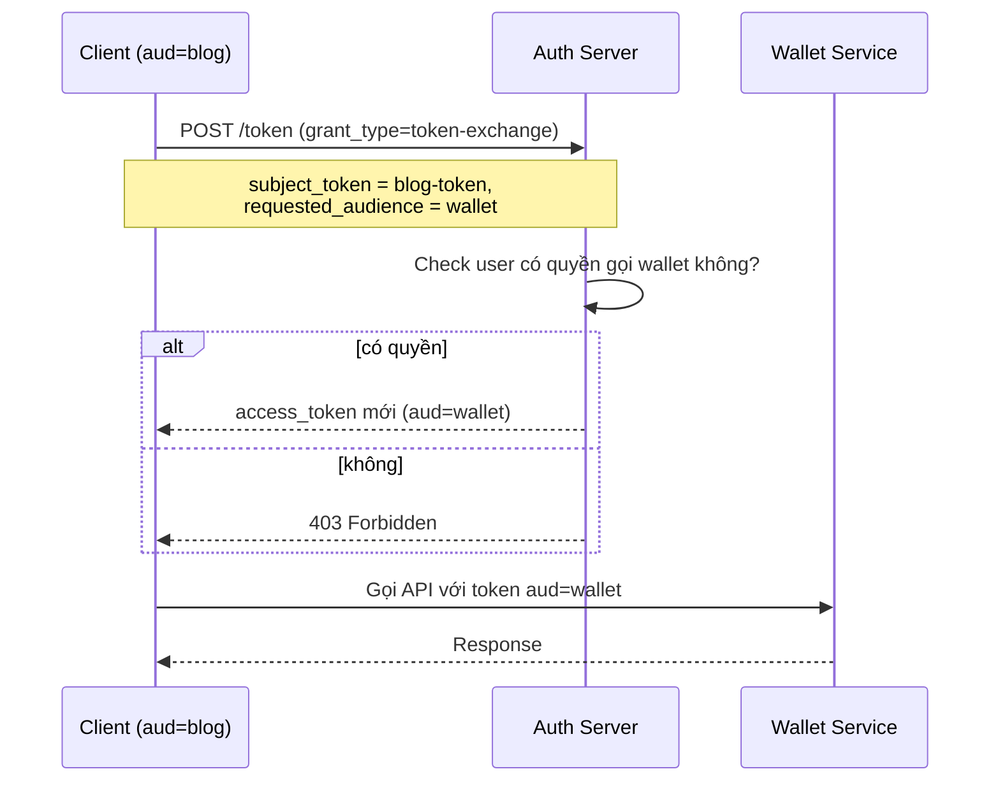

# Audience, Issuer, Subject — Ba Claim Định Danh

## Mục lục

- [Token của service A dùng được cho service B — vì sao?](#1-token-của-service-a-dùng-được-cho-service-b--vì-sao)
- [Ba claim định danh — ai, của ai, cho ai](#2-ba-claim-định-danh--ai-của-ai-cho-ai)
- [sub — Subject: token này là của ai](#3-sub--subject-token-này-là-của-ai)
- [iss — Issuer: ai phát hành token này](#4-iss--issuer-ai-phát-hành-token-này)
- [aud — Audience: token này dành cho service nào](#5-aud--audience-token-này-dành-cho-service-nào)
- [Hai claim bị bỏ qua nhiều nhất — và hậu quả](#6-hai-claim-bị-bỏ-qua-nhiều-nhất--và-hậu-quả)
- [Multi-audience — một token cho nhiều service](#7-multi-audience--một-token-cho-nhiều-service)
- [Issuer confusion — tấn công dùng token chéo issuer](#8-issuer-confusion--tấn-công-dùng-token-chéo-issuer)
- [sub namespace — định danh toàn cục vs theo tenant](#9-sub-namespace--định-danh-toàn-cục-vs-theo-tenant)
- [Code thực chiến — validate sub/iss/aud đầy đủ](#10-code-thực-chiến--validate-subissaud-đầy-đủ)
- [Tóm tắt — Cheat sheet](#11-tóm-tắt--cheat-sheet)

---

## 1. Token của service A dùng được cho service B — vì sao?

Một hệ thống có nhiều service dùng chung auth server và cùng key verify — ví dụ Blog và Wallet. Token được cấp riêng cho Blog (có `aud="blog-service"`), nhưng lại gọi được API của Wallet. Lý do: Wallet verify chữ ký đúng, check `exp` và `sub` đầy đủ, nhưng **không check `aud`** — nó không hề hỏi *"token này có thực sự dành cho mình không?"*. Token Blog biến thành chìa khoá mở được cả Wallet.

Đó là **cross-service token reuse** — lỗ hổng điển hình khi `aud` (audience) và `iss` (issuer) bị bỏ qua khi verify. Token vốn dành cho mục đích hẹp lại mở được service khác, phá vỡ ranh giới giữa các service.

> [!IMPORTANT]
> Verify chữ ký đúng chưa đủ; phải check token **dành cho service này** (`aud`) và **do đúng issuer phát hành** (`iss`). Đây là hai claim hay bị skip nhất — và là nguồn gốc của đa số lỗ hổng cross-service. Phần sau mổ xẻ chi tiết 3 claim định danh cốt lõi: `sub`, `iss`, `aud`.

---

## 2. Ba claim định danh — ai, của ai, cho ai

JWT có ba claim định danh cốt lõi, mỗi cái trả lời **một câu hỏi khác nhau**:

### 2.1. Bảng tổng quan

| Claim | Tên | Câu hỏi trả lời | Ví dụ |
|-------|-----|-----------------|-------|
| `sub` | Subject | Token này **của ai**? | `"sub": "user-123"` |
| `iss` | Issuer | **Ai phát hành** token? | `"iss": "https://auth.myapp.com"` |
| `aud` | Audience | Token **dành cho service nào**? | `"aud": "wallet-service"` |

```diagram
   Một token đầy đủ:
   {
     "sub": "user-123",                              ← của ai
     "iss": "https://auth.myapp.com",                ← ai cấp
     "aud": "wallet-service",                        ← cho ai
     "exp": 1735689600,
     "iat": 1735689000
   }

   Ba câu hỏi định danh:
   ┌────────────────────────────────────────────┐
   │  WHO   (sub): người dùng nào?              │
   │  FROM  (iss): phát hành bởi ai?            │
   │  TO    (aud): dành cho service nào?        │
   └────────────────────────────────────────────┘
```

### 2.2. Ẩn dụ: thư tín

Hiểu bằng đời thường — JWT giống **một bức thư**:

```diagram
   ┌──────────────────────────────────────────┐
   │  BỨC THƯ (JWT)                           │
   │                                          │
   │  Người nhận (aud): Wallet Service        │  ← thư gửi cho ai
   │  Người gửi (iss): Auth Server            │  ← thư từ ai
   │  Chủ đề   (sub): User-123                │  ← thư nói về ai
   │                                          │
   │  Khi Wallet nhận thư:                    │
   │  - Thư đúng gửi cho mình không? (aud)    │
   │  - Từ người gửi tin cậy không? (iss)     │
   │  - Nói về người hợp lệ không? (sub)      │
   └──────────────────────────────────────────┘
```

Thư gửi cho **Wallet** mà Blog lỡ đọc được → Blog phải tự hỏi: *"thư này có gửi cho mình không?"* (check `aud`). Nếu không check, Blog đọc lén thư Wallet → leak.

> [!NOTE]
> Cả 3 claim đều là **registered claim** trong RFC 7519 — có nghĩa chuẩn, thư viện JWT hỗ trợ validate native. Nhưng **mặc định thư viện không require** — phải config verifier chủ động check. Đây là gap tạo ra đa số lỗ hổng cross-service.

---

## 3. sub — Subject: token này là của ai

`sub` (Subject) là claim định danh **chủ thể** của token — thường là **user ID**. Đây là claim quen thuộc nhất, dùng trong mọi app.

### 3.1. sub chứa gì

```json
{
  "sub": "user-123456",
  "iss": "https://auth.myapp.com",
  "aud": "api",
  "exp": 1735689600
}
```

`sub` là **string** — nội dung do issuer quyết định, thường là:

| Loại token | `sub` thường là |
|-----------|-----------------|
| User access token | User ID (`"user-123"`, `"auth0|abc"`) |
| Service token (machine) | Client ID (`"service-payment"`) |
| OAuth delegated | User ID gốc (người ủy quyền) |

### 3.2. Quy tắc: sub phải duy nhất (trong scope issuer)

`sub` phải **độc nhất trong scope của issuer** — không hai user cùng `sub`. Nhưng `sub` **không cần độc nhất toàn cục** giữa các issuer — `iss:auth-A, sub:user-1` khác `iss:auth-B, sub:user-1`.

```diagram
   ✅ ĐÚNG:
   Issuer A: sub=user-1, sub=user-2, sub=user-3  (độc nhất trong A)
   Issuer B: sub=user-1, sub=user-2              (độc nhất trong B)
   → "user-1" của A khác "user-1" của B (khác issuer)

   ❌ SAI:
   Issuer A: sub=user-1, sub=user-1  (trùng trong cùng issuer)
   → ambiguity: ai là user-1?
```

### 3.3. Vì sao sub thường là ID, không phải email

Nhiều developer mới dùng `sub = email` (`"sub": "anne@example.com"`). Đây là anti-pattern:

```diagram
   SAI:  sub = "anne@example.com"
         → user đổi email → sub đổi → mất liên kết token cũ
         → email có thể bị reuse ( Gmail recycle) → collision

   ĐÚNG: sub = "user-uuid-1234"  (ID ổn định vĩnh viễn)
         → email đổi không ảnh hưởng sub
         → ID độc nhất, không bao giờ recycle
```

<Callout title="sub = stable ID, không phải thuộc tính thay đổi được">
`sub` phải là **định danh ổn định** — không đổi trong vòng đời user. User ID, UUID, opaque ID là tốt. Email, username, phone là tệ vì user có thể đổi. Khi `sub` đổi, mọi token cũ gắn với `sub` cũ trở nên vô nghĩa → race condition, audit log đứt gãy.
</Callout>

---

## 4. iss — Issuer: ai phát hành token này

`iss` (Issuer) định danh **bên phát hành** token — thường là **URL của auth server**. Verifier check `iss` để đảm bảo token do đúng nguồn cấp.

### 4.1. iss thường là gì

```json
{
  "iss": "https://auth.myapp.com",
  "sub": "user-123"
}
```

`iss` là **string**, thường là URL (để có namespace rõ ràng):

| Issuer ví dụ | Ý nghĩa |
|---------------|---------|
| `"https://auth.myapp.com"` | Auth server chính |
| `"https://auth.myapp.com/realms/tenant-A"` | Auth server cho tenant A (Keycloak realm) |
| `"my-app-internal"` | Issuer nội bộ (không URL, ít dùng) |

### 4.2. Vì sao phải check iss

Một hệ thống có thể có **nhiều issuer** cùng dùng key verify (hoặctin tưởng cùng JWKS). Không check `iss` → token từ issuer lạ được chấp nhận.

```diagram
   Hệ thống có 2 auth server (test + prod), cùng key:
   ┌────────────────────────────────────────────────┐
   │ Issuer TEST:  iss="https://test-auth.myapp.com"│
   │ Issuer PROD:  iss="https://auth.myapp.com"     │
   │ (cùng dùng key K để ký — misconfiguration)     │
   └────────────────────────────────────────────────┘

   Kẻ tấn công tạo tài khoản trên TEST → nhận token TEST
   Gọi PROD API với token TEST:
      Verifier PROD: check chữ ký ✓ (cùng key K)
                     check iss? → KHÔNG CHECK
                     → chấp nhận token TEST  💀
```

<Callout type="error" title="iss phân biệt môi trường">
Trong hệ thống có nhiều môi trường (dev/staging/prod) hoặc nhiều tenant, **không check `iss`** = token từ môi trường này dùng được cho môi trường khác. Đây là lỗi rất phổ biến khi dev/test/prod share key (misconfiguration). Check `iss` nghiêm ngặt chặn hoàn toàn tấn công này — token test có `iss=test` sẽ bị prod reject.
</Callout>

### 4.3. Verify iss đúng cách

```diagram
   Verifier PROD:
      expected_iss = "https://auth.myapp.com"   (config cứng)
      if (token.iss !== expected_iss):
         → REJECT
```

`iss` phải là **exact match** (khớp chính xác chuỗi), không phải substring match. `"https://auth.myapp.com"` ≠ `"https://auth.myapp.com.evil.com"` (tên miền giả mạo).

---

## 5. aud — Audience: token này dành cho service nào

`aud` (Audience) định danh **service đích** của token. Đây là claim **bị bỏ qua nhiều nhất** và cũng **nguy hiểm nhất** khi bỏ qua (như bối cảnh §1).

### 5.1. aud chứa gì

```json
{
  "aud": "wallet-service",
  "sub": "user-123",
  "iss": "https://auth.myapp.com"
}
```

`aud` có thể là **string** hoặc **array of strings** (nhiều audience):

```json
// Một audience
"aud": "wallet-service"

// Nhiều audience
"aud": ["wallet-service", "blog-service"]
```

### 5.2. Vì sao aud quan trọng — giới hạn phạm vi token

`aud` định nghĩa **token này chỉ được dùng cho service nào**. Khi mỗi service check `aud`, token cấp cho Blog **không dùng được cho Wallet** — chặn cross-service reuse.

```diagram
   Token A: aud="blog-service"
            → chỉ Blog accept. Wallet check aud → REJECT ✗

   Token B: aud="wallet-service"
            → chỉ Wallet accept. Blog check aud → REJECT ✗

   Không có aud: mọi service đều accept → token Blog dùng cho Wallet  💀
```

### 5.3. Verify aud đúng cách

Mỗi service config một `aud` mong đợi, verify token có chứa `aud` đó:

```diagram
   Wallet Service:
      expected_aud = "wallet-service"
      token_aud = ["blog-service"]   (token cấp cho Blog)
      if (!token_aud.includes(expected_aud)):
         → REJECT "wrong audience"
```

<Callout type="warn" title="aud là ranh giới service, không phải option">
Nhiều team coi `aud` là "tuỳ chọn" vì single-service ban đầu. Nhưng khi hệ thống lớn lên (thêm service thứ 2, thứ 3), không có `aud` = mọi token dùng chéo. **Luôn đặt `aud` từ ngày 1**, ngay cả khi chỉ có 1 service — chi phí rẻ, tránh refactor đau đớn sau. Đây là best practice RFC 8725.
</Callout>

---

## 6. Hai claim bị bỏ qua nhiều nhất — và hậu quả

Thống kê từ các incident JWT thực tế: **`iss` và `aud` là hai claim bị skip verify nhiều nhất**. Lý do phổ biến:

### 6.1. Vì sao hay bị bỏ qua

| Lý do | Tại sao sai |
|-------|-------------|
| *"Mình chỉ có 1 issuer, khỏi check iss"* | Khi thêm issuer thứ 2 → token chéo → refactor vội |
| *"Mình chỉ có 1 service, khỏi check aud"* | Khi thêm service thứ 2 → cross-service reuse (như §1) |
| *"Thư viện mặc định không check"* | Đúng — phải config chủ động, đó là gap |
| *"Check iss/aud làm chậm"* | Sai — string compare ~0.001ms, không đáng kể |

### 6.2. Hậu quả thực tế

```diagram
   Bỏ qua iss:
   ┌────────────────────────────────────────────┐
   │ - Token test dùng được cho prod            │
   │ - Token tenant A dùng cho tenant B         │
   │ - Token từ issuer rogue (nếu key bị leak)  │
   │   được chấp nhận                           │
   └────────────────────────────────────────────┘

   Bỏ qua aud:
   ┌────────────────────────────────────────────┐
   │ - Token Blog dùng cho Wallet (cross-svc)   │
   │ - Token legacy (cấp cho service cũ) dùng   │
   │   được cho service mới                     │
   │ - ID token (dành cho client) dùng làm      │
   │   access token gọi API                     │
   └────────────────────────────────────────────┘
```

> [!IMPORTANT]
> Nguyên tắc: **luôn verify cả `iss` và `aud`**, kể cả khi hệ thống chỉ có 1 issuer/1 service. Chi phí bỏ qua = không gì, chi phí bỏ lỡ = incident bảo mật. Đây là top best practice trong [RFC 8725](https://datatracker.ietf.org/doc/html/rfc8725) và OWASP JWT Cheat Sheet.

---

## 7. Multi-audience — một token cho nhiều service

Đôi khi một token cần dùng cho **nhiều service** cùng lúc (vd token người dùng cuối gọi cả API + thông báo push). `aud` hỗ trợ dạng array.

### 7.1. Khi nào cần multi-audience

```json
{
  "aud": ["api-service", "push-service", "analytics-service"],
  "sub": "user-123"
}
```

| Tình huống | Có cần multi-aud? |
|-----------|-------------------|
| User gọi 1 API duy nhất | Không — `aud` đơn |
| User gọi API + push notification | Có thể — multi-aud |
| Service-to-service delegation | Thường aud đơn |

### 7.2. Trade-off multi-audience

```diagram
   ✅ Lợi:
   - 1 token dùng nhiều nơi → user khỏi giữ nhiều token
   - Đơn giản hoá client-side

   ⚠ Hại:
   - Token lộ → dùng được cho TẤT CẢ service trong aud
   - Khó revoke từng service (token dùng chung)
   - Service "nhạy cảm" phải share token với service "ít nhạy cảm"
```

<Callout type="warn" title="Multi-audience tăng blast radius">
Khi `aud = [blog, wallet]`, token lộ → kẻ tấn công dùng được cho cả Blog **và** Wallet. Trong khi đó nếu chia 2 token riêng (`aud=blog` và `aud=wallet`), lộ token Blog chỉ ảnh hưởng Blog. **Best practice: aud đơn** cho service nhạy cảm; multi-aud chỉ cho các service cùng mức độ nhạy cảm. Không bao giờ gộp service nhạy cảm (payment) với service ít nhạy cảm (blog) trong cùng token.
</Callout>

### 7.3. Token exchange — aud cho service khác

Khi user cần gọi service có `aud` khác, **không sửa token** — dùng **token exchange** (RFC 8693) để lấy token mới có `aud` đúng:



Chi tiết: [oauth2-oidc-integration](/implementation/oauth2-oidc-integration/).

---

## 8. Issuer confusion — tấn công dùng token chéo issuer

Một family attack kinh điển liên quan tới `iss`: **issuer confusion** — kẻ tấn công dùng token từ issuer này cho verifier tin tưởng issuer khác.

### 8.1. Kịch bản tấn công

```diagram
   Bối cảnh:
   - Verifier V tin tưởng 2 issuer: iss-A (chính) + iss-B (legacy)
   - iss-B có policy cấp token lỏng lẻo (vd signup miễn phí, không MFA)

   Tấn công:
   1. Kẻ tấn công signup iss-B (dễ dàng)
      → nhận token: iss=B, sub=attacker, aud=V
   2. Gọi V với token iss-B
   3. Verifier V: check chữ ký ✓ (iss-B key tin cậy)
                 check iss? → KHÔNG CHECK (hoặc accept mọi iss)
                 → chấp nhận token iss-B
   4. Kẻ tấn công truy cập V với đặc quyền của iss-B user
```

### 8.2. Biến thể: key confusion (RS256 → HS256)

Một biến thể nguy hiểm hơn kết hợp với [algorithm-confusion](/security/algorithm-confusion/): kẻ tấn công dùng **public key của RS256 issuer** làm HMAC secret, tạo token giả `alg=HS256`:

```diagram
   1. Kẻ tấn công lấy public key của issuer (JWKS endpoint, công khai)
   2. Tạo token giả: alg=HS256, sub=admin, iss=legit-issuer
   3. Ký token bằng HMAC với key = public key (lấy từ JWKS)
   4. Verifier (bug): đọc alg=HS256 → dùng public key làm HMAC secret
      → verify ✓ → chấp nhận token giả  💀
```

<Callout type="error" title="Whitelist cả alg lẫn iss">
Lỗi issuer confusion và algorithm confusion thường đi cùng nhau. Phòng thủ kép: (1) **whitelist thuật toán** ở verifier (chỉ RS256, không HS256), (2) **whitelist issuer** (chỉ accept iss từ danh sách cứng). Một trong hai lỏng lẻo → mở đường tấn công. Xem: [algorithm-confusion](/security/algorithm-confusion/).
</Callout>

### 8.3. Phòng thủ issuer confusion

```diagram
   Verifier config cứng:
      trusted_issuers = ["https://auth.myapp.com"]   (chỉ 1)
      if (token.iss not in trusted_issuers):
         → REJECT

   Khi có nhiều issuer (multi-tenant, multi-env):
      iss_to_key_map = {
         "https://auth.myapp.com": key-prod,
         "https://test-auth.myapp.com": key-test,
      }
      key = iss_to_key_map[token.iss]
      if (key not found): REJECT
      verify(token, key)   ← dùng ĐÚNG key cho ĐÚNG iss
```

> [!TIP]
> Best practice: **bind issuer với key**. Mỗi issuer có key riêng, verifier chọn key dựa trên `iss` trong token. Token iss-A chỉ verify được bằng key-A — chặn hoàn toàn confusion.

---

## 9. sub namespace — định danh toàn cục vs theo tenant

Trong multi-tenant, `sub` đặt sao cho đúng? Có hai mô hình, ảnh hưởng tới thiết kế.

### 9.1. Hai mô hình sub

| Mô hình | Ví dụ | Ưu/nhược |
|---------|-------|----------|
| **Toàn cục** (global unique) | `"sub": "user-uuid-1234"` | Đơn giản, sub độc nhất mọi nơi |
| **Theo tenant** | `"sub": "tenant-A:user-1"` | Cần parse, dễ trộn logic |

```diagram
   Mô hình toàn cục (khuyến nghị):
   ┌────────────────────────────────────────────┐
   │ sub = "user-uuid-abc123"                   │
   │ (độc nhất trên toàn hệ thống, mọi tenant)  │
   │ + tid = "tenant-A"  (claim riêng)          │
   └────────────────────────────────────────────┘

   Mô hình theo tenant (không khuyến nghị):
   ┌────────────────────────────────────────────┐
   │ sub = "tenant-A:user-1"                    │
   │ (phải split ":", dễ sai, khó index)        │
   └────────────────────────────────────────────┘
```

### 9.2. Vì sao tách sub và tid

Trong [multi-tenant-saas](/case-studies/multi-tenant-saas/), mình đã nói: `sub` là định danh user, `tid` là tenant. Tách bạch hai thứ:

```diagram
   ✅ TÁCH BẠCH (khuyến nghị):
   { "sub": "user-uuid", "tid": "tenant-A" }
   → sub độc nhất toàn cục, tid rõ ràng
   → DB index trên tid nhanh
   → logic tách rời: ai (sub), của tổ chức nào (tid)

   ❌ GHÉP (không khuyến nghị):
   { "sub": "tenant-A:user-1" }
   → phải parse, dễ sai
   → khó index DB
   → trộn danh tính và phân vùng
```

> [!NOTE]
> Quy tắc: `sub` = định danh user **ổn định, độc nhất toàn cục** (UUID). `tid` = tenant, claim riêng. Đừng nhét tenant vào `sub` — tách bạch làm code rõ hơn, DB query nhanh hơn, audit trail sạch hơn. Chi tiết: [multi-tenant-saas](/case-studies/multi-tenant-saas/).

---

## 10. Code thực chiến — validate sub/iss/aud đầy đủ

Mẫu code Node.js validate đầy đủ 3 claim định danh + chữ ký + exp.

```typescript
import jwt, { JwtPayload } from 'jsonwebtoken';

// Mỗi service config riêng expected iss + aud
const SERVICE_CONFIG = {
  expectedIssuer: 'https://auth.myapp.com',
  expectedAudience: 'wallet-service',   // service này là Wallet
  allowedAlgorithms: ['RS256'],
};

export function validateToken(token: string): JwtPayload {
  const payload = jwt.verify(token, getPublicKey(), {
    algorithms: SERVICE_CONFIG.allowedAlgorithms,  // whitelist alg
    issuer: SERVICE_CONFIG.expectedIssuer,          // ★ check iss
    audience: SERVICE_CONFIG.expectedAudience,      // ★ check aud
    // exp, nbf tự check
  }) as JwtPayload;

  // ★ Require sub (một số thư viện không require)
  if (!payload.sub) {
    throw new Error('token missing sub claim');
  }

  // (Multi-tenant) Require tid nếu service là multi-tenant
  if (MULTI_TENANT && !payload.tid) {
    throw new Error('token missing tid claim');
  }

  return payload;
}

// Khi phát hành token — đặt đủ iss + aud + sub
export function issueAccessToken(userId: string, audience: string): string {
  return jwt.sign(
    {
      sub: userId,                                  // ★ của ai
      iss: 'https://auth.myapp.com',                // ★ ai cấp
      aud: audience,                                // ★ cho service nào
      tid: getCurrentTenant(),
      exp: Math.floor(Date.now() / 1000) + 15 * 60,
      iat: Math.floor(Date.now() / 1000),
    },
    PRIVATE_KEY,
    { algorithm: 'RS256', keyid: 'key-2024-Q3' },
  );
}
```

<Callout type="warn" title="Mặc định thư viện require — nhưng hãy check">
Tin tốt: `jsonwebtoken` (Node), PyJWT (Python), jjwt (Java) đều có option `issuer` và ` audience` built-in — khi config, thư viện reject token sai iss/aud tự động. Tin xấu: **phải chủ động config** — mặc định không check. Nguyên tắc: **mọi verifier đều phải set `issuer` + `audience`**, không có ngoại lệ. Đây là 2 dòng config rẻ tiền phòng tránh cả family attack.
</Callout>

---

## 11. Tóm tắt — Cheat sheet

**Ba claim định danh:**

```diagram
╭────────────────────────────────────────────────────────────────────╮
│           IDENTITY CLAIMS — CHEAT SHEET                            │
│                                                                    │
│  sub  — Subject  — token này của ai        (user ID)               │
│  iss  — Issuer   — ai phát hành token      (auth server URL)       │
│  aud  — Audience — token dành cho ai       (service name)          │
│                                                                    │
│  Câu hỏi:  WHO (sub)? FROM (iss)? TO (aud)?                        │
╰────────────────────────────────────────────────────────────────────╯
```

**5 nguyên tắc bất di bất dịch:**

| # | Nguyên tắc | Vì sao |
|---|-----------|--------|
| 1 | **Luôn verify `iss`** | Chặn token chéo môi trường/issuer |
| 2 | **Luôn verify `aud`** | Chặn cross-service token reuse |
| 3 | **`sub` = stable ID, không phải email** | Tránh vỡ liên kết khi user đổi info |
| 4 | **Multi-tenant: tách `sub` và `tid`** | Code rõ, DB nhanh, audit sạch |
| 5 | **Whitelist cả alg + iss + aud** | Phòng thủ đôi (algorithm + issuer confusion) |

**Bảng verify bắt buộc:**

| Claim | Verifier phải làm | Mặc định thư viện |
|-------|-------------------|-------------------|
| `sub` | Require có (không null) | Không require |
| `iss` | Exact match với expected | Không check |
| `aud` | Contains expected_aud | Không check |
| `exp` | Reject nếu quá hạn | Check nếu có, không require |

**Bốn câu hỏi thường gặp:**

- **Token Blog dùng được cho Wallet sao?** — Có, nếu Wallet không check `aud`. Đây là lỗi cross-service reuse.
- **Nhiều service, có cần nhiều key?** — Không. Key có thể share, nhưng mỗi service phải check `aud` riêng.
- **`sub` nên là gì?** — User ID/UUID ổn định, độc nhất toàn cục. Không dùng email/username.
- **Multi-tenant, sub để sao?** — `sub` = user ID toàn cục + `tid` = tenant ID (claim riêng). Đừng ghép.

---

## Tài liệu tham khảo

- [RFC 7519 §4.1.2 — `sub` claim](https://datatracker.ietf.org/doc/html/rfc7519#section-4.1.2)
- [RFC 7519 §4.1.1 — `iss` claim](https://datatracker.ietf.org/doc/html/rfc7519#section-4.1.1)
- [RFC 7519 §4.1.3 — `aud` claim](https://datatracker.ietf.org/doc/html/rfc7519#section-4.1.3)
- [RFC 8725 §3.6 — Use aud and iss appropriately](https://datatracker.ietf.org/doc/html/rfc8725#section-3.6)
- Trong repo: [claims](/fundamentals/claims/), [token-validation-flow](/internals/token-validation-flow/), [multi-tenant-saas](/case-studies/multi-tenant-saas/), [algorithm-confusion](/security/algorithm-confusion/).
