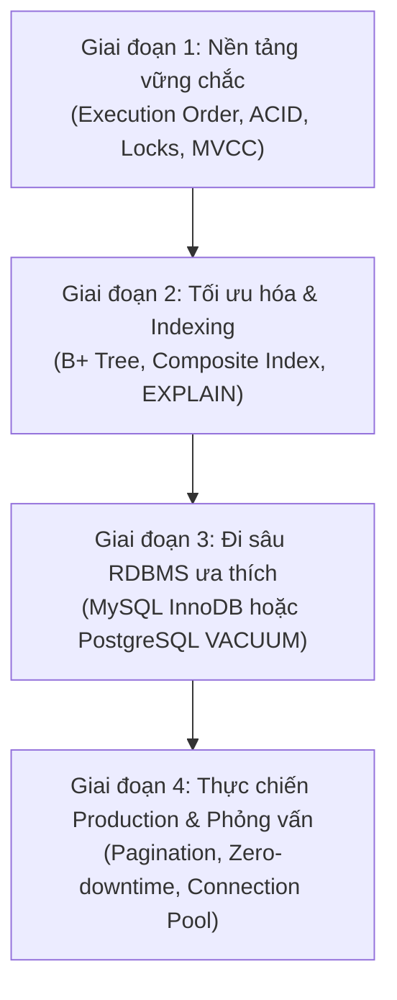

# Lộ trình Tinh thông SQL & Relational Databases

> [!NOTE]
> Database không chỉ là nơi lưu trữ dữ liệu tĩnh hay là một tầng trừu tượng phía sau ORM (Object-Relational Mapping). Trong các hệ thống phần mềm quy mô lớn, **Database luôn là nút thắt cổ chai (bottleneck) đầu tiên** ảnh hưởng trực tiếp đến hiệu năng, độ trễ và độ tin cậy của toàn bộ hệ thống.

Kho tài liệu này được thiết kế nhằm đưa bạn từ việc chỉ biết viết các câu lệnh truy vấn cơ bản (`SELECT`, `JOIN`, `GROUP BY`) đến việc **thấu hiểu tường tận cơ chế vận hành bên dưới** (Storage Engine, Buffer Pool, MVCC, B+ Tree, Locking, Execution Engine) và làm chủ kỹ năng **phân tích, tối ưu hóa truy vấn trên môi trường Production**.

---

## 🎯 Mục tiêu tài liệu

1. **Hiểu bản chất thay vì học vẹt cú pháp:** Nắm rõ cách Database Engine phân tích, lập kế hoạch thực thi (Query Planner) và truy xuất dữ liệu từ Disk/RAM.
2. **Làm chủ kỹ thuật Indexing & Tối ưu hóa:** Hiểu rõ cấu trúc B+ Tree, Composite Index, Left-most prefix rule, phân tích `EXPLAIN ANALYZE` và triệt tiêu các câu query làm quá tải hệ thống.
3. **Quản trị Transaction & Concurrency:** Nắm vững ACID, Isolation Levels, các loại Lock, hiện tượng Deadlock và cơ chế MVCC giúp hệ thống xử lý hàng nghìn request đồng thời mà không bị hỏng dữ liệu.
4. **Hiểu sâu các hệ quản trị phổ biến:** Đi sâu vào kiến trúc nội tại của **MySQL (InnoDB Engine)**, **PostgreSQL (MVCC, VACUUM)** và **Oracle Database**.
5. **Kinh nghiệm thực chiến Production & Phỏng vấn:** Tích lũy các giải pháp cho các bài toán kinh điển: phân trang triệu dòng (Deep Offset), Zero-downtime Schema Migration, cạn kiệt Connection Pool, xử lý tranh chấp đơn hàng (`SKIP LOCKED`).

---

## 🗺️ Bản đồ & Cấu trúc kiến thức

Tài liệu được chia thành 4 trụ cột kiến thức chính:

```
SQL & Database Master Roadmap
 ├── 1. Nền tảng & Cơ chế bên trong (Fundamentals & Internals)
 ├── 2. Tối ưu hóa & Lập chỉ mục (Indexing & Query Optimization)
 ├── 3. Kiến trúc RDBMS Deep Dives (MySQL, PostgreSQL, Oracle & So sánh)
 └── 4. Bài toán Production & Phỏng vấn Chuyên sâu (Real-world Scenarios)
```

---

### 1. Nền tảng & Cơ chế bên trong (Fundamentals)

Chuyên đề này xây dựng nền móng vững chắc về cách RDBMS tổ chức và xử lý dữ liệu ở tầng logic và vật lý:

* **[Tổng quan SQL](/sql-learn/fundamentals/sql-overview):** Giới thiệu các nhóm lệnh DDL, DML, DQL, DCL, TCL và tư duy quan hệ.
* **[Thứ tự thực thi câu lệnh SQL](/sql-learn/fundamentals/query-execution-order):** Hiểu rõ thứ tự xử lý logic từ `FROM` $\rightarrow$ `WHERE` $\rightarrow$ `GROUP BY` $\rightarrow$ `HAVING` $\rightarrow$ `SELECT` $\rightarrow$ `DISTINCT` $\rightarrow$ `ORDER BY` $\rightarrow$ `LIMIT`.
* **[Giao dịch & Tính chất ACID](/sql-learn/fundamentals/acid-transaction):** Phân tích 4 trụ cột Atomicity, Consistency, Isolation, Durability và cách Database bảo toàn dữ liệu khi có sự cố.
* **[Các cấp độ cô lập (Isolation Levels)](/sql-learn/fundamentals/isolation-levels):** Read Uncommitted, Read Committed, Repeatable Read, Serializable và các hiện tượng Dirty Read, Non-repeatable Read, Phantom Read, Write Skew.
* **[Cơ chế Locking](/sql-learn/fundamentals/lock):** Shared Lock (S), Exclusive Lock (X), Intent Lock (IS/IX), Row-level Lock, Table Lock và cách phát hiện/giải quyết Deadlock.
* **[Mối quan hệ giữa Locking & Isolation](/sql-learn/fundamentals/locking-isolation-relationship):** Cách các cấp độ cô lập được hiện thực hóa thông qua Lock và Snapshot.
* **[Xử lý Concurrency ở tầng ứng dụng](/sql-learn/fundamentals/application-concurrency-locking):** So sánh chi tiết Optimistic Locking vs Pessimistic Locking trong thực tế.
* **[MVCC (Multi-Version Concurrency Control)](/sql-learn/fundamentals/mvcc):** Cơ chế "người đọc không chặn người ghi, người ghi không chặn người đọc" thông qua các phiên bản bản ghi.
* **[Subquery vs CTE vs Temporary Table](/sql-learn/fundamentals/subquery-vs-cte-vs-temp-table):** Khi nào nên dùng Subquery, CTE (Common Table Expression), Temporary Table hoặc Table Variable?
* **[View vs Materialized View](/sql-learn/fundamentals/view-vs-materialized-view):** So sánh khung nhìn ảo (Virtual View) và khung nhìn vật lý hóa (Materialized View) phục vụ caching dữ liệu báo cáo.
* **[DELETE vs TRUNCATE vs DROP](/sql-learn/fundamentals/delete-vs-truncate):** Bản chất xử lý nhật ký (Logging), Transaction rollback, Reset identity và tốc độ thực thi.
* **[Chuyên sâu về JOIN](/sql-learn/fundamentals/join-deep-dive):** Inner, Left, Right, Full Outer, Cross, Semi Join, Anti Join và các bẫy thường gặp với `NULL`.

---

### 2. Tối ưu hóa hiệu năng & Lập chỉ mục (Optimization & Indexing)

Chuyên đề quan trọng nhất đối với một kỹ sư Backend hoặc Database Administrator:

* **[Cấu trúc dữ liệu B+ Tree](/sql-learn/optimization/b-plus-tree-deep-dive):** Tại sao Database chọn B+ Tree thay vì B-Tree, Binary Tree hay Hash Table để lập chỉ mục?
* **[Clustered Index vs Non-Clustered Index](/sql-learn/optimization/clustered-vs-nonclustered-index):** Sự khác biệt giữa lưu trữ dữ liệu trực tiếp trong lá cây chỉ mục (Index-Organized Table) và bảng đống (Heap Table).
* **[Tổng quan chuyên sâu về Index trong SQL](/sql-learn/optimization/index-sql-deep-dive):** Nguyên lý tìm kiếm nhị phân, IO Pages, Bookmark Lookup và Covering Index.
* **[Composite Index (Chỉ mục kết hợp)](/sql-learn/optimization/composite-index-deep-dive):** Quy tắc Left-most Prefix Rule, cách sắp xếp thứ tự cột trong index để tối đa hóa hiệu quả tái sử dụng.
* **[Tác động của DML lên Index](/sql-learn/optimization/dml-index-impact-deep-dive):** Cái giá phải trả khi có quá nhiều index: Page Split, Index Fragmentation, Write Amplification.
* **[Tối ưu hóa câu truy vấn LIKE](/sql-learn/optimization/like-query-deep-dive):** Tại sao `LIKE '%abc'` làm vô hiệu hóa B+ Tree Index và các giải pháp thay thế (Full-text Search, Trigram, Reverse Index).
* **[Lựa chọn Primary Key: UUID vs Integer](/sql-learn/optimization/primary-key-uuid-vs-integer-deep-dive):** Tác động khủng khiếp của UUID v4 ngẫu nhiên đối với Clustered Index B+ Tree và xu hướng chuyển dịch sang UUID v7 / ULID.
* **[Các thuật toán JOIN bên dưới](/sql-learn/optimization/join-algorithms-deep-dive):** Cơ chế vận hành của Nested Loop Join, Hash Join và Sort Merge Join.
* **[Các mẫu hình tối ưu hóa truy vấn](/sql-learn/optimization/query-optimization-patterns):** Loại bỏ implicit type conversion, tối ưu SARGable queries, chuyển `OR` thành `UNION ALL`.
* **[Phân vùng dữ liệu (Partitioning)](/sql-learn/optimization/sql-partition-deep-dive):** Range, List, Hash Partitioning và kỹ thuật Partition Pruning trên bảng dữ liệu khổng lồ.
* **[Đọc hiểu EXPLAIN & EXPLAIN ANALYZE](/sql-learn/optimization/explain-analyze-deep-dive):** Bóc tách chi phí (Cost), Actual Time, Loops, Rows, Buffers để bắt bệnh chậm trễ.
* **[Thống kê dữ liệu & Query Planner](/sql-learn/optimization/statistics-query-planner-deep-dive):** Histogram, Density Vector, Outdated Statistics và lý do tại sao Database chọn Sequential Scan dù đã có Index.
* **[Giám sát & Xử lý Slow Query](/sql-learn/optimization/monitoring-slow-query-deep-dive):** Thiết lập Slow Query Log, `pg_stat_statements`, Performance Schema và quy trình điều tra sự cố.

---

### 3. Kiến trúc RDBMS Deep Dives & So sánh

Mỗi hệ quản trị cơ sở dữ liệu có triết lý thiết kế và cơ chế lưu trữ khác nhau:

* **MySQL (InnoDB Engine):**
  * **[Kiến trúc bên trong InnoDB](/sql-learn/mysql/innodb):** Buffer Pool, Redo Log, Undo Log, Binlog, Doublewrite Buffer, Adaptive Hash Index.
  * **[Cơ chế Replication](/sql-learn/mysql/replication):** Asynchronous Replication, Semi-synchronous, Group Replication (MGR) và giải quyết Replication Lag.
* **PostgreSQL:**
  * **[Cơ chế VACUUM & Autovacuum](/sql-learn/postgresql/vacuum):** Giải quyết vấn đề Dead Tuples, Table Bloat, Transaction ID Wraparound trong mô hình MVCC của Postgres.
  * **[Câu hỏi phỏng vấn PostgreSQL chuyên sâu](/sql-learn/postgresql/interview):** Các câu hỏi phỏng vấn hóc búa dành riêng cho hệ sinh thái PostgreSQL.
* **Oracle Database:**
  * **[Kiến trúc Oracle Database](/sql-learn/oracle/architecture):** Cấu trúc bộ nhớ (SGA, PGA), Cấu trúc tiến trình (DBWn, LGWR, CKPT, SMON, PMON) và Tablespace / Datafiles.
  * **[Lập trình PL/SQL](/sql-learn/oracle/plsql):** Cú pháp, Packages, Procedures, Functions, Triggers và xử lý Exception.
* **So sánh:**
  * **[So sánh toàn diện MySQL vs PostgreSQL](/sql-learn/comparison/mysql-vs-postgresql):** Bảng so sánh chi tiết về Storage Engine, MVCC model, Index types, JSON support, Khả năng mở rộng và các trường hợp nên chọn hệ nào.

---

### 4. Bài toán Production & Phỏng vấn Chuyên sâu (Interview & Real-world Cases)

13+ tình huống thực chiến được đúc kết từ các câu hỏi phỏng vấn Senior/Lead và các sự cố Production thực tế:

* **[Xử lý phân trang chậm với Deep Offset](/sql-learn/interview/offset-pagination-slow):** Tại sao `OFFSET 1000000 LIMIT 20` khiến database cạn kiệt tài nguyên và cách chuyển đổi sang Keyset (Cursor-based) Pagination.
* **[Tại sao `SELECT COUNT(*)` lại chậm?](/sql-learn/interview/select-count-slow):** So sánh `COUNT(*)` trên InnoDB vs PostgreSQL vs MyISAM và các kỹ thuật đếm xấp xỉ (Approximate Counting).
* **[Giải quyết tranh chấp đặt chỗ/đơn hàng với `FOR UPDATE SKIP LOCKED`](/sql-learn/interview/for-update-skip-locked):** Xây dựng Job Queue và hệ thống giữ vé đồng thời hiệu năng cao mà không gây tắc nghẽn (Lock Contention).
* **[Thêm cột trên bảng lớn không Downtime](/sql-learn/interview/add-column-large-table-zero-downtime):** Chiến lược Online DDL, `pt-online-schema-change`, `gh-ost` khi thao tác trên bảng hàng trăm gigabyte.
* **[Cạn kiệt Connection Pool trong PostgreSQL](/sql-learn/interview/postgresql-connection-exhaustion):** Nguyên nhân sập hệ thống vì "Too many clients already", sự khác biệt giữa Process-based và Thread-based model, và vai trò sống còn của PgBouncer.
* **[Sharding dữ liệu ở quy mô lớn](/sql-learn/interview/sharding-at-scale):** Horizontal Sharding, Sharding Key selection, Resharding và xử lý Cross-shard Transactions.
* **[Tại sao câu query đầu tiên luôn chậm (Cold Cache)?](/sql-learn/interview/first-query-slow-cold-cache):** Cơ chế OS Page Cache, Database Buffer Pool và chiến lược Cache Warming trước khi đón traffic.
* **[Vì sao có Index nhưng Database vẫn chọn Sequential Scan?](/sql-learn/interview/index-not-used-seq-scan):** 10 nguyên nhân kinh điển: Selectivity thấp, ép kiểu ngầm, hàm bọc cột, lệch thống kê (Outdated Statistics).
* **[Logical vs Physical Query Execution](/sql-learn/interview/logical-vs-physical-query-execution):** Cây kế hoạch thực thi logic và quá trình chuyển đổi sang các toán tử vật lý (Physical Operators).
* **[Hướng dẫn đọc EXPLAIN ANALYZE trong PostgreSQL](/sql-learn/interview/read-explain-analyze-postgresql):** Đọc plan từ trong ra ngoài, hiểu các chỉ số Cost, Timing, Rows Filtered, Buffer Hits/Reads.
* **[Tại sao query chạy nhanh ở Staging nhưng sập ở Production?](/sql-learn/interview/fast-staging-slow-production):** Khác biệt về kích thước dữ liệu, độ phân tán (Data Distribution), Buffer Pool, Cấu hình phần cứng và Concurrent Load.
* **[So sánh IN vs EXISTS vs JOIN](/sql-learn/interview/in-vs-exists-vs-join):** Khi nào dùng toán tử nào, cách Query Optimizer biến đổi chúng (Subquery Unnesting, Semi-Join).
* **[Tác hại của `SELECT *` trong ứng dụng chịu tải](/sql-learn/interview/select-star-vs-columns):** Mất đi lợi ích của Covering Index, tăng IO Disk, tốn băng thông mạng và phình to bộ nhớ JVM/Node.js.

---

## 🧭 Lộ trình học đề xuất

Tuỳ theo mục tiêu hiện tại, bạn có thể tiếp cận bộ tài liệu theo các hướng sau:



> [!TIP]
> - **Nếu bạn đang ôn luyện phỏng vấn Backend/DevOps:** Hãy đọc trực tiếp thư mục **[Phỏng vấn chuyên sâu](/sql-learn/interview/offset-pagination-slow)** và chuyên mục **[Tối ưu hóa](/sql-learn/optimization/b-plus-tree-deep-dive)**.
> - **Nếu bạn đang gặp sự cố Production (Query chậm, Database high CPU):** Hãy mở ngay **[Đọc hiểu EXPLAIN ANALYZE](/sql-learn/optimization/explain-analyze-deep-dive)** và **[Index không được sử dụng](/sql-learn/interview/index-not-used-seq-scan)**.
> - **Nếu bạn muốn nâng cao trình độ System Design / Architecture:** Hãy nghiên cứu **[MVCC](/sql-learn/fundamentals/mvcc)**, **[MySQL InnoDB](/sql-learn/mysql/innodb)**, **[PostgreSQL VACUUM](/sql-learn/postgresql/vacuum)** và **[Sharding](/sql-learn/interview/sharding-at-scale)**.
